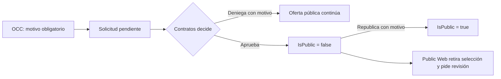

# Clausura comercial de servicios

Esta capacidad está implementada en la rama `feat/occ-service-closure`. El
repositorio aún no acredita su merge ni promoción al VPS. La [guía de
recorrido](../../docs/workflows/commercial-intake-and-governance.md#clausura-comercial-solicitada-por-occ-rama-de-implementación)
contiene los permisos, rutas y límites operativos.

La clausura afecta la **comercialización global para solicitudes nuevas**. No
retira el servicio de contratos existentes, operaciones, historia ni de
`IsActive`. El expediente conserva nombre del servicio, autor, motivos,
decisión y reapertura. Un índice SQL impide dos solicitudes pendientes del
mismo servicio. Las decisiones y la reapertura exigen versiones vigentes;
el solicitante no puede decidir su propia petición.

OCC ve el carrusel publicado en **Notificaciones → Servicios** y puede pedir
clausura, sin editar ni decidir. Contratos tiene bandeja en **Servicios** y
puede aprobar, denegar y republicar. Los roles personalizados admiten
permisos separados de lectura, solicitud, decisión y reapertura. Todas las
acciones exigen membresía AVIAM interna activa y autorización actual de la API.

La mutación, auditoría y pistas para cuentas autorizadas se guardan en la
misma transacción. Una edición ordinaria del catálogo también avisa a OCC con
permiso de lectura de clausuras, y el feed revalida ese permiso al leerse.
SignalR anuncia la invalidación; las pantallas releen por HTTP y usan sondeo
al recuperar conexión o foco. Después del commit que cambia
visibilidad, el hub público anuncia la actualización. Public Web conserva
aerolínea y representante si desaparece un servicio seleccionado, muestra su
nombre y vuelve al paso de servicios. Si el recibo de un envío se perdió,
consulta un comprobante con el mismo UUID y contenido, sin repetir la escritura.
Si no hubo commit, exige una nueva confirmación de servicios antes de enviar.
Ninguna ruta envía correos.
