# Solicitud comercial y gobernanza

La [clausura comercial de servicios](clausura-comercial-servicios.md)
documenta la solicitud de OCC, la decisión de Contratos y su efecto sobre el
carrusel público.

Esta capacidad está integrada en `Development` por el merge #114, y la fase 1
«Comercial» del ciclo operativo la completó
([ADR-0037](../../docs/adr/0037-commercial-cycle-requests-drafts-amendments-and-portal-accounts.md)).
Esta evidencia de repositorio no demuestra que la versión esté desplegada ni
aceptada operativamente en el VPS. El
[recorrido detallado](../../docs/workflows/commercial-intake-and-governance.md)
explica las decisiones, contratos HTTP y límites de los datos iniciales.

```mermaid
flowchart LR
    L[Landing: Solicitar acceso] --> S[Servicios]
    S --> A[Aerolínea del listado o propuesta]
    A --> R[Representante]
    R --> V[Resumen y confirmación]
    V --> C[Contratos verifica la aerolínea y confirma al representante]
    C -->|aprueba| U[Superadministrador invita o vincula la cuenta]
    C -->|rechaza o cancela| X[Correo al solicitante con el motivo]
    U --> B[Aerolínea comenta el borrador]
    B --> T[Contratos ajusta alcance y tarifas y envía a Finanzas]
    T --> F[Finanzas aprueba precios]
    F --> G[Contratos fija vigencia y renovación]
    G --> H[Firma dibujada de la aerolínea]
    H --> I[Contrafirma de AVIAM]
    I --> J[Contrato activo y PDF firmado por correo]
```

La fase pre-operativa (ADR-0025) añade el paso de vigencia después de Finanzas, el código
definitivo `CTR-{año}-{n}`, la firma dibujada en orden (aerolínea y después AVIAM) y el correo con
el PDF firmado. Ver [solicitudes, contratos y servicios](../03-dominio/solicitudes-contratos-y-servicios.md).

## Revisión de la solicitud

Contratos trabaja desde una bandeja paginada
(`GET contracts/commercial-requests/inbox`). Por defecto muestra las
solicitudes abiertas, de la más antigua a la más reciente, con filtro por
estado, búsqueda en el servidor y contadores por estado de toda la bandeja.
Cada paso de la revisión es un comando con `Idempotency-Key` y la versión que
mostró la bandeja; un conflicto obliga a releer.

- **Verificar la aerolínea** con una fuente oficial. Una aerolínea propuesta
  por el solicitante («Mi aerolínea no aparece») se vincula a una ficha
  existente o se convierte en una ficha verificada y publicada en «Otras
  aerolíneas». El formulario anónimo nunca escribe en el catálogo.
- **Confirmar al representante.** Contratos registra quién confirmó que el
  representante habla por la aerolínea, cuándo y por qué canal; se registra
  una sola vez. La pantalla avisa, sin bloquear, si el dominio del correo no
  coincide con el sitio oficial.
- La primera verificación o confirmación pasa la solicitud a **En revisión**;
  abrirla no cambia su estado.
- **Aprobar** exige la confirmación, la identidad verificada (razón social,
  país e ICAO; el IATA es opcional) y estaciones activas. Crea la aerolínea
  canónica, el contrato y su versión en borrador.
- **No se aprueba una segunda afiliación.** Se rechaza si la aerolínea ya tiene
  un contrato vivo o cuentas activas del portal, o si su código pertenece a
  otra aerolínea. La pantalla avisa y orienta a la enmienda o la renovación.
- **Rechazar** exige motivo. **Cancelar** (permiso nuevo
  `contracts.requests.cancel`) cierra con motivo una solicitud pendiente o en
  revisión, por ejemplo una duplicada. Nada se borra.
- Aprobar, rechazar y cancelar encolan un correo al solicitante con la
  decisión y, cuando lo hay, el motivo.

Las aerolíneas sin designador IATA se identifican por su ICAO:
`ref.airlines.iata_code` admite nulos desde esta fase. Las respuestas que ya
existían no cambian de tipo: devuelven `""` donde el campo no admite nulos.
Solicitudes muestra el tipo de documento, el país de la nacionalidad y el
distrito en español.

## Cuenta del portal y borrador

El superadministrador crea la cuenta y la API encola un correo con un enlace
de activación de 72 horas; la contraseña temporal con entrega manual queda
como alternativa explícita
([ADR-0022](../../docs/adr/0022-portal-email-verification.md)). Si el correo
ya tiene una cuenta del portal de la misma aerolínea, o de ninguna,
Superadministración la **vincula** sin tocar sus credenciales. Si pertenece a
otra aerolínea o a AVIAM, no es del portal o está deshabilitada, el error
explica por qué no se puede usar. Una solicitud cuyo contrato se descartó ya
no se aprovisiona. Si el enlace vence, «Clientes» ofrece «Reenviar
invitación». Asignar ahí una contraseña temporal a una invitación pendiente la
cierra y descarta su correo en cola. Ninguna pantalla afirma que un correo se
envió cuando solo quedó en cola.

En **Borradores**:
- La aerolínea comenta el borrador, también mientras Finanzas lo revisa, y
  Contratos le responde.
- El portal no recibe la tarifa base, los valores base de los cargos ni el
  motivo interno de una devolución de Finanzas.
- Contratos ajusta condiciones, vigencia, moneda, tarifas, servicios y
  estaciones. Cada tarifa pendiente aparece «por definir» hasta que Contratos
  la confirma, y cambiar la moneda las deja todas pendientes.
- «Enviar a Finanzas» solo se habilita cuando el servidor confirma que el
  borrador está listo. La lista de requisitos muestra cada causa pendiente: la
  cuenta del portal (activa o invitada), los términos, las tarifas
  confirmadas, las estaciones, los servicios dados de baja, los paquetes y
  alguien de Finanzas que cubra todas las estaciones.
- Contratos recibe una notificación cuando la cuenta del portal queda lista y
  cuando Finanzas devuelve o aprueba los precios.
- Un borrador que no prospera se descarta con motivo (permiso
  `contracts.drafts.delete`): la versión queda `Rejected` y, si el contrato
  nunca se activó, el contrato se termina.

La aprobación de Finanzas no activa el contrato. Pasa a activo cuando ambas
partes firmaron la versión aprobada y la aerolínea tiene un permiso de
operación verificado y vigente. La aerolínea envía sus permisos desde el
portal y Contratos los verifica en «Permisos de aerolíneas». Contratos puede
suspender, reactivar, terminar, renovar o enmendar el contrato. Una enmienda
parte de la última versión aprobada y pide solo «Vigente desde». Un barrido
horario vence los contratos sin versión vigente, suspende los de permiso
vencido y avisa 30 días antes de cada vencimiento. La línea de tiempo del
contrato reúne todo el ciclo
([ADR-0024](../../docs/adr/0024-airline-permits-and-contract-lifecycle.md)).

## Catálogo y fichas de aerolínea

El catálogo público recibe nombres, textos y medios controlados por Contratos. La lista inicial de aerolíneas conserva 51 nombres históricos de AVIAM, países y enlaces de investigación, con seis identidades cotejadas contra IATA. Una parte de las fichas usa iconos de sitios oficiales servidos localmente en ambas webs; las demás usan una placa de referencia que no se presenta como logo oficial. Los campos no corroborados permanecen como «Sin dato confirmado». Superadministración administra las fichas y puede completar las filas de fixture aún intactas; el seed no actualiza datos existentes. Cada ficha se puede verificar en un registro público («Verificar en registro»: primero las aerolíneas ya vistas en los vuelos de AeroDataBox, sin costo; luego Wikidata y, si no responde, una copia de OpenFlights; [ADR-0028](../../docs/adr/0028-aerodatabox-flight-feed-with-unit-budget.md)). Solo se publica para el paso 2 con el check verde o con la verificación manual con su fuente, y el asistente muestra el sello «Verificada en registro público» ([ADR-0023](../../docs/adr/0023-airline-public-registry-check.md)). Cuando la aerolínea ya opera (tiene su fila en `ref.airlines` o una solicitud aprobada), Superadministración no puede cambiar su razón social, su IATA, su ICAO ni su verificación; el nombre comercial, el logo y la publicación siguen editables.

**Contratos → Servicios → Catálogo** muestra la lista interna de servicios en
páginas de doce, incluidos los ocultos y los dados de baja, en el mismo orden
del API: `displayOrder` y, en empate, nombre. La interfaz muestra rango y
total, ajusta la página al actualizar si el catálogo se reduce y ubica el
servicio creado o editado después de guardarlo. Es una paginación de la vista:
`GET /contracts/catalog/services` sigue devolviendo la lista completa.

Ocultar un servicio y darlo de baja son acciones distintas. **Ocultar del
catálogo** solo lo retira del catálogo público: sigue disponible para los
contratos y para OCC. **Dar de baja** pide motivo, también lo saca de los
contratos nuevos y de la operación, y se rechaza mientras un contrato en vigor
o en aprobación lo use; en ese caso la pantalla ofrece ocultarlo. **Reactivar**
devuelve un servicio dado de baja, oculto hasta que se publique. El formulario
de edición ya no tiene la casilla «Activo».

`displayOrder` es funcional: ordena el catálogo público y las opciones de
afiliación. Cada tarjeta muestra su posición secuencial (1, 2, 3…) en ese orden;
el usuario no la escribe. Al crear, private-web envía el mayor `displayOrder`
cargado más uno, contando ocultos y dados de baja, de modo que el servicio queda al
final; al editar se conserva. El API no asigna ni exige unicidad de este número,
así que los valores guardados pueden tener huecos o repetidos heredados y dos
altas simultáneas pueden compartirlo; la posición visible sigue siendo
secuencial.

Nombre y código forman una sola entidad. El combobox de **Nombre del servicio**
reúne los servicios del API (incluidos los creados con «Otro») y los siete
servicios de rampa con código formal (`RAMP-*`) aún no creados; al elegir uno, el
código se completa y no se edita. Elegir un servicio que ya existe bloquea el
alta y ofrece editarlo. «Otro» pide nombre y código nuevos, que no pueden
repetir los de otra entidad; el texto «Otro» nunca se guarda. **Unidad de
cobro** ofrece las unidades activas que Finanzas mantiene en «Unidades de
cobro», rotuladas «Por …», sin texto libre. El catálogo guarda el código de la
unidad (`operation`, `hour`…); un nombre heredado se lee y se guarda como su
código, y un texto que no nombra ninguna unidad se conserva como «heredada»
hasta que se cambie. No hay unidad por defecto ni regla automática por
servicio.

## Superadministración y avisos

**Usuarios** separa **Clientes** (cuentas del portal de cada aerolínea) y
**Usuarios internos** (administradores y sub-usuarios por departamento; ver
[Gobernanza por departamento](../03-dominio/gobernanza-por-departamento.md)).
Clientes muestra carga, error con reintento y falta de permiso, y explica cada
error por su código. **Configuración** reúne las políticas de acceso, la
conversión de roles heredados y la auditoría paginada con actor y cambios de
campos permitidos; contraseñas y correos no se incluyen en el detalle. Su
panel «Correo del sistema» muestra si SMTP está configurado, una prueba de
envío y la bandeja de correos: propósito, estado (en cola, enviado, falló o
descartado), motivo y documento o cuenta relacionados, sin cuerpos. La
[guía de rampa](../../docs/workflows/ramp-agent-readiness.md) distingue el
perfil operativo de la elegibilidad de OCC para una tarea concreta.

El POST público vuelve a validar que los servicios elegidos sigan activos y publicados. La lista visible y la admisión usan el mismo predicado del servidor; un UUID conocido de un servicio interno no amplía el catálogo público. La admisión mantiene una transacción serializable entre esa lectura y su escritura: una retirada concurrente no se intercala entre ambas. Una relectura fallida en el formulario conserva la última selección y permite reintentar; el servidor sigue siendo la autoridad al enviar.
El cliente compartido no introduce un máximo de 1 000 entradas que el endpoint de catálogo no promete; un catálogo mayor sigue sujeto a validación de forma e identificadores. Una futura paginación requiere un cambio coordinado de API y clientes.

El API conserva la autoridad sobre permisos de roles personalizados, identidad de la aerolínea y estado contractual. Los avisos internos se guardan en el outbox y se recuperan por cuenta; SignalR indica que se debe releer. Los avisos internos no se envían por correo: por correo salen la decisión al solicitante, los de la cuenta del portal y el PDF del contrato activado. La promoción requiere que el operador prepare el secreto sintético y reconcilie el Compose Raw de Database Release según el [checkpoint de Dokploy](../../docs/deployment/dokploy-configuration.md), antes de publicar en Development.

Las decisiones de Contratos crean avisos durables: verificar un perfil invalida sus solicitudes abiertas, y confirmar al representante, aprobar, rechazar o cancelar invalida la solicitud correspondiente. La mutación y los avisos se confirman juntos en SQL; otra sesión puede recuperar el cambio por cursor aunque pierda SignalR. Esto no demuestra la latencia del navegador ni una promoción al VPS.

El inicio de Contratos usa lecturas comerciales reales. Sus indicadores de solicitudes salen de los contadores de la bandeja, que cubren todas las solicitudes; el resumen de borradores consulta una proyección autorizada de hasta 100 filas y cinco recientes, sin descargar términos, tarifas ni comentarios. El inicio tampoco descarga el catálogo completo.

Las vistas comerciales internas releen HTTP cada 25 segundos mientras están visibles y al recuperar foco o conexión. Este respaldo cubre un fallo temporal de recarga después de reconocer el cursor del feed. El intervalo no es una medición de latencia ni garantiza entrega inmediata sin red.

El aviso público `CatalogChangedV1` es una invalidación de mejor esfuerzo posterior a la escritura. Si falla, la API conserva la respuesta de la mutación ya confirmada y registra el fallo; Public Web vuelve a leer por HTTP al reconectar y con polling acotado. No constituye aceptación operativa.

## Pendiente

Los comandos que ya existían aceptan todavía llamadas sin `Idempotency-Key` ni
versión esperada mientras queden clientes antiguos. Hacerlas obligatorias, y
retirar el `DELETE` obsoleto del catálogo, es el paso «contract» que registra
[ADR-0037](../../docs/adr/0037-commercial-cycle-requests-drafts-amendments-and-portal-accounts.md),
junto con los demás pendientes de la fase.

Volver al [Mapa de aplicaciones](README.md).
