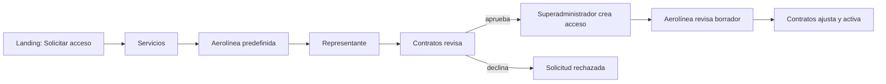

# Solicitud comercial y gobernanza

Esta capacidad está integrada en `Development` por el merge #114. Esta evidencia de repositorio no demuestra que la versión esté desplegada ni aceptada operativamente en el VPS. El [recorrido detallado](../../docs/workflows/commercial-intake-and-governance.md) explica las decisiones, contratos HTTP y límites de los datos iniciales.

El catálogo público recibe nombres, textos y medios controlados por Contratos. La lista inicial de aerolíneas ofrece nombres históricos; los campos legales y logos quedan explícitamente pendientes de verificación. El representante no elige contraseña. Contratos verifica y decide; la aprobación crea un contrato en borrador. El superadministrador crea la cuenta con contraseña temporal y entrega manual. La aerolínea puede comentar el borrador y Contratos lo activa cuando cumple las condiciones de vigencia, servicios y estaciones.

El POST público vuelve a validar que los servicios elegidos sigan activos y publicados. La lista visible y la admisión usan el mismo predicado del servidor; un UUID conocido de un servicio interno no amplía el catálogo público.

El API conserva la autoridad sobre permisos de roles personalizados, identidad de la aerolínea y estado contractual. Los avisos internos se guardan en el outbox y se recuperan por cuenta; SignalR indica que se debe releer. No hay correos automáticos. La promoción requiere que el operador prepare el secreto sintético y reconcilie el Compose Raw de Database Release según el [checkpoint de Dokploy](../../docs/deployment/dokploy-configuration.md), antes de publicar en Development.

Un refinamiento de esta rama agrega avisos durables a las decisiones de Contratos: verificar un perfil invalida sus solicitudes abiertas, y aprobar o rechazar invalida la solicitud correspondiente. La mutación y los avisos se confirman juntos en SQL; otra sesión puede recuperar el cambio por cursor aunque pierda SignalR. La prueba SQL de la rama cubre las tres transiciones. Esto no demuestra todavía la latencia del navegador ni una promoción al VPS.

El inicio de Contratos de esta rama reemplaza sus KPI y tarjetas sintéticas por una lectura de los listados comerciales reales de la API. El contador lateral deriva de la misma lectura y se reconcilia tras avisos de solicitudes, catálogo y borradores. Los KPI describen solo el alcance de esos listados (hasta 200 solicitudes y 100 borradores), no un total histórico ilimitado. Otras vistas heredadas de Contratos aún se identifican como prototipos.

El aviso público `CatalogChangedV1` es una invalidación de mejor esfuerzo posterior a la escritura. Si falla, la API conserva la respuesta de la mutación ya confirmada y registra el fallo; Public Web vuelve a leer por HTTP al reconectar y con polling acotado. Este refinamiento está en una rama de trabajo, no constituye aceptación operativa.

Volver al [Mapa de aplicaciones](README.md).
