# Solicitud comercial y gobernanza

La [clausura comercial de servicios](clausura-comercial-servicios.md)
documenta la solicitud de OCC, la decisión de Contratos y su efecto sobre el
carrusel público.

Esta capacidad está integrada en `Development` por el merge #114, y la fase 1
«Comercial» del ciclo operativo la completó
([ADR-0037](../../docs/adr/0037-commercial-cycle-requests-drafts-amendments-and-portal-accounts.md)).
La fase 2 «Pre-operación» completó la vigencia, las firmas, el permiso de
operación, el ciclo de vida del contrato y los usuarios del portal
([ADR-0038](../../docs/adr/0038-preoperation-contract-lifecycle-permits-master-data-and-workforce-readiness.md)).
Esta evidencia de repositorio no demuestra que la versión esté desplegada ni
aceptada operativamente en el VPS. El
[recorrido detallado](../../docs/workflows/commercial-intake-and-governance.md)
explica las decisiones, contratos HTTP y límites de los datos iniciales.

```mermaid
flowchart LR
    L[Landing: Solicitar acceso] --> S[Servicios]
    S --> A[Aerolínea del listado o propuesta]
    A --> R[Representante]
    R --> V[Resumen y confirmación]
    V --> C[Contratos verifica la aerolínea y confirma al representante]
    C -->|aprueba| U[Superadministrador invita o vincula la cuenta]
    C -->|rechaza o cancela| X[Correo al solicitante con el motivo]
    U --> B[Aerolínea comenta el borrador]
    B --> T[Contratos ajusta alcance y tarifas y envía a Finanzas]
    T --> F[Finanzas aprueba precios]
    F --> G[Contratos fija vigencia y renovación]
    G --> H[Firma dibujada de un representante o firmante de la aerolínea]
    H --> I[Contrafirma de AVIAM sobre la misma huella]
    I --> K[Permiso de operación verificado]
    K --> J[Contrato activo y PDF firmado por correo]
```

La fase pre-operativa (ADR-0025) añade el paso de vigencia después de Finanzas, el código
definitivo `CTR-{año}-{n}`, la firma dibujada en orden (aerolínea y después AVIAM) y el correo con
el PDF firmado. Ver [solicitudes, contratos y servicios](../03-dominio/solicitudes-contratos-y-servicios.md).

## Revisión de la solicitud

Contratos trabaja desde una bandeja paginada
(`GET contracts/commercial-requests/inbox`). Por defecto muestra las
solicitudes abiertas, de la más antigua a la más reciente, con filtro por
estado, búsqueda en el servidor y contadores por estado de toda la bandeja.
Cada paso de la revisión es un comando con `Idempotency-Key` y la versión que
mostró la bandeja; un conflicto obliga a releer.

- **Verificar la aerolínea** con una fuente oficial. Una aerolínea propuesta
  por el solicitante («Mi aerolínea no aparece») se vincula a una ficha
  existente o se convierte en una ficha verificada en «Otras aerolíneas». Desde
  el 16 de noviembre de 2026 esa ficha nace **sin publicar**: no aparece en el
  asistente público hasta que se aprueba su solicitud, y la aprobación la
  publica en la misma transacción (auditoría `commercial.airline.published`).
  Rechazar o cancelar la solicitud la deja sin publicar; vincular la solicitud a
  una ficha existente no cambia la publicación de esa ficha. Superadministración
  la ve en **Aerolíneas** como «No publicada» y puede publicarla a mano con la
  regla de siempre. El formulario de Contratos parte de lo que propuso el
  solicitante: nombre como razón social, país, códigos y, si es HTTPS, su sitio
  web como fuente. El formulario anónimo nunca escribe en el catálogo.
- **Confirmar al representante.** Contratos registra quién confirmó que el
  representante habla por la aerolínea, cuándo y por qué canal; se registra
  una sola vez. La pantalla avisa, sin bloquear, si el dominio del correo no
  coincide con el sitio oficial.
- La primera verificación o confirmación pasa la solicitud a **En revisión**;
  abrirla no cambia su estado.
- **Aprobar** exige la confirmación, la identidad verificada (razón social,
  país e ICAO; el IATA es opcional) y estaciones activas. Crea la aerolínea
  canónica, el contrato y su versión en borrador.
- **No se aprueba una segunda afiliación.** Se rechaza si la aerolínea ya tiene
  un contrato vivo o cuentas activas del portal, o si su código pertenece a
  otra aerolínea. La pantalla avisa y orienta a la enmienda o la renovación.
- **Rechazar** exige motivo. **Cancelar** (permiso nuevo
  `contracts.requests.cancel`) cierra con motivo una solicitud pendiente o en
  revisión, por ejemplo una duplicada. Nada se borra.
- Aprobar, rechazar y cancelar encolan un correo al solicitante con la
  decisión y, cuando lo hay, el motivo.

*Posterior al commit verificado (hallazgo N35 y decisión D-N35, 19 de noviembre
de 2026).* La prueba del VPS del 16 de noviembre encontró la referencia en cuatro
formatos, una verificación a mano atribuida a Contratos y el teléfono en E.164.
Ahora:

- **Referencia.** La de una solicitud pública es su UUID en 32 caracteres
  hexadecimales. La revisión la muestra completa, tal como la envía la API y sin
  mayúsculas. Las listas de Solicitudes, de Superadministración › Inicio y de la
  portada de Contratos la acortan a sus 8 primeros caracteres («1cc18541…») y
  guardan la completa en el `title`. Una referencia que no es un UUID
  («REQ-2026-000001») nunca se corta. No hay una referencia consecutiva «SOL-…»
  (D-N35).
- **Código del borrador.** El código `DRAFT-…` de un contrato nuevo se lee
  «Borrador 1cc18541…», con el código completo en el `title`, en Borradores, en
  la aprobación de contratos de Finanzas, en la portada de Contratos, en
  Contratos › Servicios pactados y en Contratos › Contratos: la lista, el
  detalle («Contrato Borrador 1cc18541… · versión 2») y sus diálogos («Retirar
  la versión 2 del contrato Borrador 1cc18541…», «Descartar el contrato
  Borrador 1cc18541…»). El nombre del PDF conserva el código. Dentro de una
  frase es «el borrador 1cc18541…». Un código definitivo («CTR-2026-0007») no
  cambia ([etiquetas](../../frontend/private-web/src/features/contracts/requests/requestLabels.js)).
  Una solicitud decidida dice «Se creó un contrato en borrador», sin el prefijo
  del UUID del contrato; la bandeja no recibe su código.
- **Quién verificó la aerolínea.** Si Superadministración verificó la ficha a
  mano, la identidad se titula «Identidad verificada a mano por
  Superadministración». Si no, se titula solo «Identidad verificada», sin
  autor: la bandeja no dice quién verificó, y la verificación de un
  superadministrador que perdió el rol o cuya cuenta está deshabilitada o
  bloqueada deja de contar como manual (ADR-0023), así que «por Contratos»
  podría ser falso. «Registros públicos» dice «✓
  Verificada a mano por Superadministración el … · fuente …», con la fecha y la
  hora de la verificación y la dirección tal cual. La fuente nunca se llama
  oficial: OpenFlights vale solo como verificación manual con su fuente a la
  vista (D-N35). Mientras la solicitud está abierta, añade «Al aprobar no se
  consulta a los registros públicos.», porque la API no los consulta en ese
  caso, y la lista de la decisión ya no dice «se comprueba al aprobar». Una
  solicitud cerrada sin veredicto dice «No se consultó a los registros
  públicos.».
- **Contacto del representante.** El correo solo se parte antes de la «@». El
  teléfono, guardado en E.164, se escribe «+1 809-555-0520»; el de otro país
  lleva su prefijo aparte («+34 600123456»), con `formatPhone` de
  `@elevant/api-client`.

*Posterior al commit verificado (hallazgo N31, 20 de noviembre de 2026).* En el
VPS de Development, «Servicios solicitados» decía «Aire acondicionado · por
operación», la unidad del catálogo, mientras la tarifa base de RAMP-AC en
Finanzas era por hora y el borrador nacía por hora. Ahora la unidad de un
servicio solicitado sigue una sola regla, la del borrador: la de la tarifa base
de Finanzas en USD del día hábil de AVIAM o, si el servicio no tiene tarifa
base, la del catálogo, siempre como código
([regla](../../database/DevelopmentDB/Elevant.Persistence/Commercial/ContractDraftUnits.cs)).

- **Abierta.** Mientras la solicitud está pendiente o en revisión, muestra la
  unidad con la que nacería hoy el borrador. Como todavía no tiene estaciones,
  usa la tarifa de todas las estaciones.
- **Al aprobar.** La solicitud guarda, en la misma transacción, la unidad con la
  que nace el borrador, aunque sea la de la tarifa propia de su única estación:
  la solicitud aprobada y su borrador coinciden. Sin tarifa base, el borrador
  toma la unidad que el catálogo tiene en ese momento.
- **Decidida.** Una solicitud aprobada, rechazada o cancelada muestra la unidad
  que guardó. Las decididas antes de este cambio conservan la suya, porque
  ninguna fila se reescribe.
- La respuesta de la bandeja no cambia de forma.

### Identificador fiscal y registros públicos (revisión del profesor)

- La solicitud pública exige el **identificador fiscal** de la aerolínea. Si la
  aerolínea es dominicana, es su **RNC**: 9 dígitos (desde el 16 de noviembre de 2026 no se comprueba su dígito verificador). Si
  no lo es, es su identificador, de 3 a 32 caracteres, con el país que lo emitió
  (`invalid_tax_registration`). Contratos lo corrige al verificar la aerolínea.
  La aprobación lo copia a la organización si esta no tiene uno. El contrato lo
  imprime («RNC 1-31-23456-9»), solo en las versiones cuyo contenido firmado lo
  incluye, y la factura e-CF lo congela como «RNC del comprador».
- La API **comprueba la aerolínea en los registros públicos** al enviar una
  aerolínea propuesta y al aprobar, y guarda el veredicto en la solicitud. La
  bandeja lo muestra en español: «Encontrada en OpenFlights», «No encontrada
  en registros públicos», «Inactiva», «No coincide: …» o «No se pudo
  comprobar».
- La aprobación con «no encontrada», «inactiva» o «no coincide» se rechaza
  (`airline_not_in_public_registry`). La excepción es una ficha verificada a
  mano por Superadministración con su fuente, que la bandeja muestra como
  «✓ Verificada a mano por Superadministración el … · fuente …». «No se pudo
  comprobar» no bloquea. El paso a paso está en la [guía comercial](../../docs/workflows/commercial-intake-and-governance.md#una-aerolínea-que-los-registros-públicos-no-confirman)
  y la regla en [ADR-0023](../../docs/adr/0023-airline-public-registry-check.md).
  Cuando Contratos pulsa **Actualizar** después de la verificación a mano, el
  aviso del rechazo anterior desaparece.
- **RNC en la ficha (16 de noviembre de 2026).** La ficha del catálogo guarda el
  identificador fiscal de la aerolínea, opcional, que Superadministración
  escribe en **Aerolíneas** («País del identificador fiscal», por defecto el de
  la aerolínea, y «RNC» o «Identificador fiscal»). No forma parte de la
  identidad verificada: cambiarlo no anula el check del registro ni la
  verificación manual, y queda auditado (`airline.tax_registration`). El
  catálogo público lo devuelve y el asistente lo precarga al elegir la
  aerolínea, editable: el país y el número de la ficha, o, sin RNC en la ficha,
  el país de la aerolínea y el campo vacío; cambiar de aerolínea los reemplaza.
  En «Mi aerolínea no aparece», el país elegido para la aerolínea pasa al
  identificador fiscal. Los tres formularios (asistente, Contratos y
  Superadministración) escriben el RNC con su máscara `1-31-23456-9`, teclado
  numérico y, con los 9 dígitos, «RNC válido» (con menos, al enviar, «El RNC tiene 9 dígitos.»);
  se envían los 9 dígitos (`maskRnc` y `rncFeedback` de `@elevant/api-client`).
- **Pasaporte dominicano del representante.** Con «Pasaporte» y nacionalidad
  República Dominicana (los valores por defecto), el asistente público muestra un
  «RD» fijo junto al campo, fuera de su nombre, y se escriben solo los 7 dígitos;
  se guarda y se envía `RD` y los dígitos, también al pegar «RD1234567».

Las aerolíneas sin designador IATA se identifican por su ICAO:
`ref.airlines.iata_code` admite nulos desde esta fase. Las respuestas que ya
existían no cambian de tipo: devuelven `""` donde el campo no admite nulos.
Solicitudes muestra el tipo de documento, el país de la nacionalidad y el
distrito en español.

## Cuenta del portal y borrador

El superadministrador crea la cuenta y la API encola un correo con un enlace
de activación de 72 horas; la contraseña temporal con entrega manual queda
como alternativa explícita
([ADR-0022](../../docs/adr/0022-portal-email-verification.md)). Si el correo
ya tiene una cuenta del portal de la misma aerolínea, o de ninguna,
Superadministración la **vincula** sin tocar sus credenciales. Si pertenece a
otra aerolínea o a AVIAM, no es del portal o está deshabilitada, el error
explica por qué no se puede usar. Una solicitud cuyo contrato se descartó ya
no se aprovisiona. Si el enlace vence, «Clientes» ofrece «Reenviar
invitación». Asignar ahí una contraseña temporal a una invitación pendiente la
cierra y descarta su correo en cola. Ninguna pantalla afirma que un correo se
envió cuando solo quedó en cola.

En **Borradores**:
- La aerolínea comenta el borrador, también mientras Finanzas lo revisa, y
  Contratos le responde.
- El portal no recibe la tarifa base, los valores base de los cargos ni el
  motivo interno de una devolución de Finanzas.
- Contratos ajusta condiciones, vigencia, moneda, tarifas, servicios y
  estaciones. Cada tarifa pendiente aparece «por definir» hasta que Contratos
  la confirma, y cambiar la moneda las deja todas pendientes.
- «Enviar a Finanzas» solo se habilita cuando el servidor confirma que el
  borrador está listo. La lista de requisitos muestra cada causa pendiente: la
  cuenta del portal (activa o invitada), los términos, las tarifas
  confirmadas, las estaciones, los servicios dados de baja, los paquetes y
  alguien de Finanzas que cubra todas las estaciones.
- Contratos recibe una notificación cuando la cuenta del portal queda lista y
  cuando Finanzas devuelve o aprueba los precios.
- Un borrador que no prospera se descarta con motivo (permiso
  `contracts.drafts.delete`): la versión queda `Rejected` y, si el contrato
  nunca se activó, el contrato se termina.

La aprobación de Finanzas no activa el contrato ni pone en vigor la versión.
El contrato pasa a activo cuando ambas partes firmaron la versión aprobada
sobre la misma huella y la aerolínea tiene un permiso de operación verificado
y vigente. La aerolínea envía sus permisos desde el portal y Contratos los
verifica en «Permisos de aerolíneas». La línea de tiempo del contrato reúne
todo el ciclo
([ADR-0024](../../docs/adr/0024-airline-permits-and-contract-lifecycle.md)).

## Vigencia, firmas y ciclo de vida (fase 2)

Desde la fase 2 del ciclo
([ADR-0038](../../docs/adr/0038-preoperation-contract-lifecycle-permits-master-data-and-workforce-readiness.md)):

- **Qué se factura.** Una versión rige solo desde su segunda firma. Hasta
  entonces, la versión en vigor sigue rigiendo y facturándose. En la segunda
  firma, la anterior termina a más tardar la víspera del nuevo inicio, y los
  vuelos aún no ejecutados cuyas líneas coinciden con las tarifas firmadas
  pasan a la versión nueva.
- **Vigencia y firmas.** Al fijar la vigencia, la aerolínea recibe el correo
  «listo para firmar». Firman sus representantes y firmantes; AVIAM solo
  contrafirma la misma huella. La firma y la vigencia corren serializadas, y
  quien pierde la carrera recibe `content_changed`. El contenido firmado
  incluye los recargos y los paquetes, que el portal muestra en «Recargos y
  paquetes».
- **Permisos.** Contratos verifica o rechaza un permiso enviado y revoca con
  motivo uno verificado. La revocación suspende en la misma transacción los
  contratos activos que se quedan sin un permiso usable, y verificar uno nuevo
  los reanuda. Cada decisión explica qué contratos activó, reanudó o suspendió.
- **Ciclo de vida.** Contratos suspende, reactiva, renueva y termina:
  - Renovar copia la versión en vigor con sus recargos negociados,
    exenciones y paquetes, también desde un contrato vencido.
  - Terminar respeta el preaviso firmado o pide una causa inmediata
    (incumplimiento o mutuo acuerdo). Una terminación con fecha futura se
    puede cancelar antes de su día. Terminar cierra los borradores y retira
    las versiones aprobadas que todavía no rigen.
  - «Retirar versión» pasa a `Rejected`, con motivo, una versión aprobada que
    todavía no rige (sin las dos firmas y que no sea la versión heredada con
    la que el contrato se activó); responde `version_signed` si ya rige. Las
    firmas no se borran: se anulan en la auditoría.
  - Una enmienda parte de la versión que rige y pide solo «Vigente desde». Ni
    la renovación ni la enmienda se crean mientras otra versión aprobada espera
    las firmas.
- **Barrido.** Cada hora activa, vence y suspende contratos, y termina los que
  llegan a su fecha programada. Avisa del vencimiento de un contrato los días
  de aviso que firmó su versión (30 si no tiene) y del de un permiso a 30
  días. Reintenta la renovación automática que no pudo iniciarse y avisa a
  Contratos como máximo una vez por día hábil.
- **Correos a la aerolínea.** Todas sus cuentas activas del portal reciben el
  «listo para firmar», el rechazo o la revocación de un permiso, los avisos de
  vencimiento y la suspensión, sin el motivo interno de Contratos
  ([destinatarios](../../database/DevelopmentDB/Elevant.Persistence/Commercial/AirlineNoticeEmails.cs)).
- **Usuarios del portal.** El representante de la aerolínea es la cuenta
  aprovisionada, o quien designe Superadministración en «Clientes». Invita,
  desactiva y reactiva usuarios desde el portal y marca firmantes. Solo los
  representantes y los firmantes firman contratos y envían el permiso JAC
  ([roles](../../database/DevelopmentDB/Elevant.Persistence/Commercial/AirlinePortalRoles.cs)).
  Una aerolínea cuyas cuentas creó solo Superadministración, sin
  aprovisionamiento, no tiene representante hasta que se designe uno.

*Posterior al commit verificado (hallazgo N33, 19 de noviembre de 2026).* La
prueba del VPS del 16 de noviembre encontró «al Sin vencimiento», el código
«(WN )», una ayuda con las firmas al revés y un permiso sin verificar en verde.
Ahora:

- **Código de la aerolínea.** SQL lee un IATA de dos letras con el relleno de la
  columna ICAO («WN »), y las versiones se firmaron sobre ese valor. La
  [respuesta del documento](../../backend/Elevant.Api/Controllers/ContractDocumentsController.cs),
  el [PDF](../../backend/Elevant.Infrastructure/Commercial/ContractPdfRenderer.cs),
  la [lista de contratos](../../database/DevelopmentDB/Elevant.Persistence/Commercial/EfManagedContractReadStore.cs)
  y AVIAM Web lo recortan al presentarlo: «(WN)», y un ICAO queda entero
  («(SWA)»). La huella SHA-256 se sigue calculando sobre el valor guardado, así
  que ninguna firma deja de coincidir con su documento y no hace falta un ADR.
  Cambiar el tipo de la columna quedó descartado: exigiría un plan para las
  huellas ya firmadas.
- **Vigencia.** El detalle escribe «Del 3 de noviembre de 2026 al 2 de noviembre
  de 2027» o, sin fin, «Desde el 3 de noviembre de 2026, sin vencimiento»; la
  lista conserva «01/09/2026 — Sin vencimiento»
  ([`validityRange`](../../frontend/private-web/src/features/contracts/agreements/agreementLabels.js)).
- **Orden de los pasos.** La ayuda de Contratos › Contratos sigue el orden que
  aplica el servidor: Finanzas aprueba los precios, Contratos fija la vigencia,
  firma la aerolínea, AVIAM contrafirma y, con el permiso JAC verificado, el
  contrato se activa. Antes decía «firman AVIAM y la aerolínea» y no nombraba la
  vigencia ni el permiso.
- **Permiso sin verificar.** Un permiso enviado, rechazado o con la verificación
  revocada cuyas fechas están vigentes se ve «Fechas vigentes» en tono neutro;
  «Vigente» en verde queda para un permiso verificado
  ([permisos](../../frontend/private-web/src/features/contracts/permits/AirlinePermitsPage.jsx)).

## Catálogo y fichas de aerolínea

El catálogo público recibe nombres, textos y medios controlados por Contratos. La lista inicial de aerolíneas conserva 51 nombres históricos de AVIAM, países y enlaces de investigación, con seis identidades cotejadas contra IATA. Una parte de las fichas usa iconos de sitios oficiales servidos localmente en ambas webs; las demás usan una placa de referencia que no se presenta como logo oficial. Los campos no corroborados permanecen como «Sin dato confirmado». Desde el 16 de noviembre de 2026, todas las aerolíneas activas de la lista tienen identidad: sus códigos IATA e ICAO vienen de la copia de OpenFlights del repositorio (`openflights-airlines.tsv`), cotejados por nombre, o, para las que esa copia no tiene, de sus designadores públicos con su sitio oficial como fuente. ARKEFLY, marca histórica de TUIFLY NETHERLANDS, deja a esta los designadores OR/TFL. En Development, «Completar fichas AVIAM» también pone un **RNC ficticio de demostración** (`AviamAirlineReference.DevelopmentTaxRegistrations`) a las fichas sin identificador, solo con `AirlineCatalogEnrichment:IncludeDevelopmentTaxRegistrations`, que únicamente Development y Test permiten; no son los RNC reales de las aerolíneas. Superadministración administra las fichas y con **Completar fichas AVIAM** completa las que nadie editó: las del seed y las que solo cambiaron la propia acción o un check de registro, según la auditoría. Nunca toca una ficha guardada, verificada o creada por una persona, una que ya opera ni un designador que otra ficha verificada usa; por eso pulsarlo otra vez aplica las identidades nuevas. Fuera de Development el RNC no se completa así. El seed no actualiza datos existentes. Cada ficha se puede verificar en un registro público («Verificar en registro»: primero las aerolíneas ya vistas en los vuelos de AeroDataBox, sin costo; luego Wikidata y, si no responde, una copia de OpenFlights; [ADR-0028](../../docs/adr/0028-aerodatabox-flight-feed-with-unit-budget.md)). Solo se publica para el paso 2 con el check verde o con la verificación manual con su fuente, y el asistente muestra el sello «Verificada en registro público» ([ADR-0023](../../docs/adr/0023-airline-public-registry-check.md)). Cuando la aerolínea ya opera (tiene su fila en `ref.airlines` o una solicitud aprobada), Superadministración no puede cambiar su razón social, su IATA, su ICAO ni su verificación; el nombre comercial, el logo y la publicación siguen editables. Desde el 16 de noviembre de 2026, **Corregir identidad** en **Editar aerolínea** permite a un superadministrador corregir esos datos (por ejemplo, identidades de prueba) con un **Motivo de la corrección** obligatorio de 10 a 500 caracteres y la verificación con su fuente HTTPS: la API (`identityCorrectionReason`) lo audita como `commercial.airline.identity_corrected` con los valores anteriores y nuevos y el motivo, la verificación pasa a su nombre y se limpia el check del registro. Los designadores siguen siendo únicos entre fichas verificadas. Los contratos, las facturas, las solicitudes y la aerolínea canónica (`ref.airlines`) conservan los datos con los que se hicieron: la corrección cambia solo la ficha del catálogo.

**Contratos → Servicios → Catálogo** muestra la lista interna de servicios en
páginas de doce, incluidos los ocultos y los dados de baja, en el mismo orden
del API: `displayOrder` y, en empate, nombre. La interfaz muestra rango y
total, ajusta la página al actualizar si el catálogo se reduce y ubica el
servicio creado o editado después de guardarlo. Es una paginación de la vista:
`GET /contracts/catalog/services` sigue devolviendo la lista completa.

Ocultar un servicio y darlo de baja son acciones distintas. **Ocultar del
catálogo** solo lo retira del catálogo público: sigue disponible para los
contratos y para OCC. **Dar de baja** pide motivo, también lo saca de los
contratos nuevos y de la operación, y se rechaza mientras un contrato en vigor
o en aprobación lo use; en ese caso la pantalla ofrece ocultarlo. **Reactivar**
devuelve un servicio dado de baja, oculto hasta que se publique. El formulario
de edición ya no tiene la casilla «Activo».

`displayOrder` es funcional: ordena el catálogo público y las opciones de
afiliación. Cada tarjeta muestra su posición secuencial (1, 2, 3…) en ese orden;
el usuario no la escribe. Al crear, private-web envía el mayor `displayOrder`
cargado más uno, contando ocultos y dados de baja, de modo que el servicio queda al
final; al editar se conserva. El API no asigna ni exige unicidad de este número,
así que los valores guardados pueden tener huecos o repetidos heredados y dos
altas simultáneas pueden compartirlo; la posición visible sigue siendo
secuencial.

Nombre y código forman una sola entidad. El combobox de **Nombre del servicio**
reúne los servicios del API (incluidos los creados con «Otro») y los siete
servicios de rampa con código formal (`RAMP-*`) aún no creados; al elegir uno, el
código se completa y no se edita. Elegir un servicio que ya existe bloquea el
alta y ofrece editarlo. «Otro» pide nombre y código nuevos, que no pueden
repetir los de otra entidad; el texto «Otro» nunca se guarda. **Unidad de
cobro** ofrece las unidades activas que Finanzas mantiene en «Unidades de
cobro», rotuladas «Por …», sin texto libre. El catálogo guarda el código de la
unidad (`operation`, `hour`…); un nombre heredado se lee y se guarda como su
código, y un texto que no nombra ninguna unidad se conserva como «heredada»
hasta que se cambie. No hay unidad por defecto ni regla automática por
servicio.

## Superadministración y avisos

**Usuarios** separa **Clientes** (cuentas del portal de cada aerolínea) y
**Usuarios internos** (administradores y sub-usuarios por departamento; ver
[Gobernanza por departamento](../03-dominio/gobernanza-por-departamento.md)).
Clientes muestra carga, error con reintento y falta de permiso, y explica cada
error por su código. Desde la fase 2, Clientes también designa representantes y
firmantes de cada aerolínea, y nunca quita el rol al último representante
activo. **Estaciones** crea las estaciones de la plataforma con el IATA de su
aeropuerto, cambia su zona horaria mientras no tienen historia y no desactiva
una estación en uso. **Configuración** reúne las políticas de acceso, la
conversión de roles heredados y la auditoría paginada con actor y cambios de
campos permitidos; contraseñas y correos no se incluyen en el detalle. Su
panel «Correo del sistema» muestra si SMTP está configurado, una prueba de
envío y la bandeja de correos: propósito, estado (en cola, enviado, falló o
descartado), motivo y documento o cuenta relacionados, sin cuerpos. La
[guía de rampa](../../docs/workflows/ramp-agent-readiness.md) distingue el
perfil operativo de la elegibilidad de OCC para una tarea concreta.

Desde el PR A1 del plan «OCC a nivel NOC» (código de `cba00f73`),
**Configuración** abre con el panel «Vuelo demo», solo para el
superadministrador. Donde `DemoFlights:Mode` lo permite, que es el entorno de
desarrollo, dispara un vuelo de prueba de una aerolínea con contrato vigente
hoy en la estación: dos propuestas del proveedor «Demo» que OCC ve llegar,
importa y opera como cualquier otro vuelo; en otro entorno, el panel dice que
están apagados. Una vez importado se
factura como tal, así que conviene usar una aerolínea de prueba. La lista
«Vuelos demo de hoy» sigue cada vuelo y ofrece «Cancelar vuelo» o «Terminar
demo» ([ADR-0041](../../docs/adr/0041-demo-flights-and-punta-cana-stands.md),
[panel](../../frontend/private-web/src/features/governance/DemoFlightsPanel.jsx)).

Desde el PR A2 del mismo plan (código de `d6461fa1` a `ff066d47`), el panel
suma la tarjeta «Posiciones de Punta Cana», el segundo comando del
superadministrador en «Configuración». «Cargar posiciones»
(`POST governance/demo-station`, con su `Idempotency-Key` y el mismo modo) crea
en PUJ las terminales A, B y FBO y las 41 posiciones del
[catálogo](../../backend/Elevant.Application/Operations/DemoStation/PuntaCanaStationLayout.cs)
que faltan, activas, sin coordenadas y con atributos provisionales; adopta las
que ya existen por su código normalizado y nunca cambia, desactiva ni borra
nada. La respuesta es el estado de la estación, así que repetirla no crea nada
([almacén](../../database/DevelopmentDB/Elevant.Persistence/Operations/EfDemoStationStore.cs)).
El formulario dispara ahora «Al azar» por defecto: el servidor sortea la
posición entre las que cubre, a la hora de llegada, un agente que pasa la regla
de asignación de OCC; si ninguna lo cumple, el panel lo explica y ofrece
disparar sin posición o crear antes la cobertura.

El POST público vuelve a validar que los servicios elegidos sigan activos y publicados. La lista visible y la admisión usan el mismo predicado del servidor; un UUID conocido de un servicio interno no amplía el catálogo público. La admisión mantiene una transacción serializable entre esa lectura y su escritura: una retirada concurrente no se intercala entre ambas. Una relectura fallida en el formulario conserva la última selección y permite reintentar; el servidor sigue siendo la autoridad al enviar.
El cliente compartido no introduce un máximo de 1 000 entradas que el endpoint de catálogo no promete; un catálogo mayor sigue sujeto a validación de forma e identificadores. Una futura paginación requiere un cambio coordinado de API y clientes.

El API conserva la autoridad sobre permisos de roles personalizados, identidad de la aerolínea y estado contractual. Los avisos internos se guardan en el outbox y se recuperan por cuenta; SignalR indica que se debe releer. Los avisos internos no se envían por correo: por correo salen la decisión al solicitante, los de la cuenta del portal, el PDF del contrato activado y, desde la fase 2, los avisos a la aerolínea sobre sus contratos, sus permisos y sus usuarios del portal. De Finanzas, la aerolínea recibe la factura emitida y el «Pago recibido» de un pago con tarjeta y, desde la fase 4, la nota de crédito o débito con su PDF y el aviso único de factura vencida; la bandeja los nombra «Nota de ajuste emitida» y «Factura vencida» ([ADR-0040](../../docs/adr/0040-billing-cycle-invoicing-from-operations-card-collections-credit-notes-and-payables.md)). La promoción requiere que el operador prepare el secreto sintético y reconcilie el Compose Raw de Database Release según el [checkpoint de Dokploy](../../docs/deployment/dokploy-configuration.md), antes de publicar en Development.

Las decisiones de Contratos crean avisos durables: verificar un perfil invalida sus solicitudes abiertas, y confirmar al representante, aprobar, rechazar o cancelar invalida la solicitud correspondiente. La mutación y los avisos se confirman juntos en SQL; otra sesión puede recuperar el cambio por cursor aunque pierda SignalR. Esto no demuestra la latencia del navegador ni una promoción al VPS.

El inicio de Contratos usa lecturas comerciales reales. Sus indicadores de solicitudes salen de los contadores de la bandeja, que cubren todas las solicitudes; el resumen de borradores consulta una proyección autorizada de hasta 100 filas y cinco recientes, sin descargar términos, tarifas ni comentarios. El inicio tampoco descarga el catálogo completo.

Las vistas comerciales internas releen HTTP cada 25 segundos mientras están visibles y al recuperar foco o conexión. Este respaldo cubre un fallo temporal de recarga después de reconocer el cursor del feed. El intervalo no es una medición de latencia ni garantiza entrega inmediata sin red.

El aviso público `CatalogChangedV1` es una invalidación de mejor esfuerzo posterior a la escritura. Si falla, la API conserva la respuesta de la mutación ya confirmada y registra el fallo; Public Web vuelve a leer por HTTP al reconectar y con polling acotado. No constituye aceptación operativa.

## Pendiente

Los comandos que ya existían aceptan todavía llamadas sin `Idempotency-Key`
mientras queden clientes antiguos:

- La decisión de solicitudes, el borrador (guardar y enviar), el comentario de
  la aerolínea, el aprovisionamiento, el reenvío de la invitación y la
  contraseña temporal de clientes tampoco exigen la versión esperada.
- El ciclo de vida del contrato, la decisión de Finanzas, el `PUT` del
  catálogo, la decisión y la reapertura de clausuras y el `PUT` de aerolíneas
  ya exigen la versión; solo la clave es opcional.
- El `PUT` heredado de verificación de aerolíneas
  (`contracts/commercial-requests/airlines/{profileId}/verification`), que
  reescribía la identidad sin clave ni versión y ningún cliente usaba, se
  retiró de la API y del contrato OpenAPI.

Hacer obligatorio lo que falta, y retirar el `DELETE` obsoleto del catálogo,
es el paso «contract» que registra
[ADR-0037](../../docs/adr/0037-commercial-cycle-requests-drafts-amendments-and-portal-accounts.md),
junto con los demás pendientes de la fase.

La fase 2 suma a ese paso la vigencia, el envío y la revisión del permiso, que
aceptan la clave como opcional. Los comandos nuevos (retirar una versión,
revocar un permiso y los usuarios del portal) la exigen. También quedan
abiertos:

- el listado de Contratos muestra «Aprobada» para una versión que espera las
  firmas;
- la renovación firmada de un contrato suspendido no envía el PDF firmado;
- los correos nuevos a la aerolínea aparecen en la bandeja referidos a la cuenta
  del portal, no al contrato ni al permiso.

Ver [ADR-0038](../../docs/adr/0038-preoperation-contract-lifecycle-permits-master-data-and-workforce-readiness.md).

Volver al [Mapa de aplicaciones](README.md).
