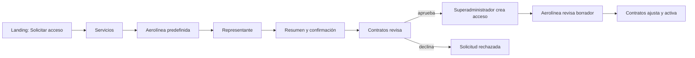

# Solicitud comercial y gobernanza

La [clausura comercial de servicios](clausura-comercial-servicios.md) documenta
la solicitud de OCC, decisión de Contratos y efecto sobre el carrusel público
en la rama local. La sección siguiente conserva el estado verificado del flujo
de alta anterior.

Esta capacidad está integrada en `Development` por el merge #114. Esta evidencia de repositorio no demuestra que la versión esté desplegada ni aceptada operativamente en el VPS. El [recorrido detallado](../../docs/workflows/commercial-intake-and-governance.md) explica las decisiones, contratos HTTP y límites de los datos iniciales.

El catálogo público recibe nombres, textos y medios controlados por Contratos. La lista inicial de aerolíneas conserva 51 nombres históricos de AVIAM, países y enlaces de investigación, con seis identidades cotejadas contra IATA. Cinco iconos de sitios oficiales se sirven localmente en ambas webs; los demás usan monogramas. Los campos no corroborados permanecen como «Sin dato confirmado». Superadministración administra las fichas y puede completar las filas de fixture aún intactas; el seed no actualiza datos existentes. El representante puede añadir datos opcionales y revisa un cuarto paso antes del envío. No elige contraseña. Contratos verifica y decide; la aprobación crea un contrato en borrador. El superadministrador crea la cuenta con contraseña temporal y entrega manual. La aerolínea puede comentar el borrador; cada tarifa pendiente aparece «por definir» hasta que Contratos la confirme. La activación exige todas las tarifas confirmadas, además de vigencia, servicios y estaciones.

En esta rama, **Contratos → Servicios → Catálogo** muestra la lista interna de
servicios en páginas de diez, incluidos los ocultos. La interfaz muestra rango
y total, ajusta la página al actualizar si el catálogo se reduce y ubica el
servicio creado o editado después de guardarlo. Es una paginación de la vista:
`GET /contracts/catalog/services` sigue devolviendo la lista completa. Este
cambio local no acredita una promoción al VPS.

El módulo Usuarios muestra los roles personalizados con acciones Ver/Crear/Editar/Acceso completo; cada módulo comienza en Ver, que es el mínimo, y el formulario valida la política de contraseña temporal del API antes de enviarla. También ofrece `RAMP_AGENT` sólo al vincular un perfil operativo de Gestión Humana con estación vigente. La [guía de rampa](../../docs/workflows/ramp-agent-readiness.md) distingue el perfil de la elegibilidad de OCC para una tarea concreta. Configuración lee auditoría paginada con actor y cambios de campos permitidos; contraseñas y correos no se incluyen en el detalle.

El POST público vuelve a validar que los servicios elegidos sigan activos y publicados. La lista visible y la admisión usan el mismo predicado del servidor; un UUID conocido de un servicio interno no amplía el catálogo público. La admisión mantiene una transacción serializable entre esa lectura y su escritura: una retirada concurrente no se intercala entre ambas. Una relectura fallida en el formulario conserva la última selección y permite reintentar; el servidor sigue siendo la autoridad al enviar.
El cliente compartido no introduce un máximo de 1 000 entradas que el endpoint de catálogo no promete; un catálogo mayor sigue sujeto a validación de forma e identificadores. Una futura paginación requiere un cambio coordinado de API y clientes.

El API conserva la autoridad sobre permisos de roles personalizados, identidad de la aerolínea y estado contractual. Los avisos internos se guardan en el outbox y se recuperan por cuenta; SignalR indica que se debe releer. No hay correos automáticos. La promoción requiere que el operador prepare el secreto sintético y reconcilie el Compose Raw de Database Release según el [checkpoint de Dokploy](../../docs/deployment/dokploy-configuration.md), antes de publicar en Development.

Un refinamiento de esta rama agrega avisos durables a las decisiones de Contratos: verificar un perfil invalida sus solicitudes abiertas, y aprobar o rechazar invalida la solicitud correspondiente. La mutación y los avisos se confirman juntos en SQL; otra sesión puede recuperar el cambio por cursor aunque pierda SignalR. La prueba SQL de la rama cubre las tres transiciones. Esto no demuestra todavía la latencia del navegador ni una promoción al VPS.

El inicio de Contratos de esta rama reemplaza sus KPI y tarjetas sintéticas por lecturas comerciales reales. El contador lateral deriva de hasta 200 solicitudes; el resumen de borradores consulta una proyección autorizada de hasta 100 filas y cinco recientes, sin descargar términos, tarifas ni comentarios. Los KPI no son totales históricos ilimitados; el inicio tampoco descarga el catálogo completo. Otras vistas heredadas de Contratos aún se identifican como prototipos.

Las vistas comerciales internas releen HTTP cada 25 segundos mientras están visibles y al recuperar foco o conexión. Este respaldo cubre un fallo temporal de recarga después de reconocer el cursor del feed. El intervalo no es una medición de latencia ni garantiza entrega inmediata sin red.

El aviso público `CatalogChangedV1` es una invalidación de mejor esfuerzo posterior a la escritura. Si falla, la API conserva la respuesta de la mutación ya confirmada y registra el fallo; Public Web vuelve a leer por HTTP al reconectar y con polling acotado. Este refinamiento está en una rama de trabajo, no constituye aceptación operativa.

Volver al [Mapa de aplicaciones](README.md).
