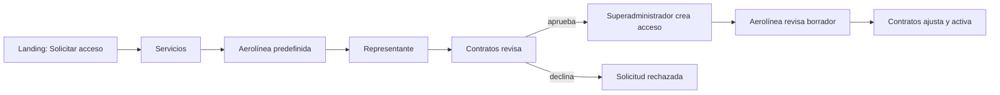

# Solicitud comercial y gobernanza

Esta capacidad está implementada en una rama de trabajo y todavía no se ha desplegado ni aceptado operativamente en Development. El [recorrido detallado](../../docs/workflows/commercial-intake-and-governance.md) explica las decisiones, contratos HTTP y límites de los datos iniciales.

El catálogo público recibe nombres, textos y medios controlados por Contratos. La lista inicial de aerolíneas ofrece nombres históricos; los campos legales y logos quedan explícitamente pendientes de verificación. El representante no elige contraseña. Contratos verifica y decide; la aprobación crea un contrato en borrador. El superadministrador crea la cuenta con contraseña temporal y entrega manual. La aerolínea puede comentar el borrador y Contratos lo activa cuando cumple las condiciones de vigencia, servicios y estaciones.

El API conserva la autoridad sobre permisos de roles personalizados, identidad de la aerolínea y estado contractual. Los avisos internos se guardan en el outbox y se recuperan por cuenta; SignalR indica que se debe releer. No hay correos automáticos ni modificación del VPS como parte de esta rama.

Volver al [Mapa de aplicaciones](README.md).
