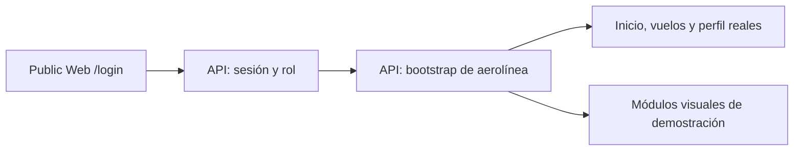

# Public Web y portal de aerolíneas

Public Web combina la landing pública con el acceso de aerolíneas. En Development, la aerolínea entra desde `/login` y utiliza `/portal`; la antigua ruta separada `/dev-airline` fue retirada. El portal ya autentica y consulta un bootstrap real de la API, pero no es un portal operacional completo ni una capacidad de Production.

## Frontera y estado actual

| Parte | Comportamiento verificado en el repositorio |
| --- | --- |
| Identidad | `POST /api/v1/auth/session` emite la sesión; `GET /api/v1/auth/session` la revalida al recargar. El navegador comprueba el rol de aerolínea y la membresía correspondiente, pero la API sigue siendo la autoridad de autorización. |
| Contraseña temporal | El código permitido `password_change_required` conduce a `POST /api/v1/auth/password-change`; tras el cambio se requiere un inicio de sesión nuevo. |
| Tenant y estaciones | `GET /api/v1/airline/portal/bootstrap` deriva el tenant y la cobertura desde la sesión del servidor. El cliente no envía un ID de tenant elegido por el usuario. |
| Inicio, vuelos y perfil | Muestran nombre, estaciones, identidad y operaciones de la ventana actual contenidas en el bootstrap. Inicio y vuelos separan además una muestra visual sintética del prototipo, con indicadores y rotaciones EV etiquetados y sin enlaces de detalle. El detalle solo abre una operación real presente en la respuesta de la API. No hay consulta histórica general. |
| Solicitudes, contratos, documentos, finanzas y reportes | Conservan tarjetas y listados visuales con registros sintéticos claramente marcados como demostración. No se presentan como datos de la aerolínea; descargas y respuestas financieras permanecen deshabilitadas. |
| Afiliación | La experiencia de solicitud en `/login` conserva un adaptador prototípico; no emite una cuenta ni demuestra persistencia contractual en la API canónica. |

El JWT corto y su vencimiento se conservan en `sessionStorage` de la pestaña, no en `localStorage`. No existe opción «Recordarme». Al recargar, el cliente revalida identidad y bootstrap; al cerrar sesión, vencer el token o perder autorización, limpia el acceso. Un fallo transitorio permite reintentar sin presentar datos obsoletos como si fueran actuales. La comprobación del navegador no sustituye el enforcement del backend por tenant y estación.

## Recorrido y límites

La landing, la solicitud comercial y los antiguos componentes de `PortalWorkspace` siguen siendo fuentes de UX prototípica; las rutas activas de `/portal` no montan ese repositorio mock. La muestra de Inicio y Vuelos usa fixtures descartables calculados en el navegador, separados del bootstrap por un aviso persistente. Sus filtros funcionan, pero ninguna rotación sintética abre un detalle; las operaciones reales conservan sus enlaces propios. El contenido sintético de los demás módulos es una vista previa estática y deshabilitada, no un contrato de datos ni una autorización local. Las futuras consultas de contratos, documentos, finanzas, solicitudes e historial requieren endpoints OpenAPI, persistencia y pruebas de aislamiento antes de habilitar acciones.

## Desarrollo y evidencia

`NEXT_PUBLIC_ELEVANT_API_URL` configura el cliente compartido en el bundle y nunca puede contener secretos. Los orígenes locales deben estar admitidos por CORS en Development; Tailscale limita alcance de red pero no sustituye autenticación. El navegador no accede a SQL Server ni a proveedores externos directamente.

Las pruebas del cliente API validan el código de error permitido sin exponer cuerpos crudos. Public Web prueba sesión, caducidad, roles, datos autorizados, vistas previas inactivas y 404 de `/dev-airline` con Vitest y Playwright en escritorio, tablet y móvil. Esa evidencia es de código y navegador con respuestas sintéticas; por sí sola **no demuestra** promoción ni funcionamiento de las seis cuentas reales en el VPS.

Fuentes principales: [README de Public Web](../../frontend/public-web/README.md), [proveedor de sesión](../../frontend/public-web/src/components/auth/AirlineSessionProvider.tsx), [vista del portal](../../frontend/public-web/src/components/portal/AirlinePortalPage.tsx), [cliente API](../../packages/api-client/src/client.ts) y [contrato OpenAPI](../../packages/api-client/openapi/elevant-v1.json).
