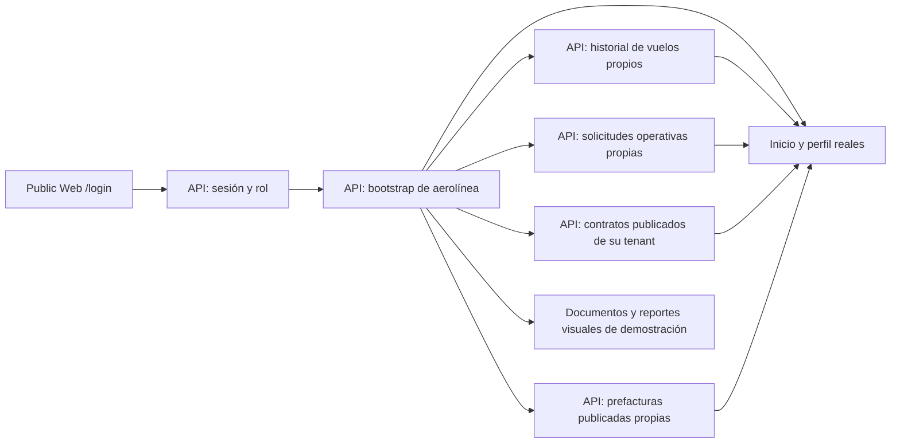

# Public Web y portal de aerolíneas

> El commit de verificación del frontmatter corresponde a la base anterior.
> Los cambios de historial y detalle descritos como «esta rama de integración»
> tienen pruebas locales, pero requieren nueva verificación integral, CI y
> promoción antes de convertirse en estado remoto verificado.

Public Web combina la landing pública con el acceso de aerolíneas. En Development, la aerolínea entra desde `/login` y utiliza `/portal`; la antigua ruta separada `/dev-airline` fue retirada. El portal ya autentica y consulta un bootstrap real de la API, pero no es un portal operacional completo ni una capacidad de Production.

## Frontera y estado actual

| Parte | Comportamiento verificado en el repositorio |
| --- | --- |
| Identidad | `POST /api/v1/auth/session` emite la sesión; `GET /api/v1/auth/session` la revalida al recargar. El navegador comprueba el rol de aerolínea y la membresía correspondiente, pero la API sigue siendo la autoridad de autorización. |
| Contraseña temporal | El código permitido `password_change_required` conduce a `POST /api/v1/auth/password-change`; tras el cambio se requiere un inicio de sesión nuevo. |
| Tenant y estaciones | `GET /api/v1/airline/portal/bootstrap` deriva el tenant y la cobertura desde la sesión del servidor. El cliente no envía un ID de tenant elegido por el usuario. |
| Inicio, vuelos y perfil | Inicio y perfil muestran el contexto del bootstrap sin mezclar rotaciones EV del prototipo. En esta rama de integración, Vuelos consulta además `GET /api/v1/airline/portal/operations`, paginado y filtrado por aerolínea/contrato histórico en SQL. El detalle relee por ID una operación propia aunque no figure en el bootstrap; servicios y evidencias aún faltan. Este cambio aún no está desplegado. |
| Contratos | `GET /api/v1/airline/portal/contracts` deriva el tenant de la sesión y devuelve páginas de versiones publicadas (`Approved` o `Superseded`), estaciones y tarifas. El historial vencido continúa visible para la misma aerolínea; los borradores se consultan por una ruta separada con comentarios autorizados. Otros tenants no se exponen. |
| Solicitudes | En esta rama consulta `ops.OperationalServiceRequest` paginado y filtrado por aerolínea en la API; no confundir con la solicitud comercial pública. Crear/cancelar sigue deshabilitado. Aún no está promocionado. |
| Finanzas | En esta rama consulta prefacturas publicadas (`Submitted`, `Disputed`, `Accepted` o `Invoiced`) paginadas y filtradas por aerolínea en SQL. Puede releer por ID las líneas y montos snapshot de una prefactura propia; borradores y otros tenants no se exponen. Disputa, factura, pago y recibo aún no están disponibles. |
| Documentos y reportes | Conservan tarjetas y listados visuales con registros sintéticos claramente marcados como demostración. No se presentan como datos de la aerolínea; descargas y exportaciones permanecen deshabilitadas. |
| Solicitud de acceso | `/solicitar-acceso` usa catálogo y solicitud comerciales canónicos. No recoge contraseña ni crea cuenta; Contratos revisa y Superadministrador provisiona después. |

El JWT corto y su vencimiento se conservan en `sessionStorage` de la pestaña, no en `localStorage`. No existe opción «Recordarme». Al recargar, el cliente revalida identidad y bootstrap; al cerrar sesión, vencer el token o perder autorización, limpia el acceso. Un fallo transitorio permite reintentar sin presentar datos obsoletos como si fueran actuales. La comprobación del navegador no sustituye el enforcement del backend por tenant y estación.

## Recorrido y límites

Los antiguos componentes de `PortalWorkspace` siguen siendo fuentes de UX prototípica; las rutas activas de Inicio, Vuelos, Solicitudes y Finanzas no montan ese repositorio mock ni `PortalDemoPreview`. Inicio muestra la ventana actual del bootstrap; Vuelos carga páginas del historial propio desde SQL, incluso después de vencer un contrato que cubría la operación en su fecha, con estado vacío/error explícito. El detalle se autoriza por tenant y operación exacta, pero todavía no incluye servicios ni evidencia. Solicitudes carga la entidad operativa propia; un seed determinista de Development la vincula a `DEV-TAT-0002`. Finanzas muestra únicamente prefacturas publicadas propias y un vacío real si todavía no existen; al abrir una, relee las líneas inmutables con autorización por tenant. La creación de borradores es interna y no los hace visibles a la aerolínea. Documentos y Reportes siguen como vistas previas estáticas. Contratos consulta versiones publicadas y borradores por rutas autorizadas; los comentarios de borrador no activan unilateralmente el contrato. Las futuras consultas de documentos, facturas, recibos y evidencia operativa, así como escrituras de solicitudes, requieren contratos, persistencia y pruebas de aislamiento antes de habilitar acciones.

## Desarrollo y evidencia

`NEXT_PUBLIC_ELEVANT_API_URL` configura el cliente compartido en el bundle y nunca puede contener secretos. Los orígenes locales deben estar admitidos por CORS en Development; Tailscale limita alcance de red pero no sustituye autenticación. El navegador no accede a SQL Server ni a proveedores externos directamente.

Las pruebas del cliente API validan el código de error permitido sin exponer cuerpos crudos. Public Web prueba sesión, caducidad, roles, contrato consultable, historial de vuelos, vistas previas inactivas y 404 de `/dev-airline` con Vitest y Playwright en escritorio, tablet y móvil. Las pruebas SQL verifican paginación, contratos y operaciones propios tras vencimiento, exclusión de otra aerolínea y de borradores. La evidencia de navegador usa respuestas simuladas; por sí sola **no demuestra** promoción ni funcionamiento de las seis cuentas reales en el VPS. El historial descrito aquí pertenece a la rama de integración y requiere CI, merge y promoción antes de ser estado remoto.

Fuentes principales: [README de Public Web](../../frontend/public-web/README.md), [proveedor de sesión](../../frontend/public-web/src/components/auth/AirlineSessionProvider.tsx), [vista del portal](../../frontend/public-web/src/components/portal/AirlinePortalPage.tsx), [cliente API](../../packages/api-client/src/client.ts) y [contrato OpenAPI](../../packages/api-client/openapi/elevant-v1.json).
