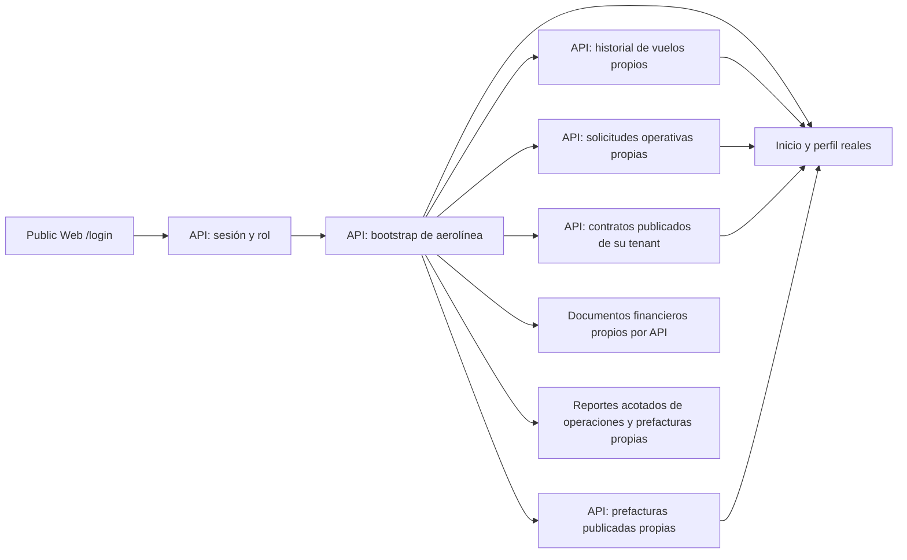

# Public Web y portal de aerolíneas

> [!NOTE]
> La revisión docente de octubre de 2026 cambió validaciones, permisos, notificaciones y otros comportamientos descritos aquí. El estado actual de cada punto está en [Correcciones de la revisión docente](correcciones-revision-docente-2026-10.md).

> El commit de verificación del frontmatter corresponde a la base anterior.
> El historial, Finanzas y Documentos ya tienen código en la release #118;
> el snapshot de evidencia aprobada descrito más abajo pertenece a una rama
> posterior con pruebas locales. Ni esas pruebas ni esta nota demuestran su
> promoción al VPS o la aceptación del ciclo completo allí.
> La descarga financiera descrita abajo pertenece a otro tramo local posterior;
> tampoco se ha verificado en CI ni en el VPS. Lo que la tabla atribuye a la
> fase 2 (estado de la aerolínea, firma, permisos y usuarios del portal) es
> posterior al commit verificado de esta nota: describe el código de
> `50e7778f`
> ([ADR-0038](../../docs/adr/0038-preoperation-contract-lifecycle-permits-master-data-and-workforce-readiness.md)).
> Lo que atribuye a la fase 3 (las horas locales de la operación y la Orden de
> Servicio corregida por OCC) también es posterior: describe el código de
> `f2d5c52c`
> ([ADR-0039](../../docs/adr/0039-operation-planning-coverage-offline-tablet-occ-review-and-reports.md)).

Public Web combina la landing pública con el acceso de aerolíneas. En Development, la aerolínea entra desde `/login` y utiliza `/portal`; la antigua ruta separada `/dev-airline` fue retirada. El portal ya autentica y consulta un bootstrap real de la API, pero no es un portal operacional completo ni una capacidad de Production.

## Frontera y estado actual

| Parte | Comportamiento verificado en el repositorio |
| --- | --- |
| Identidad | `POST /api/v1/auth/session` valida correo y contraseña y responde `202 code_required`; la sesión se emite en `POST /api/v1/auth/session/verify-code` con el código de 6 dígitos enviado al correo (10 minutos, 5 intentos, reenvío con `resend-code`; [ADR-0022](../../docs/adr/0022-portal-email-verification.md)). `GET /api/v1/auth/session` la revalida al recargar. El navegador comprueba el rol de aerolínea y la membresía correspondiente, pero la API sigue siendo la autoridad de autorización. |
| Activación y recuperación | Las cuentas nuevas reciben un enlace a `/activar` (72 horas) para confirmar el correo y crear su contraseña. «¿Olvidaste tu contraseña?» lleva a `/recuperar`, que envía un enlace de 30 minutos y responde igual exista o no la cuenta. Un enlace o código que vence en la cola de correo, o que otro reemplaza, se descarta sin enviarse. Ni el inicio de sesión ni `/activar` ni `/recuperar` nombran un entorno: solo muestran una etiqueta si el build define `NEXT_PUBLIC_ELEVANT_ENVIRONMENT_LABEL`, y hoy ni la imagen ni la plantilla de Dokploy la pasan. Ninguna de esas pantallas afirma que un correo ya salió. |
| Remitente | Los correos salen por la cuenta Gmail no-reply, con contraseña de aplicación y envío real verificado en local. En el VPS se activa con las variables `ELEVANT_SMTP_*` del Environment API, según el checklist de [configuración de Dokploy](../../docs/deployment/dokploy-configuration.md). Superadministración → Configuración → «Correo del sistema» muestra si SMTP está configurado, un botón de prueba y la bandeja de correos con el estado, el motivo y el documento o la cuenta de cada uno ([ADR-0037](../../docs/adr/0037-commercial-cycle-requests-drafts-amendments-and-portal-accounts.md)). |
| Contraseña temporal | Solo para cuentas creadas con la alternativa manual: el código `password_change_required` conduce a `POST /api/v1/auth/password-change`; tras el cambio se requiere un inicio de sesión nuevo. |
| Tenant y estaciones | `GET /api/v1/airline/portal/bootstrap` deriva el tenant y la cobertura desde la sesión del servidor. El cliente no envía un ID de tenant elegido por el usuario. |
| Estado de la aerolínea | Desde la fase 2 ([ADR-0038](../../docs/adr/0038-preoperation-contract-lifecycle-permits-master-data-and-workforce-readiness.md)), `GET /api/v1/airline/portal/standing` dice si la aerolínea está activa, pendiente, suspendida, vencida, terminada o sin contrato, y si el portal queda de solo lectura. También devuelve las estaciones de sus contratos aprobados (con las que están en vigor) y lo que espera cada contrato. Inicio, Perfil, el filtro de tesorería y la barra del portal lo leen a demanda ([hook](../../frontend/public-web/src/components/auth/useAirlineStanding.ts)), así que un contrato suspendido o vencido ya no vacía las estaciones. El bootstrap no cambia. |
| Inicio, vuelos y perfil | Inicio y perfil muestran el contexto del bootstrap sin mezclar rotaciones EV del prototipo. Vuelos consulta `GET /api/v1/airline/portal/operations`, paginado y filtrado por aerolínea/contrato histórico en SQL. El detalle relee por ID una operación propia aunque no figure en el bootstrap. Esta rama posterior añade una lectura de servicios y tiempos de la entrega aprobada por OCC, sin notas internas ni identidades de agentes; aún no está promocionada. Desde la fase 3, la aprobación de OCC, el inicio y el fin reales y las firmas de la Orden de Servicio se muestran en la hora local de la estación, con el sufijo «(hora local PUJ)», como el PDF firmado; la zona sale del bootstrap o del estado de la aerolínea, y la API sigue enviando UTC ([formato](../../frontend/public-web/src/lib/business-day.ts)). Si OCC corrigió la Orden después de la firma, la aerolínea recibe esa versión, y su PDF lo dice con el motivo. |
| Contratos | `GET /api/v1/airline/portal/contracts` deriva el tenant de la sesión y devuelve páginas de versiones publicadas (`Approved` o `Superseded`), estaciones y tarifas. El historial vencido continúa visible para la misma aerolínea; los borradores se consultan por una ruta separada con comentarios autorizados. Otros tenants no se exponen. La aerolínea comenta su borrador también mientras Finanzas lo revisa, con `Idempotency-Key` y la versión en pantalla, y ve las respuestas como «Contratos AVIAM». El portal no recibe la tarifa base, los valores base de los cargos ni el motivo interno de una devolución de Finanzas, y muestra las unidades de cobro en español ([ADR-0037](../../docs/adr/0037-commercial-cycle-requests-drafts-amendments-and-portal-accounts.md)). |
| Firma del contrato | La aerolínea firma primero, con una firma dibujada en un canvas (PNG de hasta 256 KB), y solo después de que Contratos confirma la vigencia y la renovación; el portal muestra esos términos y que AVIAM contrafirma después. El PDF firmado llega por correo al activarse el contrato (ADR-0025). Desde la fase 2, solo firman los representantes y los firmantes de la aerolínea (`signer_required`); a los demás el portal les dice a quién pedírselo. La aerolínea recibe por correo el «listo para firmar» cuando Contratos fija la vigencia. Los contratos que esperan algo se muestran como «Pendiente de firmas» o «Pendiente de permiso de operación», nunca como «Borrador», y una renovación o enmienda aprobada sin las dos firmas lleva la insignia «Pendiente de firmas» ([estados](../../frontend/public-web/src/lib/contract-status.ts)). La sección «Recargos y paquetes» lee `GET /api/v1/contract-versions/{id}/pricing-terms` y dice si forman parte del contenido firmado ([sección](../../frontend/public-web/src/components/portal/AirlineContractPricing.tsx)). |
| Permisos | La aerolínea envía sus permisos desde el portal ([ADR-0024](../../docs/adr/0024-airline-permits-and-contract-lifecycle.md)). Desde la fase 2, el envío lleva una `Idempotency-Key`: un resultado incierto se reintenta con la misma clave y el documento ya subido, sin subirlo de nuevo. Solo lo envían representantes y firmantes. Un documento subido hace más de seis días se pide de nuevo (`document_expired`). El formulario limita las fechas con el día hábil de AVIAM, los permisos revocados se muestran con su motivo y cada error se explica por su código ([sección](../../frontend/public-web/src/components/portal/AirlinePermitsSection.tsx)). |
| Usuarios del portal | Desde la fase 2, «Perfil» tiene «Usuarios del portal», con carga, vacío, error con «Reintentar» y falta de permiso. Todos los usuarios ven la lista. El representante invita por correo, desactiva con confirmación, reactiva y marca firmantes, con una clave por intención y la versión en pantalla; nunca se modifica a sí mismo ni a otro representante. El texto dice que la invitación «quedó en cola» ([sección](../../frontend/public-web/src/components/portal/AirlinePortalUsersSection.tsx) y [API](../../backend/Elevant.Api/Controllers/AirlinePortalUsersController.cs)). |
| Solicitudes | En esta rama consulta `ops.OperationalServiceRequest` paginado y filtrado por aerolínea en la API; no confundir con la solicitud comercial pública. Crear/cancelar sigue deshabilitado. Aún no está promocionado. |
| Facturas | Desde [ADR-0035](../../docs/adr/0035-direct-invoicing-simulated-ecf.md) lista las facturas propias del estado de cuenta (`GET airline/portal/treasury/statements`) con e-NCF, estado (Pendiente, Vencida o Pagada), vencimiento y saldo; el detalle muestra líneas, pagos y el PDF de la factura e-CF simulada (`GET airline/portal/invoices/{invoiceId}/document`). No hay prefacturas, aceptación ni disputa: los reclamos se resuelven fuera del sistema con nota de crédito. Desde [ADR-0036](../../docs/adr/0036-simulated-card-payment.md) el detalle permite **pagar con tarjeta simulada** el saldo completo (Idempotency-Key estable ante un resultado incierto), muestra el historial de intentos y descarga el recibo PDF. Se revalida con el aviso `airline_treasury`. |
| Documentos y reportes | Documentos lista los PDF de cada factura propia por id. Reportes muestra la primera página autorizada de operaciones y las facturas del estado de cuenta, sin métricas globales. Nada de este tramo está promocionado. |
| Solicitud de acceso | `/solicitar-acceso` usa catálogo y solicitud comerciales canónicos. No recoge contraseña ni crea cuenta; Contratos revisa y Superadministrador provisiona después. Si la aerolínea no figura en el listado, «Mi aerolínea no aparece» la propone con nombre, país, ICAO, IATA solo si existe y sitio HTTPS opcional, y avisa cuando ese ICAO ya está en el listado. La confirmación final anuncia que Contratos responderá por correo; el solicitante recibe la aprobación, el rechazo o la cancelación con su motivo. Una aerolínea sin IATA entra al portal con su ICAO. |

El JWT corto y su vencimiento se conservan en `sessionStorage` de la pestaña, no en `localStorage`. No existe opción «Recordarme». Al recargar, el cliente revalida identidad y bootstrap; al cerrar sesión, vencer el token o perder autorización, limpia el acceso. Un fallo transitorio permite reintentar sin presentar datos obsoletos como si fueran actuales. La comprobación del navegador no sustituye el enforcement del backend por tenant y estación.

> [!note] Rama `feat/finance-refinement`
> En Finanzas, los cargos aplicados por el agente y los ajustes de Finanzas aparecen como líneas propias bajo su servicio, con motivo, y se pueden disputar una a una. La factura muestra vencimiento, estado, saldo, pagos parciales y notas de crédito mediante `GET /api/v1/airline/portal/invoices/{id}/statement`. Sigue siendo no fiscal. Ver [Finanzas: tarifarios, cargos y cobros](../03-dominio/finanzas-tarifas-cargos-y-cobros.md).

## Recorrido y límites

Los antiguos componentes de `PortalWorkspace` siguen siendo fuentes de UX
prototípica; las rutas activas no montan ese repositorio mock ni
`PortalDemoPreview`. La rama de integración retira además el proveedor de
sesión mock del layout activo; `AirlineSessionProvider` queda como único
contexto de acceso. El login representa la verificación como pendiente antes
de autenticar, sin una ruta inventada ni un estado autenticado ficticio. Esto
es evidencia de código y pruebas locales, no de promoción al VPS. Fuentes:
[layout](../../frontend/public-web/src/app/layout.tsx),
[login](../../frontend/public-web/src/components/auth/AuthExperience.tsx) y
[prueba](../../frontend/public-web/tests/unit/real-airline-login.test.tsx).
Inicio muestra la ventana actual del bootstrap; Vuelos
carga el historial propio desde SQL, incluso después de vencer un contrato
que cubría la operación en su fecha, con vacío/error explícito. El detalle
se autoriza por tenant y operación exacta. La rama posterior consulta
`GET /api/v1/airline/portal/operations/{operationId}/approved-evidence`:
antes de aprobar muestra un vacío real; después muestra servicios y conteo
de incidencias congelados en la entrega aprobada, además de los tiempos
reales de la operación. El backend lee el snapshot de revisión para servicios
e incidencias, no las filas actuales que una corrección podría modificar.
No envía descripciones de incidentes, notas internas ni identidades de
agentes. Solicitudes carga la entidad operativa propia; un seed determinista
de Development la vincula a `DEV-TAT-0002`. Finanzas muestra prefacturas
publicadas propias y un vacío real si aún no existen; relee sus líneas
inmutables con autorización por tenant. Los borradores internos no se hacen
visibles hasta un envío auditado. El feed solo indica releer por HTTP, sin
importes ni líneas. Documentos relee facturas y pagos propios antes de
ofrecer PDF privado. Reportes comunica el límite de cobertura de sus
primeras páginas. Los comentarios de borrador de Contratos no activan
unilateralmente un contrato. Otras evidencias operativas y escrituras de
solicitudes siguen pendientes.

En la rama de integración, una invalidación financiera conserva la selección de la
prefactura en Finanzas y el panel expandido en Documentos, incluso tras
volver de una página posterior a la primera, mientras relee factura y pago
por las rutas autorizadas. Si la relectura falla, la vista
retira el detalle anterior y presenta un error recuperable. Esto evita que
un sondeo periódico cierre la confirmación o el panel de descarga; una
descarga iniciada durante la revalidación puede requerir reintento. Tampoco
demuestra por sí solo la disponibilidad del objeto PDF en el VPS. Fuentes:
[vista financiera](../../frontend/public-web/src/components/portal/AirlineFinancePage.tsx),
[Documentos](../../frontend/public-web/src/components/portal/AirlineDocumentsPage.tsx)
y [prueba de regresión](../../frontend/public-web/tests/unit/airline-portal-page.test.tsx).

En la rama de integración aún no promocionada, la aerolínea también puede
registrar una disputa persistente e idempotente de líneas de una prefactura
`Submitted` propia. Un endpoint **nuevo** de lectura por tenant devuelve el
historial de objeciones, y Finanzas tiene otro endpoint de lectura por cuenta y
estación. Los detalles v1 existentes conservan su forma para permitir una
promoción API-primero con clientes antiguos. Las pruebas locales de API, SQL y
clientes respaldan este cambio de rama, pero no demuestran CI, merge ni VPS.
La rama local incorpora la resolución de Finanzas: mantener devuelve la
prefactura a `Submitted` y anular conserva un historial consultable sin
habilitar nuevas acciones sobre ese documento. El cliente nuevo solicita
`includeVoided=true` para ese historial y `includeResolutions=true` para leer
decisión y motivo; la respuesta por defecto preserva los estados y campos que
aceptan los clientes ya desplegados. La aerolínea no escoge el resultado.
El PDF de recibo de este tramo local se ofrece únicamente cuando existe un
pago manual persistido. La API revalida la cuenta después de leer el objeto
privado; un objeto faltante o alterado produce error recuperable, no datos de
otro tenant. Es un recibo **no fiscal** del registro manual, no una prueba de
transferencia bancaria. La migración y rutas aún no están en Development remoto.
Esta rama ya permite
consultar un pago manual existente por la factura propia; el endpoint devuelve
un vacío real cuando no hay registro y no verifica fondos externos. Fuentes:
[controlador de aerolínea](../../backend/Elevant.Api/Controllers/AirlinePortalController.cs),
[persistencia de disputas](../../database/DevelopmentDB/Elevant.Persistence/Commercial/EfAirlinePreinvoiceDisputeStore.cs)
y [cliente compartido](../../packages/api-client/src/client.ts).

## Layout responsive

La escala de breakpoints es mobile-first en rem (40, 48, 64, 80 y 90 rem) y
ahora también la usa `/solicitar-acceso`, que en tablet se presenta en una sola
columna. El contenido del portal es un contenedor CSS (`container: portal`): las
métricas, las líneas de tarifa y prefactura y los encabezados responden al
ancho disponible junto al sidebar, no al del viewport
([estilos](../../frontend/public-web/src/components/portal/AirlinePortalPage.module.css)).
La navegación inferior del portal se mantiene hasta 64 rem. El héroe 3D elige
la calidad LITE en teléfonos, tablets y equipos o redes limitados.

Playwright añade proyectos de 360, 1024 y 1920 px que repiten las
comprobaciones de desbordamiento con un
[detector de elementos fuera del viewport](../../frontend/public-web/tests/e2e/layout.ts).
Las specs del portal dependen de un stub de API incompleto y ya fallaban antes
de este cambio; CI no ejecuta e2e.

## Desarrollo y evidencia

`NEXT_PUBLIC_ELEVANT_API_URL` configura el cliente compartido en el bundle y nunca puede contener secretos. Los orígenes locales deben estar admitidos por CORS en Development; Tailscale limita alcance de red pero no sustituye autenticación. El navegador no accede a SQL Server ni a proveedores externos directamente.

Fuera de CI, `npm run test:e2e:cycle` recorre el ciclo operativo completo (fases 1 a 4) contra el stack local real, con su propia aerolínea sintética por corrida ([configuración](../../frontend/public-web/playwright.cycle.config.ts) y [guía local](../../docs/workflows/local-development.md)); ver [Pruebas, calidad y frontera con CI](../06-desarrollo/pruebas-calidad-y-frontera-ci.md).

Las pruebas del cliente API validan el código de error permitido sin exponer cuerpos crudos. Public Web prueba sesión, caducidad, roles, contrato consultable, historial de vuelos, vistas previas inactivas y 404 de `/dev-airline` con Vitest y Playwright en escritorio, tablet y móvil. Las pruebas SQL verifican paginación, contratos y operaciones propios tras vencimiento, exclusión de otra aerolínea y de borradores. La evidencia de navegador usa respuestas simuladas; por sí sola **no demuestra** promoción ni funcionamiento de las seis cuentas reales en el VPS. El historial descrito aquí pertenece a la rama de integración y requiere CI, merge y promoción antes de ser estado remoto.

Fuentes principales: [README de Public Web](../../frontend/public-web/README.md), [proveedor de sesión](../../frontend/public-web/src/components/auth/AirlineSessionProvider.tsx), [vista del portal](../../frontend/public-web/src/components/portal/AirlinePortalPage.tsx), [cliente API](../../packages/api-client/src/client.ts) y [contrato OpenAPI](../../packages/api-client/openapi/elevant-v1.json).
