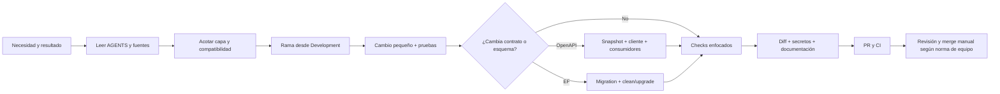

# Guía de desarrollo de ELEVANT

Esta sección explica cómo pasar de una necesidad acotada a un pull request
revisable sin romper las fronteras del monorepo. Cubre preparación, cambios,
validación y handoff en el checkout local. No sustituye los workflows de CI ni
autoriza publicar artefactos, operar Dokploy, mutar el VPS o fusionar una rama.

> [!IMPORTANT]
> ELEVANT tiene una API y una base lógica por ambiente. Private Web, Public Web
> y Mobile Agent son consumidores independientes; nunca se crea un backend o
> una base por cliente y ningún cliente accede directamente a SQL Server o a un
> proveedor de aviación.

## Rutas de lectura

| Necesidad | Nota |
| --- | --- |
| Preparar una estación de trabajo | [Preparación del entorno local](preparacion-del-entorno-local.md) |
| Encontrar el comando correcto | [Comandos locales por subárbol](comandos-locales-por-subarbol.md) |
| Crear rama y preparar el PR | [Flujo de rama y pull request](flujo-de-rama-y-pull-request.md) |
| Cambiar frontend, API, DB o varias capas | [Cambio seguro por tipo](cambio-seguro-por-tipo.md) |
| Cambiar un endpoint o cliente generado | [OpenAPI y cliente compartido](openapi-y-cliente-compartido.md) |
| Crear/aplicar una migración o trabajar con datos | [Migraciones y datos](migraciones-y-datos.md) |
| Saber qué prueba localmente y qué deja a CI | [Pruebas, calidad y frontera con CI](pruebas-calidad-y-frontera-ci.md) |
| Diagnosticar un fallo local | [Depuración local](depuracion-local.md) |
| Cerrar el trabajo y entregarlo | [Definition of Done y handoff](definition-of-done-y-handoff.md) |

## Ciclo de trabajo

Las flechas terminan en revisión humana. Que Git pueda combinar una rama no
significa que compile, que el contrato sea compatible ni que CI vaya a pasar.
Hoy esa revisión es una norma de equipo, no una barrera técnica de GitHub:
la [protección de ramas pendiente](../../.github/BRANCH_PROTECTION.md) permite
a un colaborador con escritura hacer push directo a `Development`. No se debe
interpretar este diagrama como una garantía automática de PR o checks verdes.

## Orden de autoridad durante el desarrollo

1. Código y pruebas ejecutables para comportamiento.
2. Migraciones EF para el esquema.
3. OpenAPI compilado y su snapshot para el contrato HTTP existente.
4. Workflows para los gates que CI ejecuta.
5. `AGENTS.md`, ADR y documentación para límites y decisiones.
6. Prototipos y fixtures únicamente para vocabulario y recorridos.

Si dos capas discrepan, no elijas la interpretación más cómoda. Reduce el
alcance, registra la discrepancia y corrige fuente y comportamiento mediante el
PR autorizado.

## Primeros diez minutos de una tarea

1. Ejecuta `git status --short --branch` y no pises cambios ajenos.
2. Lee el `AGENTS.md` raíz y el más cercano a cada ruta afectada.
3. Abre el README y el manifiesto del subárbol.
4. Decide si cambia comportamiento, OpenAPI, esquema, configuración o solo UX.
5. Elige checks antes de escribir código.
6. Anota qué queda deliberadamente fuera y si el cambio exige coordinación.

## Frontera de esta sección

- **Aquí:** checkout local, dependencias, ramas, pruebas, build, OpenAPI,
  migraciones, datos sintéticos, diagnóstico y PR.
- **En CI:** entornos efímeros, SQL Server 2022 de certificación, validación de
  imágenes y gates del proveedor Git.
- **Fuera de este alcance:** publicación, promoción pull-based, schedules,
  Dokploy, firewall, Tailscale y recuperación del VPS.

Fuentes principales: [guía raíz](../../AGENTS.md),
[contribución](../../CONTRIBUTING.md),
[desarrollo local](../../docs/workflows/local-development.md),
[flujo Git](../../docs/workflows/git-workflow.md) y
[pull requests](../../docs/workflows/pull-requests.md).
