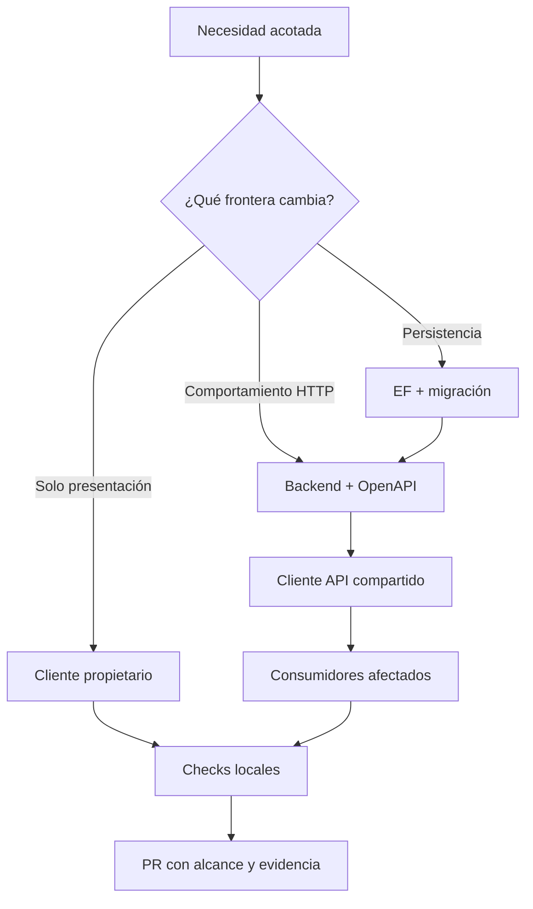

# Cambio seguro por tipo

El tamaño del diff no determina el riesgo. Un cambio pequeño en el contrato
HTTP, el modelo EF o la configuración pública puede afectar a varios
consumidores. Primero clasifica el cambio y después valida su frontera.

## Mapa de decisión

| Si se modifica | Fuente autoritativa | Impacto que se debe revisar |
| --- | --- | --- |
| UI o flujo de un cliente | código y pruebas de ese cliente | estados visibles, accesibilidad, adapter y contrato consumido |
| endpoint o regla de negocio | `backend` y OpenAPI compilado | capas API/Application/Domain, errores, autorización y tres clientes |
| entidad o persistencia | mappings y migraciones de `DevelopmentDB` | upgrade, instalación limpia, seed y compatibilidad con API |
| tipos/operaciones compartidas | snapshot y `packages/api-client` | Private Web, Public Web y Mobile Agent |
| comportamiento durable transversal | todas las fuentes anteriores | secuencia expand/contract, documentación y plan de retirada |



## Frontend: cambio dentro del cliente propietario

1. Lee el `AGENTS.md`, README y `package.json` más cercanos.
2. Conserva la frontera: el cliente habla con la API; nunca con SQL Server ni
   con proveedores de aviación directamente.
3. Separa transporte, adaptación y presentación. Los mocks del prototipo son
   ejemplos descartables, no contratos de persistencia.
4. Modela al menos carga, vacío, éxito, error y reintento. Mobile además debe
   tratar conectividad intermitente sin inventar confirmaciones del servidor.
5. Inyecta el origen de API por configuración. No codifiques un host, token o
   tenant en el fuente.
6. En Public Web, consulta primero la documentación de Next instalada bajo
   `frontend/public-web/node_modules/next/dist/docs/` para la API o patrón que
   vayas a usar.
7. Ejecuta el bloque del cliente en
   [Comandos locales por subárbol](comandos-locales-por-subarbol.md).

Si cambia una operación, tipo o error HTTP, ya no es un cambio “solo
frontend”: activa el circuito OpenAPI.

## API: vertical slice sin filtrar persistencia

Respeta las referencias actuales entre proyectos:

```text
Elevant.Api -> Elevant.Application -> Elevant.Domain
            -> Elevant.Contracts
            -> Elevant.Infrastructure -> Elevant.Application + Elevant.Domain
            -> Elevant.Persistence -> Elevant.Domain
```

`Elevant.Persistence` posee EF y actualmente no referencia `Elevant.Application`
ni implementa un puerto de persistencia definido allí. La API compone estas
capas; el patrón de puertos para operaciones de negocio nuevas es una decisión
de diseño a concretar, no una capacidad ya implementada.

Para una operación de negocio:

1. define intención y reglas en Application/Domain;
2. define la abstracción necesaria y su implementación sin invertir las
   referencias permitidas; si requiere un puerto nuevo de persistencia en
   Application, revisa primero el grafo y sus pruebas de arquitectura;
3. expón DTOs de `Elevant.Contracts`, nunca entidades EF;
4. devuelve errores coherentes mediante Problem Details;
5. aplica autenticación, tenant y autorización en la frontera correcta;
6. añade pruebas del comportamiento y de casos negativos;
7. compila el OpenAPI real y revisa compatibilidad antes de regenerar el
   cliente compartido.

Una modificación de API no autoriza agregar una migración desde el proyecto
API ni duplicar DbContexts dentro de `backend`.

## Base de datos: una historia EF revisable

1. Modifica entidades/mappings en
   `database/DevelopmentDB/Elevant.Persistence`.
2. Genera la migración solo con el script del repositorio.
3. Revisa operaciones, nombres, constraints, índices y el snapshot completo.
4. Prefiere cambios aditivos y compatibles. No reescribas migraciones ya
   compartidas, no introduzcas cascadas implícitas y no escondas DML de negocio
   en `Up`/`Down`.
5. Comprueba instalación limpia y upgrade con la infraestructura local; CI es
   quien certifica además idempotencia y las variantes Compose de entrega.
6. Actualiza documentación durable si cambió esquema o semántica.

El seed de Development debe seguir sintético, determinista e idempotente. Un
cambio de tabla no autoriza implementar endpoints o pantallas fuera del alcance.

## Cambio coordinado: expandir antes de contraer

Un cambio incompatible no debe aterrizar como un único salto. La secuencia de
desarrollo segura es:

1. **Expandir datos:** agregar columnas/tablas/constraints compatibles.
2. **Expandir API:** aceptar la forma anterior y la nueva cuando sea necesario.
3. **Actualizar contrato:** compilar snapshot, regenerar cliente y probar los
   tres consumidores.
4. **Migrar consumidores/datos:** observar que ya no dependen de la forma vieja.
5. **Contraer después:** retirar la compatibilidad en otro cambio con evidencia.

Esto define dependencias y PRs; no es una instrucción de despliegue. La
publicación y promoción pertenecen al carril de release.

## Señales para detenerse y escalar

Detén la implementación y registra una decisión si:

- el requisito obliga a romper simultáneamente consumidores activos;
- no está claro qué equipo o subárbol posee el dato;
- se necesitaría una credencial real o un endpoint privado para probar;
- el cambio propone una segunda API/base por cliente;
- solo funciona reescribiendo historia de migraciones o borrando datos;
- afecta Production o el VPS sin autorización explícita.

Continúa con [OpenAPI y cliente compartido](openapi-y-cliente-compartido.md),
[Migraciones y datos](migraciones-y-datos.md) y la
[Definition of Done](definition-of-done-y-handoff.md).
