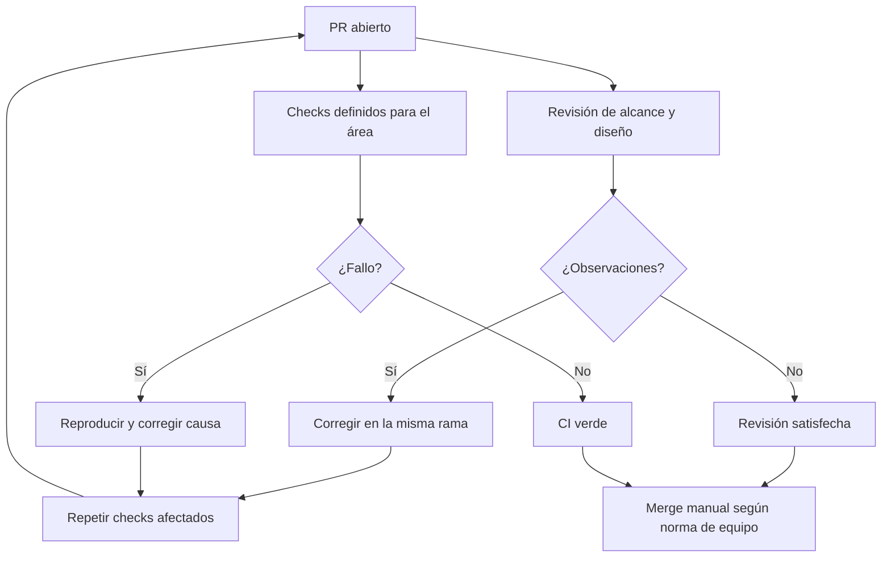

# Flujo de rama y pull request

`Development` es la rama de integración. `main` representa la frontera de
Production. Por norma de equipo, el trabajo ordinario parte de `Development`,
vive en una rama acotada y se fusiona mediante revisión manual. Esto todavía
no está impuesto por branch protection: el
[estado de protección](../../.github/BRANCH_PROTECTION.md) documenta que un
colaborador con escritura puede hacer push directo a `Development`, incluso
iniciar una promoción automática si cambia artefactos de base y CI pasa.

## 1. Proteger el trabajo existente

```powershell
git status --short --branch
git diff --stat
git diff
```

Si aparecen cambios que no son tuyos, no los limpies, muevas ni incluyas. Si se
solapan con tu tarea, detente y coordina. Esta guía deliberadamente no propone
`reset --hard`, checkout destructivo ni force-push.

## 2. Crear una rama actualizada

Con el árbol limpio y sin trabajo compartido pendiente:

```powershell
git fetch origin
git switch Development
git pull --ff-only origin Development
git switch -c feature/descripcion-corta
```

Usa `fix/descripcion-corta` para una corrección y reserva `hotfix/*` para un
incidente originado desde Production con proceso explícito. No crees ramas
permanentes por persona ni reescribas una rama compartida sin coordinación.

## 3. Mantener alcance y commits revisables

- Un PR resuelve un problema coherente y declara qué deja fuera.
- No mezcles un refactor amplio con una corrección funcional.
- Añade tests junto al comportamiento que protegen.
- Un cambio durable actualiza README, contrato, migración o Vault pertinente.
- Un commit debe ser coherente y compilable cuando sea posible.
- Los generados se incluyen solo cuando su política los versiona y son
  reproducibles desde su entrada.

Revisa con frecuencia:

```powershell
git status --short
git diff --check
git diff --stat
git diff -- <ruta-afectada>
```

## 4. Preparar exactamente lo que se entregará

```powershell
git add -- <ruta-1> <ruta-2>
git diff --cached --check
git diff --cached --stat
git diff --cached
```

Prefiere rutas explícitas frente a `git add .`. Si el diff staged contiene un
`.env`, credencial, PII, output de build, base, backup o cambio ajeno, retíralo
de la propuesta antes de crear el commit mediante una acción no destructiva y
revisa nuevamente el estado.

Después de validar:

```powershell
git commit -m "tipo(area): describir intención"
git push -u origin HEAD
```

El push crea una rama remota; no fusiona ni despliega.

## 5. Completar el PR

La [plantilla de PR](../../.github/pull_request_template.md) y la
[guía de revisión](../../docs/workflows/pull-requests.md), en conjunto, piden
documentar según el alcance:

1. problema, resultado y alcance;
2. carpeta afectada y elementos excluidos;
3. comandos ejecutados con resultado;
4. cambio o ausencia de cambio en OpenAPI;
5. cambio o ausencia de cambio en base de datos;
6. nombres y propósito de variables, nunca valores;
7. impacto durable en el Vault o explicación de por qué no aplica;
8. evidencia visual con datos ficticios cuando cambia UI;
9. riesgo, compatibilidad y recuperación proporcional al cambio;
10. confirmación de seguridad y ausencia de secretos.

No pegues logs crudos. Conserva solo el fragmento saneado que prueba el gate y
elimina rutas privadas, identidades, tokens, payloads y valores de configuración.

## 6. Responder a revisión y CI



El diagrama expresa el proceso esperado, no un bloqueo automático: en el
repositorio privado actual los checks no están configurados como requisitos
de branch protection. Quien tenga escritura debe abstenerse de hacer push
directo, y revisar explícitamente CI y aprobación antes del merge.

Un PR sin conflictos solo prueba que Git puede combinar texto. Un check fallido
se corrige por su causa; no se reintenta a ciegas ni se edita un ambiente para
hacerlo pasar.

## 7. Handoff antes del merge

Comprueba que el último commit corresponde al diff revisado y entrega:

- SHA de la rama y rutas modificadas;
- checks locales y resultados;
- checks que solo CI puede cubrir;
- contrato/esquema y consumidores afectados;
- deuda o decisión pendiente;
- declaración explícita: no fusionado y no desplegado, salvo autorización
  distinta y registrada.

Relacionados: [Definition of Done](definition-of-done-y-handoff.md),
[flujo Git fuente](../../docs/workflows/git-workflow.md) y
[guía de PR](../../docs/workflows/pull-requests.md).
