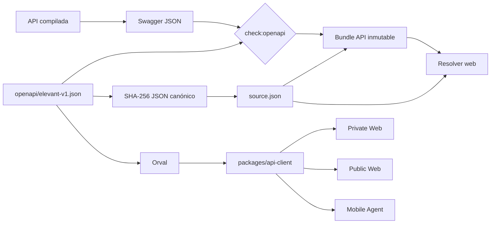

# OpenAPI y cliente compartido

OpenAPI es el contrato cliente/servidor cuando una operación existe. El
snapshot canónico se revisa desde el host API compilado que se propone
versionar; CI exige después que la imagen API inmutable del mismo commit lo
reproduzca exactamente. No procede de un servidor mutable ni se confía en una
especificación desconectada del código. Ese snapshot alimenta el cliente
TypeScript común de Private Web, Public Web y Mobile Agent.



`check:openapi` solo compara el Swagger candidato con el snapshot versionado;
no lo crea ni lo reescribe. La imagen certificada vuelve a servir ese contrato,
y su bundle queda unido a la misma huella sin obligar a un segundo commit de
reconciliación.

## Autoridad y superficie actual

- El código compilado de la API es la autoridad para el documento real.
- `packages/api-client/openapi/elevant-v1.json` es el snapshot revisado.
- `packages/api-client/generated` es generado: nunca se edita a mano.
- `packages/api-client/openapi/source.json` es un descriptor cerrado con
  `schemaVersion`, `openApiSha256` y la ruta Swagger exacta; no intenta nombrar
  una imagen o ejecución que todavía no existe.
- Commit, run e imagen pertenecen al manifiesto OCI inmutable de cada release;
  el bundle API lleva además la etiqueta OCI
  `io.elevant.api-release.openapi-sha256`.
- health, readiness y Swagger son endpoints de plataforma, no operaciones de
  negocio del cliente generado.
- El snapshot actual es deliberadamente pequeño; no documentes un endpoint de
  prototipo como implementado solo porque aparece en una UI o fixture.

## Cuándo activar el circuito

Actívalo si cambia cualquiera de estos elementos:

- ruta, método, status code o formato de error;
- request/response, nulabilidad, enum o paginación;
- seguridad o headers observables;
- operación o tipo usado por un consumidor.

Un refactor interno que conserve el documento compilado no requiere regenerar
el cliente, pero debe demostrar que `check:openapi` sigue exacto. Si cambia un
input que produce API, CI crea una release API exacta nueva y recertifica ambas
webs aunque la huella OpenAPI permanezca igual.

## Bucle local reproducible

Instala primero el paquete con Node 24 como línea base común:

```powershell
npm --prefix packages/api-client ci
```

Con la API local saludable, compara el contrato servido sin imprimir ninguna
variable de entorno. Este paso detecta drift; no autoriza reemplazar el
snapshot canónico con la salida local:

```powershell
npm --prefix packages/api-client run check:openapi -- `
  http://127.0.0.1:8080/swagger/v1/swagger.json
```

Una vez revisado el Swagger del host compilado, actualiza juntos el snapshot y
la huella declarada en `source.json`; después regenera:

```powershell
npm --prefix packages/api-client run generate
npm --prefix packages/api-client run check
git diff -- packages/api-client/openapi packages/api-client/generated
```

La generación debe producir un diff explicable tanto en snapshot como en
tipos/operaciones. Un diff sorpresivo se investiga; no se normaliza editando el
archivo generado.

## Descriptor, fingerprint y procedencia

El descriptor v1 tiene exactamente tres propiedades. La huella se calcula
ordenando recursivamente las claves de objetos, conservando el orden de arrays
y serializando sin espacios antes de aplicar SHA-256 a los bytes UTF-8. Los
enteros fuera del rango seguro de JavaScript fallan cerrado para que una pérdida
de precisión no una dos contratos distintos.

Backend CI exige igualdad entre descriptor, snapshot y Swagger de la imagen
certificada. Web CI añade la etiqueta del bundle API como tercera prueba y obtiene
la procedencia exacta desde el manifiesto inmutable, no desde `source.json`. El
resolver también comprueba que el commit declarado sea el `HEAD` examinado y que
no exista un cambio de input API pendiente entre la release seleccionada y ese
checkout.

La huella demuestra igualdad del JSON canónico. No demuestra compatibilidad
semántica, calidad del diseño ni constituye una atestación criptográfica
externa; esas conclusiones requieren revisión y pruebas adicionales.

## Validar los tres seams

Después del paquete compartido, valida los consumidores afectados:

```powershell
npm --prefix frontend/private-web ci
npm --prefix frontend/private-web test

npm --prefix frontend/public-web ci
npm --prefix frontend/public-web run lint
npm --prefix frontend/public-web run typecheck
npm --prefix frontend/public-web test

npm --prefix frontend/mobile-agent ci
npm --prefix frontend/mobile-agent run lint
npm --prefix frontend/mobile-agent run typecheck
npm --prefix frontend/mobile-agent run test:api-client-bundle
```

Esos bloques comprueban que el paquete se consume y, en Mobile, que Metro lo
puede empaquetar. No sustituyen pruebas funcionales de cada nueva operación.

## Compatibilidad que se revisa en el PR

| Cambio propuesto | Tratamiento seguro |
| --- | --- |
| campo response nuevo y opcional | aditivo; regenerar y probar consumidores |
| request acepta forma nueva | mantener forma previa durante transición |
| enum agrega valor | clientes deben tolerar el valor antes de recibirlo |
| campo pasa a requerido | potencialmente rompedor; secuencia expand/contract |
| rename/eliminación de ruta o campo | no hacerlo en un solo PR coordinado |
| error cambia de forma | tratar como contrato observable, no detalle interno |

## Qué agrega CI

El workflow de API client reconstruye una API del mismo commit, obtiene su
Swagger local y compara el snapshot; también ejecuta las costuras de los
consumidores. Backend CI repite la igualdad antes de publicar API y Web CI
resuelve la release compatible antes de construir y nuevamente antes de
publicar. CI no consulta el Swagger privado de Development ni convierte un
origen remoto mutable en autoridad del PR.

El origen de API de cada cliente llega por configuración pública. Usa loopback
en local o un dominio reservado como `https://api.elevant.test` al probar
validadores; nunca copies dominios internos, tokens o credenciales al Vault.

Consulta también [Cambio seguro por tipo](cambio-seguro-por-tipo.md),
[comandos exactos](comandos-locales-por-subarbol.md) y el
[contrato fuente](../../docs/api/openapi-contract.md).
