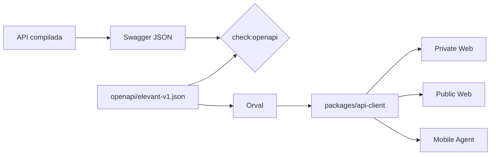

# OpenAPI y cliente compartido

OpenAPI es el contrato cliente/servidor cuando una operación existe. El
snapshot canónico procede de la imagen API inmutable y certificada del mismo
commit, no de una especificación escrita a mano ni de un servidor mutable. Ese
snapshot alimenta el cliente TypeScript común de Private Web, Public Web y
Mobile Agent.



`check:openapi` solo compara el Swagger candidato con el snapshot versionado;
no lo crea ni lo reescribe. La captura aprobada desde la imagen certificada es
un paso separado anterior a Orval.

## Autoridad y superficie actual

- El código compilado de la API es la autoridad para el documento real.
- `packages/api-client/openapi/elevant-v1.json` es el snapshot revisado.
- `packages/api-client/generated` es generado: nunca se edita a mano.
- `packages/api-client/openapi/source.json` registra commit, ejecución e imagen
  inmutable de procedencia sin guardar una URL operativa.
- health, readiness y Swagger son endpoints de plataforma, no operaciones de
  negocio del cliente generado.
- El snapshot actual es deliberadamente pequeño; no documentes un endpoint de
  prototipo como implementado solo porque aparece en una UI o fixture.

## Cuándo activar el circuito

Actívalo si cambia cualquiera de estos elementos:

- ruta, método, status code o formato de error;
- request/response, nulabilidad, enum o paginación;
- seguridad o headers observables;
- operación o tipo usado por un consumidor.

Un refactor interno que conserve el documento compilado no requiere regenerar,
pero sí debe demostrar que `check:openapi` sigue exacto.

## Bucle local reproducible

Instala primero el paquete con Node 24 como línea base común:

```powershell
npm --prefix packages/api-client ci
```

Con la API local saludable, compara el contrato servido sin imprimir ninguna
variable de entorno. Este paso detecta drift; no autoriza reemplazar el
snapshot canónico con la salida local:

```powershell
npm --prefix packages/api-client run check:openapi -- `
  http://127.0.0.1:8080/swagger/v1/swagger.json
```

Una vez que el proceso de contrato haya capturado el Swagger desde la imagen
certificada exacta y actualizado `source.json`, regenera:

```powershell
npm --prefix packages/api-client run generate
npm --prefix packages/api-client run check
git diff -- packages/api-client/openapi packages/api-client/generated
```

La generación debe producir un diff explicable tanto en snapshot como en
tipos/operaciones. Un diff sorpresivo se investiga; no se normaliza editando el
archivo generado.

## Validar los tres seams

Después del paquete compartido, valida los consumidores afectados:

```powershell
npm --prefix frontend/private-web ci
npm --prefix frontend/private-web test

npm --prefix frontend/public-web ci
npm --prefix frontend/public-web run lint
npm --prefix frontend/public-web run typecheck
npm --prefix frontend/public-web test

npm --prefix frontend/mobile-agent ci
npm --prefix frontend/mobile-agent run lint
npm --prefix frontend/mobile-agent run typecheck
npm --prefix frontend/mobile-agent run test:api-client-bundle
```

Esos bloques comprueban que el paquete se consume y, en Mobile, que Metro lo
puede empaquetar. No sustituyen pruebas funcionales de cada nueva operación.

## Compatibilidad que se revisa en el PR

| Cambio propuesto | Tratamiento seguro |
| --- | --- |
| campo response nuevo y opcional | aditivo; regenerar y probar consumidores |
| request acepta forma nueva | mantener forma previa durante transición |
| enum agrega valor | clientes deben tolerar el valor antes de recibirlo |
| campo pasa a requerido | potencialmente rompedor; secuencia expand/contract |
| rename/eliminación de ruta o campo | no hacerlo en un solo PR coordinado |
| error cambia de forma | tratar como contrato observable, no detalle interno |

## Qué agrega CI

El workflow de API client reconstruye una API del mismo commit, obtiene su
Swagger local y compara el snapshot; también ejecuta las costuras de los
consumidores. CI no consulta el Swagger privado de Development y no convierte
un origen remoto mutable en autoridad del PR.

El origen de API de cada cliente llega por configuración pública. Usa loopback
en local o un dominio reservado como `https://api.elevant.test` al probar
validadores; nunca copies dominios internos, tokens o credenciales al Vault.

Consulta también [Cambio seguro por tipo](cambio-seguro-por-tipo.md),
[comandos exactos](comandos-locales-por-subarbol.md) y el
[contrato fuente](../../docs/api/openapi-contract.md).
