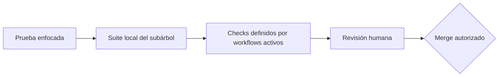

# Pruebas, calidad y frontera con CI

Los checks locales dan retroalimentación temprana; CI repite y amplía la
evidencia en un entorno limpio. Que un PR no tenga conflictos solo significa
que Git puede combinar texto: no demuestra compilación, contratos, seguridad
ni comportamiento.

## Tres niveles de confianza

1. **Enfocado:** prueba el caso modificado durante la iteración.
2. **Local completo:** ejecuta las suites del dueño y de sus consumidores.
3. **CI + review:** reconstruye desde locks, agrega certificación y valida el
   diff y las decisiones. Ningún nivel sustituye al siguiente.

## Matriz local por frontera

| Frontera | Checks locales mínimos |
| --- | --- |
| Backend | locked restore, build Release, test Release |
| Modelo EF | backend anterior + `has-pending-model-changes` + tooling DB |
| API client | `npm ci`, `generate`, `check` y `check:openapi` contra API local |
| Private Web | `npm ci`, `test`, `test:delivery`, validator y build configurado; *posterior al commit verificado (PR M2):* `test:visual` antes de mergear un cambio de mapas ([suite visual](#suite-visual-de-los-mapas-del-occ)) |
| Public Web local | `npm ci`, lint, typecheck, test y build configurado; el validator de release requiere metadatos y orígenes distintos del ejemplo local |
| Mobile Agent | `npm ci`, lint, typecheck, bundle seam del API client y export Android completo con Metro |
| Vault | secret scan, `vault:test`, `vault:generate`, `vault:check` |

Los comandos copiables están en
[Comandos locales por subárbol](comandos-locales-por-subarbol.md). Para un
cambio transversal se usa la unión de sus filas, no solo la suite más rápida.

## Recorrido E2E del ciclo completo

Posterior al commit verificado de esta nota: esta sección describe el código de
la fase 1 del ciclo (`8a79fe70`), que esa verificación no cubre.

Además de las suites de cada subárbol, Public Web tiene un recorrido de
Playwright que atraviesa el ciclo operativo completo contra el stack local real
([configuración](../../frontend/public-web/playwright.cycle.config.ts),
[pruebas de la fase 1](../../frontend/public-web/tests/e2e-cycle/fase1-comercial.spec.ts)
y [ADR-0037](../../docs/adr/0037-commercial-cycle-requests-drafts-amendments-and-portal-accounts.md)).

- **Qué recorre.** Cuatro proyectos encadenados, uno por fase: comercial,
  pre-operación, operación y facturación. Cada corrida crea su propia aerolínea
  sintética, y cada fase continúa la corrida que dejó la anterior.
- **Qué necesita.** El stack local de `database/DevelopmentDB` con el overlay
  de Compose para E2E, que suma almacenamiento S3 local, el CORS de los puertos
  del arnés y límites de uso altos. También Mailpit, de donde lee los enlaces y
  códigos del portal, Google Chrome, y `E2E_CYCLE_ENV_FILE` apuntando al `.env`
  del stack, del que toma las credenciales sembradas sin imprimirlas.
- **Cómo corre.** `npm run test:e2e:cycle`, desde `frontend/public-web`, levanta
  public-web y private-web en modo desarrollo y reenvía el nombre HTTPS de la
  API a la API local. El estado de la corrida y las capturas quedan fuera del
  repositorio, sin trazas ni reporte HTML. Los pasos exactos están en la
  [guía de desarrollo local](../../docs/workflows/local-development.md#recorrido-e2e-del-ciclo-completo)
  y en el [README de Public Web](../../frontend/public-web/README.md).
- **Qué no es.** Ningún workflow de CI lo ejecuta. En ese corte, los huecos
  todavía abiertos figuraban como `test.fixme("hueco …")`; el estado vigente
  está en la fase 4, abajo. Una corrida verde es evidencia local: no reemplaza
  CI ni prueba un despliegue.

Desde la fase 2 del ciclo (código de `50e7778f`, también posterior al commit
verificado;
[ADR-0038](../../docs/adr/0038-preoperation-contract-lifecycle-permits-master-data-and-workforce-readiness.md)):

- **Feed simulado.** El mismo overlay activa el proveedor de vuelos simulado
  (`SimulatedFlightFeed__Enabled`), que nunca llama a AeroDataBox ni a la red.
  La API se niega a arrancar si el `.env` también activa AeroDataBox, y con
  `ELEVANT_E2E_SIMULATED_FLIGHT_FEED=false` el overlay no lo activa.
- **Pasos de la fase 2.** Los huecos de la fase 2 ya son pruebas reales
  ([pruebas de la fase 2](../../frontend/public-web/tests/e2e-cycle/fase2-preoperacion.spec.ts)).
  El paso que importa vuelos se salta si la API no usa el proveedor simulado,
  para no gastar nunca unidades de pago. En ese corte, las fases 3 y 4 todavía
  tenían pasos `test.fixme`.

Desde la fase 3 del ciclo (código de `f2d5c52c`, también posterior al commit
verificado;
[ADR-0039](../../docs/adr/0039-operation-planning-coverage-offline-tablet-occ-review-and-reports.md)):

- **Pasos de la fase 3.** Ya no queda ningún `test.fixme` en las
  [pruebas de la fase 3](../../frontend/public-web/tests/e2e-cycle/fase3-operacion.spec.ts):
  los pasos de los huecos 3-A a 3-K son pruebas reales, y un paso final
  comprueba los reportes de OCC y de Gestión Humana. En ese corte, solo la
  fase 4 conservaba pasos `test.fixme` (ver abajo).
- **Franja horaria.** El recorrido corre entre las 08:30 y las 22:30 de la hora
  local, porque la fase 2 elige la plantilla de turno del agente sintético que
  cubre el vuelo de la corrida. Los pasos de la fase 3 que necesitan otra
  ventana libre en ese turno se saltan con su motivo cuando ya no queda, y el
  que reabre la aprobación se salta si la operación del ciclo ya está en una
  prefactura.
- **Corrida registrada.** El 8 de noviembre de 2026 las fases 1 a 3 pasaron
  enteras contra el stack local recreado con la rama completa: 52 de 52
  pasos (14, 18 y 20). Varias corridas el mismo día agotan las ventanas libres
  del agente sintético. Para una corrida limpia se recrea el stack (`down -v`)
  y se aparta `passwords.json` del estado del arnés, porque el seed vuelve a
  las contraseñas iniciales.

Desde la fase 4 del ciclo (código de `39a85a46`, el paso 4-B y el retiro del
último `test.fixme` de `9ae53481`, el ajuste del paso de cuentas por pagar de
`c3d86d0f`, la revisión del bloque A de `8b61f567`, la del bloque D de
`9335e657` y la del bloque E de `8450f65d`, también posteriores al commit
verificado;
[ADR-0035](../../docs/adr/0035-direct-invoicing-simulated-ecf.md),
[ADR-0036](../../docs/adr/0036-simulated-card-payment.md) y
[ADR-0040](../../docs/adr/0040-billing-cycle-invoicing-from-operations-card-collections-credit-notes-and-payables.md)):

- **Pasos de la fase 4.** Ya no queda ningún `test.fixme` en las
  [pruebas de la fase 4](../../frontend/public-web/tests/e2e-cycle/fase4-facturacion.spec.ts):
  la emisión, el pago con tarjeta, la nota de crédito, el estado de cuenta, los
  reportes, el menú de Finanzas, las cuentas por pagar y los gastos son pruebas
  reales. Dos pasos se saltan con su motivo cuando la corrida no dejó lo que
  necesitan: el estado de cuenta del portal, si no se emitió la nota de
  crédito, y el charter, mientras la corrida de la fase 3 no deje un charter
  facturado; las pruebas SQL cubren el charter (4-N08 y 4-N22). El paso de
  cuentas por pagar anula desde «Pagos del proveedor» de una factura anulada un
  pago con remanente que bloqueaba el retiro del proveedor
  (`supplier_has_open_balance`), y después lo retira. El último paso
  comprueba, sin navegador, que el Vault describe el ciclo como el código: cada
  operación que cita el mapa de capacidades existe en el snapshot y ninguna
  nota vigente describe la API como vacía ni da por inexistentes la
  autenticación, las rutas de negocio, el tiempo real o el almacenamiento
  privado. La puerta real de esa regla es `npm run vault:ci`.
- **Pasarela simulada.** El mismo overlay activa `CardPayments__Mode=Simulated`:
  las tarjetas de prueba se aprueban o rechazan en memoria, sin red.
- **Reapertura en la fase 3.** El paso que reabre la aprobación se salta si la
  operación del ciclo ya se facturó o si la retiene un borrador con factura
  emitida (`pending_preinvoice`): su corrección es una nota de crédito.
- **Corrida registrada.** El 11 de noviembre de 2026 las fases 1 a 4 pasaron
  contra el stack local recreado con la rama completa: 63 de 64 pasos
  en verde (14, 18, 20 y 11) y uno saltado por diseño, el del charter, en
  7,2 minutos.

Desde el vuelo demo (PR A1 del plan «OCC a nivel NOC», código de `cba00f73`,
también posterior al commit verificado;
[ADR-0041](../../docs/adr/0041-demo-flights-and-punta-cana-stands.md)):

- **Proyecto `demo`.** Un quinto proyecto del arnés, sin dependencias, que corre
  con los demás o aparte (`--project=demo`)
  ([prueba](../../frontend/public-web/tests/e2e-cycle/demo-vuelo.spec.ts) y
  [ayudantes de operación](../../frontend/public-web/tests/e2e-cycle/support/operations.ts)).
  Superadministración dispara un vuelo demo de la aerolínea sembrada «Demo
  Airlines» hacia una posición libre de la Terminal A; OCC lo ve con «Demo» y
  con la posición preseleccionada en «Importar vuelos», lo importa sin pulsar
  «Actualizar ahora» y se lo asigna al agente sembrado, programando o ampliando
  su turno del día si hace falta; la API marca el aterrizaje, la tablet
  registra `BLOCK_ON` y `PUSHBACK`, la API marca el despegue y la lista de
  Superadministración sigue cada fase; un segundo vuelo se cancela antes de
  tocar pista y sale de los vuelos propuestos. En ese corte, al final el agente
  entregaba la operación sin servicios y OCC liberaba la posición, que el
  push-back todavía no liberaba (ver el PR A2, abajo).
- **Corrida local.** El 13 de noviembre de 2026, antes de mergear el PR A1
  (#176), el proyecto pasó 6 de 6 en 8,9 minutos contra el stack
  `elevant-ciclo` recreado desde cero; las fases 1 a 4 pasaron igual. Es
  evidencia local, no de un despliegue, y ningún workflow de CI lo corre.
- **Pruebas automáticas.** Unitarias del reloj, las reglas, la numeración, los
  aeropuertos, la regla de códigos de posición (con un archivo de casos que
  leen también las pruebas de JavaScript), el manejador y la configuración; de
  la API (endpoints y worker) y de arquitectura; 16 pruebas SQL del almacén
  ([pruebas SQL](../../backend/tests/Elevant.IntegrationTests/Persistence/SqlServerMigrationTests.DemoFlights.cs));
  del cliente compartido, y de private-web: panel, estado, servicio, diálogo de
  importación y etiquetas «Demo».

Desde las posiciones de Punta Cana (PR A2 del mismo plan, código de `d6461fa1`
a `ff066d47`, también posterior al commit verificado;
[ADR-0041](../../docs/adr/0041-demo-flights-and-punta-cana-stands.md)):

- **Proyecto `demo`.** Antes de disparar, Superadministración carga las
  posiciones de Punta Cana desde su tarjeta, y OCC cubre por la API una posición
  de la Terminal A con el agente sembrado: si el agente no tiene turno ese día,
  Gestión Humana le programa la plantilla que cubre la hora actual, y si lo tiene
  pero no alcanza, lo amplía. El vuelo se dispara con «Al azar»: la prueba
  comprueba que el servidor sortea la posición cubierta, la única elegible, y que
  «Importar vuelos» la preselecciona. Tras el `PUSHBACK`, el tablero de
  posiciones la da libre mientras Planificación y la tablet la siguen nombrando.
  La limpieza ya no pulsa «Liberar»: el agente entrega la operación y OCC libera
  la cobertura que creó la prueba.
- **Corrida local.** El 13 de noviembre de 2026, antes de mergear el PR A2, el
  proyecto pasó 8 de 8 en 8,9 minutos contra el stack `elevant-ciclo`
  reconstruido desde cero con esa rama. Es evidencia local, no de un despliegue,
  y ningún workflow de CI lo corre.
- **Pruebas automáticas.** Unitarias del catálogo, el plan de la carga, el
  sorteo, la elegibilidad, el manejador de la carga y la regla del push-back; de
  arquitectura, la paridad del catálogo con el conjunto de datos del mapa, que
  solo corre Backend CI (un cambio solo en private-web corre solo Web clients
  CI, y por eso la prueba del tablero de private-web fija la misma lista de 41
  posiciones con su terminal); de la
  API, la carga y la consulta de las opciones; 8 pruebas SQL de la carga y de las
  posiciones elegibles
  ([carga](../../backend/tests/Elevant.IntegrationTests/Persistence/SqlServerMigrationTests.DemoStation.cs))
  y 8 de la liberación con el push-back, con la tablet real
  ([liberación](../../backend/tests/Elevant.IntegrationTests/Persistence/SqlServerMigrationTests.StandRelease.cs));
  del cliente compartido, y de private-web: panel, tarjeta, motivos y servicio.

Desde la imagen aérea y los vuelos del mapa (PR A3 del mismo plan, código de
`77dff268` a `e098ccde`, también posterior al commit verificado;
[ADR-0042](../../docs/adr/0042-occ-air-picture-and-map-flights.md)):

- **Fixtures sintéticos.** Las respuestas de prueba del adaptador tienen la
  forma real del JSON v2 de readsb, con direcciones, matrículas, *callsign* y
  posiciones inventadas
  ([adsb.fi](../../backend/tests/Elevant.UnitTests/Infrastructure/Fixtures/readsb-adsbfi-point.synthetic.json)
  y [adsb.lol](../../backend/tests/Elevant.UnitTests/Infrastructure/Fixtures/readsb-adsblol-point.synthetic.json));
  el proyecto de pruebas los copia a su salida. Ninguna respuesta real se
  versiona, porque la licencia de adsb.fi no permite redistribuirla. El HTTP se
  simula con un manejador de prueba, y ninguna prueba ni workflow de CI llama a
  adsb.fi o a adsb.lol.
- **Prueba en vivo opcional.**
  [`AirTrafficLiveTests`](../../backend/tests/Elevant.UnitTests/Infrastructure/AirTrafficLiveTests.cs)
  hace una sola lectura de 250 NM alrededor de Punta Cana, sin clave, y solo
  corre con `ELEVANT_LIVE_AIR_TRAFFIC=1`: contra adsb.fi, o contra adsb.lol con
  `ELEVANT_LIVE_AIR_TRAFFIC_PROVIDER=AdsbLol`. Informa cuántos aviones vio,
  nunca la respuesta. Como la de AeroDataBox, CI nunca la activa.
- **La E2E no activa el tráfico.** El overlay del arnés deja apagada la imagen
  aérea salvo que `ELEVANT_E2E_AIR_TRAFFIC_ENABLED` la encienda, así que el
  recorrido nunca lee una red real; la lectura a mano es un paso aparte y
  deliberado ([guía local](../../docs/workflows/local-development.md)). El PR
  no suma pasos al arnés porque no tiene pantallas.
- **Pruebas automáticas.** Unitarias del adaptador y su parser, el relevo, la
  configuración, el servicio de la imagen, las esperas, el emparejamiento, las
  claves y las fases, y los manejadores de las tres lecturas. De la API,
  montando el host sin SQL: el worker y los endpoints, entre ellos que la
  imagen de Development enciende el tráfico y sube el límite a 600. De
  arquitectura: contratos sin `long` y con ids públicos, tres lecturas bajo
  `occ/map` y el worker, que solo depende de Application. Siete pruebas SQL de
  los vuelos del mapa
  ([pruebas SQL](../../backend/tests/Elevant.IntegrationTests/Persistence/SqlServerMigrationTests.MapFlights.cs)),
  y las del cliente compartido.

Desde el clima del aeródromo por la API (PR M8 del mismo plan, código de
`65f9446f` y `eeac6d1e`, también posterior al commit verificado;
[ADR-0043](../../docs/adr/0043-occ-maps-one-engine.md)):

- **Fixtures sintéticos.** Las respuestas de prueba de la fuente tienen la
  forma real de las respuestas `metar` y `taf` de la Data API de
  aviationweather.gov, con valores inventados
  ([METAR](../../backend/tests/Elevant.UnitTests/Infrastructure/Fixtures/awc-metar.synthetic.json)
  y [TAF](../../backend/tests/Elevant.UnitTests/Infrastructure/Fixtures/awc-taf.synthetic.json));
  ninguna respuesta real se versiona. El HTTP se simula con un manejador de
  prueba, y ninguna prueba ni workflow de CI llama a aviationweather.gov.
- **Prueba en vivo opcional.**
  [`AviationWeatherLiveTests`](../../backend/tests/Elevant.UnitTests/Infrastructure/AviationWeatherLiveTests.cs)
  hace una consulta de METAR y una de TAF de Punta Cana (MDPC) y solo corre
  con `ELEVANT_LIVE_AVIATION_WEATHER=1`. Informa conteos y la antigüedad del
  METAR, nunca la respuesta. Como las de AeroDataBox y del tráfico, CI nunca la
  activa.
- **La E2E no enciende el clima.** El overlay del arnés lo deja apagado salvo
  que `ELEVANT_E2E_AVIATION_WEATHER_ENABLED` lo encienda, así que el recorrido
  nunca lee el servicio real; la lectura a mano es un paso aparte y deliberado
  ([guía local](../../docs/workflows/local-development.md)). El PR no suma
  pasos al arnés porque no tiene pantallas.
- **Pruebas automáticas.** Unitarias de la fuente y su parser, las esperas, la
  configuración y el manejador de la lectura. De la API, montando el host sin
  SQL: la validación, los códigos y los títulos, el estado en el 200, el lector
  solo de planificación y la imagen de Development, que enciende el clima. De
  arquitectura: contratos sin `long`, enumeraciones ni ids internos, y una sola
  lectura bajo `occ/weather`. Una prueba SQL del código OACI del aeropuerto de
  la estación
  ([prueba SQL](../../backend/tests/Elevant.IntegrationTests/Persistence/SqlServerMigrationTests.Weather.cs)),
  y las del cliente compartido.

## Suite visual de los mapas del OCC

Posterior al commit verificado de esta nota: esta sección describe el código del
PR M2 «Motor único y estilo NOC» (`c0b20127`), que esa verificación no cubre
([ADR-0043](../../docs/adr/0043-occ-maps-one-engine.md)).

Private Web tiene una suite de Playwright para los mapas del OCC
([configuración](../../frontend/private-web/playwright.occ.config.mjs),
[aislamiento de la red](../../frontend/private-web/tests/visual/support/isolate.mjs)
y [comportamiento del laboratorio](../../frontend/private-web/tests/visual/lab/map-lab.behaviour.spec.mjs)).
Usa la dependencia `playwright` que ya existía; sus pruebas importan de
`playwright/test`.

- **Qué recorre.** Dos proyectos. `lab` abre el laboratorio de mapas
  (`/map-lab`, solo en desarrollo), con escenas fijas, sin sesión ni API. `occ`
  abre las pantallas del OCC con una sesión sintética y la API simulada; hoy,
  Mapa de posiciones
  ([prueba](../../frontend/private-web/tests/visual/occ/positions-map.spec.mjs))
  y, posterior al commit verificado (PR U4, `bcfd6fd7`), la pantalla de
  arranque del OCC sobre Panorama
  ([prueba](../../frontend/private-web/tests/visual/occ/boot-screen.spec.mjs)).
  Desde el PR M6, también posterior, recorre la vista «Mapa» de Planificación
  ([prueba](../../frontend/private-web/tests/visual/occ/planning-map.spec.mjs);
  ver [Cinemática y vuelo demo en los mapas del OCC (PR M6)](#cinemática-y-vuelo-demo-en-los-mapas-del-occ-pr-m6)).
  Y desde el PR U3 recorre también la consola de Panorama
  ([prueba](../../frontend/private-web/tests/visual/occ/console.spec.mjs); ver
  [La consola del OCC (PR U3)](#la-consola-del-occ-pr-u3)).
- **Qué comprueba.** Los botones de vista y las teclas `1` a `4` escriben
  `view=`; un clic en una posición escribe `stand=` y `Esc` lo limpia; la
  leyenda lista solo lo que hay en pantalla, y en Mapa de posiciones es la
  única; sin WebGL aparece la lista de
  respaldo, y se queda, sin lienzo debajo ni errores en la página, cuando un
  contexto WebGL perdido vuelve sin WebGL2; con el mapa base caído aparece su
  aviso. También que los botones de zoom
  y las vistas mueven de verdad la cámara, en `next dev` y en un build de
  producción; que el doble montaje de React Strict Mode deja un solo mapa y la
  página llega a `networkidle`; y que releer las posiciones conserva el mismo
  lienzo. De la pantalla de arranque comprueba que no está en el HTML del
  servidor pero aparece en una sesión nueva, sobre la pantalla de carga; que se
  va como mucho 6 s después del acceso aunque nadie avise; que deja pasar los
  clics desde el primer instante de su salida; que una recarga de la misma
  pestaña no la repite; y que con movimiento reducido solo se mueve la línea de
  progreso.
- **Las demás pantallas del OCC (PR U6).** Posterior al commit verificado, el
  proyecto `occ` recorre también Revisión, Cobertura de posiciones,
  Notificaciones, Chat interno, Datos maestros, Tablets, Contratos listos y
  Reportes, con una prueba por pantalla (por ejemplo, la de
  [Revisión](../../frontend/private-web/tests/visual/occ/review.spec.mjs)).
  Entran como una entrada posterior de la pestaña, sin la pantalla de arranque,
  sobre una API simulada cuyas respuestas sintéticas pasan los validadores
  estrictos del cliente compartido
  ([validación](../../frontend/private-web/tests/visualScreensFixtures.test.js)).
  Fotografían los datos, el vacío, el error o la falta de permiso y los
  diálogos de cada pantalla, a 1440×900 y a 1920×1080, y el chat también a
  1024×768, donde la lista y el hilo se ven de a uno. Corren en los dos temas:
  con `OCC_VISUAL_THEME=light`, los colores que comprueban salen de la paleta
  del tema (`occRgb` en
  [la apertura](../../frontend/private-web/tests/visual/occ/occScreen.mjs)). Ver
  [Resto de pantallas del OCC (PR U6)](../05-aplicaciones/private-web-aviam.md#resto-de-pantallas-del-occ-pr-u6).
- **Sin red.** Cada petición a otro origen se responde desde la suite o se
  aborta, y la prueba falla si una salió hacia un origen que la suite no
  responde. La TileJSON es sintética; las teselas son un mundo inventado
  alrededor de Punta Cana; los glifos `0-255` de los tres Noto Sans son
  fixtures con su licencia SIL OFL 1.1; y la API responde un stub con Problem
  Details. La prueba de la pantalla de arranque también responde el acceso y
  las tres lecturas de Panorama, con datos sintéticos que pasan los validadores
  estrictos del cliente compartido, y, sin salir del equipo, los tres orígenes
  que todavía usa Panorama (los estilos publicados de OpenFreeMap, NASA GIBS e
  IEM), con un estilo vacío, un 404 y un 503. Desde el PR U3, esa prueba
  responde las lecturas de la consola, las mismas de su propia prueba, y de los
  orígenes ajenos solo queda IEM, con un 503; la prueba de la consola responde
  IEM con un METAR sintético. Además, su Chrome no resuelve ningún nombre salvo
  `localhost`.
  Ninguna prueba llama a OpenFreeMap, a la API real ni a un proveedor.
- **Cómo corre.** `npm run test:visual`, desde `frontend/private-web`, levanta
  `next dev` en el puerto 4186 con los tres `NEXT_PUBLIC_*` de Development y
  usa el Google Chrome instalado. Con `OCC_VISUAL_TARGET=production`, después
  de `npm run build`, corre contra el build de producción; allí el laboratorio
  solo comprueba que `/map-lab` responde la página de no encontrada. Los pasos
  exactos están en el [README de Private Web](../../frontend/private-web/README.md)
  y en [Comandos locales por subárbol](comandos-locales-por-subarbol.md#private-web).
- **Capturas.** Una por escena del laboratorio a 1440×900, más la terminal B de
  cerca, la rampa sin mapa base, la rampa a 1920×1080 y Mapa de posiciones, en
  `frontend/private-web/test-results/visual/`, que Git ignora. Desde U4 se
  suman las de la pantalla de arranque: al empezar, mientras espera a Panorama
  y la consola después, a 1440×900 y a 1920×1080, y con movimiento reducido a
  1440×900. Desde U3 se suman las de la consola: al abrir, con los paneles
  plegados y abiertos, con un vuelo y una posición elegidos y sin motor de
  mapa, a 1440×900 y a 1920×1080, una llegada demo antes y después de «Ver y
  seguir», a 1920×1080, y una tira elegida con «Alertas» plegada, a 1440×900.
  La de Mapa de posiciones muestra el mapa sin la pantalla de
  arranque: sus pruebas entran como una entrada posterior de la misma pestaña,
  con la marca de la cuenta ya puesta, y fallan si la pantalla sigue encima
  cuando el mapa ya está listo. Las revisa una persona: no hay líneas base de
  imagen, porque cambian con la máquina y la GPU.
- **Qué no es.** Ningún workflow de CI la ejecuta, y `npm test` no la recoge:
  `vitest.config.mjs` excluye `tests/visual/**`. Se corre antes de mergear un
  cambio de mapas, y una corrida verde es evidencia local, no de un despliegue.
  Lo que sí corre en CI es el build, que termina comprobando que el
  laboratorio no entra en el bundle de producción
  (`PRIVATE_WEB_MAP_LAB_ABSENT_OK`).

## Tráfico real en los mapas del OCC (PR M5)

Posterior al commit verificado de esta nota: esta sección describe el código del
PR M5 «Tráfico real en el mapa» (`48ae657e` a `03dda909`), que esa verificación
no cubre ([ADR-0043](../../docs/adr/0043-occ-maps-one-engine.md)). Las pruebas
de vitest corren con `npm test`; la spec visual, con la suite visual.

- **Presupuesto de un minuto demo.**
  [`useMapSituation.budget.test.jsx`](../../frontend/private-web/src/features/maps/useMapSituation.budget.test.jsx)
  monta el hook real del mapa con el adaptador simulado, que responde cada
  lectura a los 200 ms, y repite con relojes falsos el minuto demo del
  [plan de peticiones](../../frontend/private-web/src/features/admin-occ/live/occRequestPlan.js)
  (ocho `occ_planning`, dos avisos y una revisión). Comprueba que el mapa pide
  6 imágenes aéreas, cada una al menos 10 segundos después de la anterior por
  mucho que se anuncie, como mucho 9 lecturas de vuelos, un ping y ninguna
  estela; y que Monitoreo de vuelos como está hoy (el marco, el observador
  propio de la ruta, sus relecturas y su sondeo), más el mapa, no pasa de las
  70 peticiones de un minuto con vuelo demo. En la corrida del PR sumaron 62.
  Desde CN-18/19 el minuto demo tiene veinte pistas, el observador del marco
  las agrupa (una lectura del cursor cada 10 segundos como mucho) y Monitoreo
  relee con `useOccScreenRefresh`: el tope es 40.
- **Ritmo y estados.**
  [`useMapSituation.test.jsx`](../../frontend/private-web/src/features/maps/useMapSituation.test.jsx)
  comprueba con el mismo adaptador que la imagen se pide con `trails=short` una
  vez y `none` después, nunca más rápido que `refreshAfterSeconds`; que las dos
  lecturas esperan con la pestaña oculta y leen una vez al volver; que los
  vuelos se releen con `occ_planning` como mucho una vez cada 3 segundos, y
  cada 60 si no; que `Disabled`, `Unavailable`, `Stale` y `Warming` son datos y
  no errores; los cinco estados de la vista, con el no autorizado sin ninguna
  petición; que una imagen aérea que falla, o el 404 de una estación sin
  tráfico en vivo, deja el mapa con sus vuelos y la fuente «Sin conexión» o
  «Sin configurar»; que el reloj se alimenta del `serverTime` y del ping; y
  que la estela del avión elegido se lee una sola vez. Las pruebas del
  [reloj](../../frontend/private-web/src/services/serverClock.test.js), del
  [servicio](../../frontend/private-web/src/services/occMapService.test.js),
  del [modelo](../../frontend/private-web/src/features/maps/traffic/situationModel.test.js)
  y de las [estelas](../../frontend/private-web/src/features/maps/traffic/trailStore.test.js)
  prueban cada pieza sola: la muestra de menor ida y vuelta, el 401 que cierra
  la sesión, un vuelo para un avión (también por la clave vieja de una visita
  enlazada con 3-N07), una visita o una escala elegidas que nombran el tramo
  que vuela su avión, el umbral derivado de «sin actualizar», el tráfico
  oculto solo dentro de una posición en la que ya está un avión de AVIAM o
  demo (nunca en la de un vuelo que todavía llega) y las estelas cortadas a
  `max(60 s, 3 × refreshAfterSeconds)`, con sus topes de 600 y 60 puntos.
- **Tráfico sintético.**
  [`trafficFixtures.js`](../../frontend/private-web/src/features/maps/testing/trafficFixtures.js)
  arma, con la forma de las tres lecturas de A3, una imagen aérea, vuelos y
  estelas alrededor de Punta Cana, con direcciones, matrículas, *callsign*,
  aerolínea e identificadores inventados; nada sale de un proveedor. Su
  [prueba](../../frontend/private-web/src/features/maps/testing/trafficFixtures.test.js)
  y la de las
  [escenas del laboratorio](../../frontend/private-web/src/features/maps/lab/trafficScenes.test.js)
  pasan cada respuesta por los validadores estrictos del cliente compartido
  (`isOccAirPicture`, `isOccMapFlights` e `isOccAircraftTrack`), en los cinco
  estados de la imagen y con estelas y sin ellas. El adaptador simulado
  también valida cada respuesta que da, como el cliente valida las de la API.
  Ninguna prueba llama a la API ni a una red de tráfico.
- **Escenas del laboratorio.** Siete escenas nuevas
  ([escenas](../../frontend/private-web/src/features/maps/lab/trafficScenes.js)),
  con la red sintética «Red ADS-B de prueba»: `region-traffic-mixed`,
  `approach-traffic-demo`, `ramp-traffic-ground`,
  `approach-traffic-estimated-stale`, `region-traffic-selected`,
  `approach-traffic-hex-selected` y `region-layers-menu`. En M5 sus posiciones
  estimadas (la llegada demo en final y un vuelo de AVIAM sin señal) se pasaban
  a mano, porque las pantallas no estimaban ninguna; desde M6 las calcula el
  almacén de movimiento, como en las pantallas (ver
  [Cinemática y vuelo demo en los mapas del OCC (PR M6)](#cinemática-y-vuelo-demo-en-los-mapas-del-occ-pr-m6)).
- **Spec visual del tráfico.**
  [`map-lab.traffic.spec.mjs`](../../frontend/private-web/tests/visual/lab/map-lab.traffic.spec.mjs),
  del proyecto `lab` de la [suite visual](#suite-visual-de-los-mapas-del-occ),
  fotografía las siete escenas a 1440×900 y a 1920×1080, y en las cuatro
  primeras comprueba que el crédito de la red está a la vista como enlace y que
  la leyenda lista el tráfico. Comprueba también que la atribución abierta
  nombra la red; que otro avión muestra su etiqueta bajo el puntero; que cada
  vista explica su tráfico («Otro tráfico en tierra» en la rampa; «Demo»,
  «est.» y la estela en la llegada demo, que en M5 tenía además una estela
  estimada pasada a mano) y que la imagen con retraso lo dice; el bloque de
  datos del vuelo elegido y el de otro avión, sin enlaces; desde M6, las cuatro
  partes de la ruta del vuelo elegido en la leyenda; y
  que un clic elige un avión (`hex=` o `flightId=`), `L` abre el menú de capas,
  la primera `Esc` lo cierra y conserva lo elegido, la segunda suelta el vuelo,
  y «Etiquetas de todo el tráfico» sobrevive a una recarga, con
  `elevant-occ-map-layers:v1` vacío al volver al valor por omisión. Como el
  resto de la suite, corre fuera del CI y una persona revisa sus capturas.

## Referencias y meteorología en los mapas del OCC (PR M8)

Posterior al commit verificado de esta nota: esta sección describe el código del
PR M8 (mapas) «Capas aeronáuticas y clima en el mapa» (`1c0f2482` a
`d5e35d68`), que esa verificación no cubre
([ADR-0043](../../docs/adr/0043-occ-maps-one-engine.md)). Las pruebas de vitest
corren con `npm test`; las dos specs visuales, con la suite visual. Ninguna
llama a aviationweather.gov, a Iowa Mesonet ni a NASA GIBS.

- **Clima sintético.**
  [`weatherFixtures.js`](../../frontend/private-web/src/features/maps/testing/weatherFixtures.js)
  arma respuestas de `GET occ/weather` para Punta Cana en los cuatro estados
  (`Live`, `Stale`, `Unavailable` y `Disabled`), con un METAR, un TAF e
  identificadores inventados y el crédito del servicio; su
  [prueba](../../frontend/private-web/src/features/maps/testing/weatherFixtures.test.js)
  pasa cada una por el validador estricto del cliente compartido
  (`isOccAerodromeWeather`). El adaptador simulado del servicio también valida
  cada respuesta que da.
- **Servicio y hook.**
  [`weatherService.test.js`](../../frontend/private-web/src/services/weatherService.test.js)
  comprueba que la lectura remota pide `no-store` y alimenta el reloj del
  servidor; que un 401 cierra la sesión; que `invalid_weather_query`,
  `forbidden` y `not_found` se explican en español sin el título del
  servidor; que lo decodificado por la API solo rellena lo que el texto en
  bruto no dice; y que el crédito de NOAA llega como no oficial.
  [`useMdpcWeather.test.js`](../../frontend/private-web/src/features/weather/useMdpcWeather.test.js)
  comprueba que no lee apagado o sin estación, y que toma la de la sesión del
  OCC; los estados (`Live` y `Stale` con datos; `Unavailable` y `Disabled`
  vacíos, con el crédito; el error de la primera lectura y la relectura fallida
  que conserva los datos); que un 403 detiene el sondeo hasta que llega un
  acceso nuevo o alguien pide `refresh()`, y que entonces vuelve a leer; el
  sondeo de 10 minutos, solo con la pestaña a la vista, y la lectura al volver
  la conexión; que su respuesta conserva las claves de antes; que informa su
  estado a la lista de fuentes del marco; y que la regla de frescura es la
  misma en el marco, el viento del mapa e `isObservationStale` (un METAR `Live`
  de 80 minutos al día, uno `Stale` de 40 sin actualizar y el límite de 90
  minutos medido al milisegundo).
- **TAF y viento por pista.**
  [`taf.test.js`](../../frontend/private-web/src/features/weather/taf.test.js)
  corta el texto en bruto en sus grupos, ordena los periodos, dice qué rige
  ahora y qué viene, y escribe cada periodo en español y en inglés con la hora
  de la estación.
  [`runwayWind.test.js`](../../frontend/private-web/src/features/maps/airport/runwayWind.test.js)
  comprueba el viento de frente, de cola y de costado de cada cabecera, el
  rótulo «R08» y que el módulo es puro.
- **Referencias y noche.**
  [`referenceFeatures.test.js`](../../frontend/private-web/src/features/maps/traffic/referenceFeatures.test.js)
  comprueba los anillos (su radio, su cierre y su rótulo), los ejes de 10 NM
  con sus marcas, la pista en uso con su origen (las llegadas, el viento de un
  METAR en vivo o la 08), los aeropuertos de la región (MDPC como el propio) y con las
  contrapartes resaltadas, las radioayudas en español y en inglés, y que no hay
  FIR. Una llegada vota solo en final, sobre el eje prolongado de una cabecera:
  un avión en el tramo de viento en cola al este del campo no vota, y el voto
  de una llegada sigue contando después del aterrizaje, hasta 10 minutos.
  [`useRecentArrivals.test.js`](../../frontend/private-web/src/features/maps/core/useRecentArrivals.test.js)
  comprueba que el mapa guarda esos votos de una lectura a otra.
  [`referenceLayers.test.js`](../../frontend/private-web/src/features/maps/style/referenceLayers.test.js)
  comprueba que lo que sale de OurAirports va en su propia fuente, con su
  crédito.
  [`nightShade.test.js`](../../frontend/private-web/src/features/maps/traffic/nightShade.test.js)
  comprueba que en cada vértice del borde de la noche el sol está a −6°, con
  una tolerancia de 0,05° según `sunPosition` del módulo solar; que el anillo
  está cerrado y dentro de ±85°; que la palabra «Noche» va del lado de la
  noche; y que la sombra se mueve con el minuto.
- **Meteorología en el mapa.**
  [`weatherLayers.test.js`](../../frontend/private-web/src/features/maps/traffic/weatherLayers.test.js)
  comprueba que las imágenes del satélite solo se dibujan en Región y
  Aproximación, apagadas por omisión, en grises (`raster-saturation` −1), con
  el crédito de GIBS en sus fuentes y las teselas fijadas a la hora de su
  imagen, y que el estilo sigue pasando `validateStyleMin`; el viento, con
  «100° 13 kt R08», «VRB», la ráfaga y la calma, oculto sin METAR y atenuado
  con «Sin actualizar desde las 14:02»; su ficha por cabecera; y lo que dicen
  la leyenda y el menú. La leyenda del viento sin actualizar dice «Sin
  actualizar» y también «No oficial»
  ([entradas](../../frontend/private-web/src/features/maps/ui/referenceLegend.test.js)
  y [leyenda](../../frontend/private-web/src/features/maps/ui/MapLegend.test.jsx)).
  [`useSatelliteImagery.test.jsx`](../../frontend/private-web/src/features/maps/useSatelliteImagery.test.jsx)
  comprueba que la hora de una imagen se lee solo mientras se pide, cada 10
  minutos con la pestaña a la vista, y que el adaptador simulado no usa la red.
  Las pruebas del
  [motor](../../frontend/private-web/src/features/maps/core/mapEngine.test.js)
  y del [mapa falso](../../frontend/private-web/tests/fakeMapLibre.test.js)
  reponen las teselas de una fuente ráster tras perder el contexto, como
  MapLibre 6.16.
- **Specs visuales.** Del proyecto `lab` de la
  [suite visual](#suite-visual-de-los-mapas-del-occ):
  - [`map-lab.references.spec.mjs`](../../frontend/private-web/tests/visual/lab/map-lab.references.spec.mjs)
    fotografía las referencias de día, al atardecer (las 18:15 de Punta Cana) y
    en Aproximación, a 1440×900 y a 1920×1080. Comprueba que la leyenda lista
    cada referencia solo mientras está en pantalla, y que el grupo
    «Referencias» del menú las muestra y las oculta, sin guardar nada al volver
    al valor por omisión. También fotografía los créditos abiertos en Región y
    comprueba que «OurAirports» sale una vez mientras se dibujan los ejes, los
    aeropuertos o las radioayudas, y que se va con el último.
  - [`map-lab.weather.spec.mjs`](../../frontend/private-web/tests/visual/lab/map-lab.weather.spec.mjs)
    fotografía el satélite en Región y el viento en vivo, su ficha y el viento
    sin actualizar, a los mismos dos tamaños. Comprueba que cada tesela de GIBS
    que se pide está fijada a la hora de su imagen; que cada crédito («NASA
    GIBS» y «Clima: NOAA Aviation Weather Center») se ve solo con lo que
    acredita; y que sin METAR no hay viento, y el menú dice por qué.

  El aislamiento responde las teselas de GIBS fijadas a una hora con una
  imagen inventada, y no responde una sin hora, así que la spec falla si el
  mapa la pide. La lluvia inventada lleva los tonos de una escala, como la de
  IMERG, para que las capturas muestren que el mapa la dibuja en grises. En el
  proyecto `occ`, el stub de la API responde `occ/weather` con un clima
  sintético, que
  [su prueba](../../frontend/private-web/tests/visualOccFixtures.test.js) pasa
  por el validador estricto. Como el resto de la suite, corre fuera del CI y
  una persona revisa sus capturas.

## Cinemática y vuelo demo en los mapas del OCC (PR M6)

Posterior al commit verificado de esta nota: esta sección describe el código del
PR M6 «Cinemática y vuelo demo en el mapa» (`71b01804` a `763cf9ae`), que esa
verificación no cubre ([ADR-0043](../../docs/adr/0043-occ-maps-one-engine.md)).
Las pruebas de vitest corren con `npm test`; las specs visuales, con la suite
visual.

- **El contrato del vuelo demo.**
  [`demoProfile.test.js`](../../frontend/private-web/src/features/maps/kinematics/demoProfile.test.js)
  arma el reloj demo como lo arma el servidor y lo lee como el mapa lee el
  bloque `demo` de los vuelos, sobre el plano firmado de MDPC. Con 8 minutos
  (216 s de rodaje de llegada), cada una de las 41 posiciones activas se alcanza
  por la 08 con un rodaje ajustado de 25 kt o menos. B36 y B37, las dos que no
  caben a velocidad real, van comprimidas menos del 2 %: la prueba demuestra por
  geometría que ningún rodaje posible cabe, fija las escalas «×1,01» (B36) y
  «×1,02» (B37), el rótulo «Demo acelerada ×1,02» y comprueba que con 222 s de rodaje o con 10 minutos todas caben. Los
  5 minutos de rodaje de salida caben a 25 kt o menos desde todas, con A1, A2 y
  AN1 desde la intersección H. Prueba también los seis instantes del servidor,
  con un segundo de margen; que ningún tramo salta; el arranque a 5 NM como
  mínimo; la espera sobre la puerta de aproximación; la 08 con cualquier viento;
  la espera de plataforma; la posición dada después, y que rehecha con su
  propia continuación conserva el rodaje; la cancelación; el final donde está
  de un vuelo que las lecturas dejan de listar; y que dos construcciones dan lo
  mismo.
- **Pureza.**
  [`purity.test.js`](../../frontend/private-web/src/features/maps/kinematics/purity.test.js)
  recorre las fuentes de `kinematics/` y `airport/runwayInUse.js`, sin sus
  comentarios, y falla con `Date.now()`, `performance.now()`, un `new Date()`
  sin argumentos, `Math.random()` o un import de JSON.
- **El bucle y el movimiento.**
  [`frameLoop.test.js`](../../frontend/private-web/src/features/maps/core/frameLoop.test.js)
  usa un reloj y un `requestAnimationFrame` falsos: ningún cuadro si nada se
  mueve; un cuadro por cada cuadro del navegador mientras algo se mueve; la hora
  del reloj de render, nunca `Date.now()`; la pausa y la reanudación; el reloj
  congelado del laboratorio; la pestaña oculta; un tic por segundo con
  movimiento reducido; y el ritmo de `updateData`.
  [`motionStore.test.js`](../../frontend/private-web/src/features/maps/traffic/motionStore.test.js)
  prueba la caché de trayectorias por sus entradas; el vuelo demo con los
  instantes del servidor en la 08, su espera sin importar, la importación sin
  salto, que la continuación sobrevive a «Terminar demo» y al final del vuelo, la
  cancelación y el desvanecimiento de un vuelo demo que las lecturas dejan de
  listar; la pista de las llegadas vistas en final durante media hora; la
  decisión F-1; que una salida importada solo sale con `PUSHBACK` o con señal;
  que una señal parada en la posición no pone nada en marcha al envejecer; la
  ruta de un vuelo que no se dibuja; el relevo en vivo, sin señal y estimado; un
  avión por visita; la escala de tiempo; `trackConfigFor`; y el próximo cambio.
  Las del relevo, la ruta, la cámara de seguimiento y los rodajes están junto a
  cada módulo de `kinematics/`.
- **Las posiciones con los vuelos.**
  [`standInputs.test.js`](../../frontend/private-web/src/features/maps/traffic/standInputs.test.js)
  y [`footprint.test.js`](../../frontend/private-web/src/features/maps/aircraft/footprint.test.js)
  (la huella mide la envergadura por el largo con un 2 % de margen, apunta
  según el rumbo y cabe en su posición); las pruebas del modelo, las capas y la
  leyenda de las posiciones suman «Llegando» desde el vuelo, las huellas, la
  barra de avance y el aviso.
  [`MapSituationGate.test.jsx`](../../frontend/private-web/src/features/maps/MapSituationGate.test.jsx)
  comprueba que fuera del marco del OCC no se lee nada. Las pruebas de Mapa de
  posiciones y de Planificación comprueban que fuera del marco leen solo el
  tablero, como antes, y que dentro dibujan el tráfico, sus posiciones leen
  «Llegando» y «Ocupada» de los vuelos y el vuelo o el avión de la URL es lo
  elegido, con su bloque de datos.
  [`useStandDisplay.test.js`](../../frontend/private-web/src/features/maps/stands/useStandDisplay.test.js)
  comprueba que con el reloj del mapa las posiciones leen la hora del servidor
  aunque el equipo vaya desfasado, que la posición demo cambia en el segundo
  exacto de `onBlockAt` y `offBlockAt` y que la pausa la congela; las pruebas
  de las capas de tráfico comprueban que un avión estimado o demo parado en su
  posición conserva su anillo «est.» y su placa «Demo» y sus entradas de la
  leyenda.
- **Datos sintéticos validados.**
  [`visualOccFixtures.test.js`](../../frontend/private-web/tests/visualOccFixtures.test.js)
  pasa por los validadores estrictos del cliente compartido la imagen aérea, los
  vuelos del mapa, la traza y el ping que responde la API simulada de la suite
  visual, inventados y sin ningún proveedor.
- **Specs visuales.**
  [`map-lab.motion.spec.mjs`](../../frontend/private-web/tests/visual/lab/map-lab.motion.spec.mjs)
  fotografía seis escenas del vuelo demo y de las fuentes de una posición, con
  lo que dice el bloque de datos de cada una, y «Pausar movimiento».
  [`map-lab.route-follow.spec.mjs`](../../frontend/private-web/tests/visual/lab/map-lab.route-follow.spec.mjs)
  fotografía la ruta de una llegada y la de una salida y el modo seguir en
  final, en rodaje y en el ascenso de una salida que gira tras despegar, con el
  avión a la vista, y comprueba que `S` y «Seguir» escriben `follow=1` y que un
  arrastre deja de seguir y lo dice. En el proyecto `occ`,
  [`planning-map.spec.mjs`](../../frontend/private-web/tests/visual/occ/planning-map.spec.mjs)
  y [`positions-map.spec.mjs`](../../frontend/private-web/tests/visual/occ/positions-map.spec.mjs)
  muestran las posiciones alimentadas por los vuelos con el tráfico encima.
  Todas corren a 1440×900 y a 1920×1080, fuera del CI, y una persona revisa sus
  capturas. Ninguna mide los cuadros por segundo: el Chrome de la suite dibuja
  por software (desde el 27 de noviembre de 2026 la suite tiene un modo GPU;
  ver [Cuadros por segundo en GPU real](#cuadros-por-segundo-en-gpu-real)).

## Cuadros por segundo en GPU real

Posterior al commit verificado de esta nota: esta sección describe el código
del carril M2 «Capa de tráfico animada» del 27 de noviembre de 2026
([ADR-0043](../../docs/adr/0043-occ-maps-one-engine.md), actualización de esa
fecha), que esa verificación no cubre.

- **Qué se mide.** Las specs de fluidez del laboratorio
  ([`map-lab.fluency.spec.mjs`](../../frontend/private-web/tests/visual/lab/map-lab.fluency.spec.mjs)
  y [`map-lab.follow3d.spec.mjs`](../../frontend/private-web/tests/visual/lab/map-lab.follow3d.spec.mjs))
  cuentan los eventos `render` de MapLibre, es decir, los cuadros que el mapa
  dibuja de verdad, y no los callbacks de `requestAnimationFrame`. En cada
  cuadro leen dónde dibujó ese cuadro a cada avión vigilado (la posición
  interpolada por la capa animada), no dónde lo dejó la última escritura del
  GeoJSON, y cuentan cualquier cambio de posición como una actualización.
  Informan los cuadros por segundo, el p50 y el p95 del tiempo de cuadro, la
  parte de cuadros de más de 33,3 ms, el hueco más largo y las tareas largas
  ([`perf.mjs`](../../frontend/private-web/tests/visual/support/perf.mjs)).
- **Dos modos.** Por defecto la suite dibuja con SwiftShader, y esas cifras
  solo sirven como comprobación de humo: más de 5 cuadros por segundo, sin
  saltos ni retrocesos y con el tiempo bloqueado acotado. Con
  `OCC_VISUAL_GPU=1`, la
  [configuración](../../frontend/private-web/playwright.occ.config.mjs) abre un
  Chrome visible sin SwiftShader, con ANGLE sobre Direct3D 11, a 1920×1080
  (`OCC_VISUAL_VIEWPORT` lo cambia); `OCC_VISUAL_GPU=high` pide la GPU
  dedicada. Una corrida en modo GPU anota el renderizador, la versión de
  Chrome, la vista y la densidad, y falla si el renderizador es SwiftShader.
- **Puertas en GPU.** Al menos 30 cuadros por segundo y un p95 de 33,4 ms como
  mucho; en la spec de fluidez, además, que un avión en movimiento se redibuje
  30 veces por segundo o más; en la de «Seguir en 3D», los 30 cuadros por
  segundo y el p95 de 33,4 ms con y sin seguir (el p95 desde el 28 de noviembre
  de 2026). `OCC_PERF_OUT` guarda cada resultado en un archivo JSON fuera del
  repositorio.
- **Perfil de CPU.**
  [`map-lab.follow3d-profile.spec.mjs`](../../frontend/private-web/tests/visual/lab/map-lab.follow3d-profile.spec.mjs)
  solo corre con `OCC_PROFILE_OUT=<archivo.cpuprofile>`: graba el perfilador
  de Chrome mientras sigue en 3D la llegada de `airfield-3d-replay`
  (`OCC_PROFILE_SECONDS`, 15 s por defecto), guarda el perfil, que abre
  DevTools, e imprime las funciones con más tiempo propio y total y las capas
  y teselas que MapLibre recorre en cada cuadro.
- **En la aplicación.** Ctrl+Alt+F muestra u oculta un medidor de cuadros
  plano sobre el mapa (cuadros por segundo de los últimos 2 s, cuadro p95,
  aviones dibujados y la GPU). Está oculto por defecto y sirve para mirar una
  máquina concreta; no es una prueba.
- **Qué no es.** El modo GPU necesita una sesión de escritorio con GPU, así que
  ningún workflow de CI lo corre. Sus cifras dependen de la máquina y de lo que
  corra a la vez; las del 28 de noviembre de 2026, con `next dev` en la laptop
  de desarrollo (Intel UHD y RTX 3060), están en la ADR. No hay medición
  contra un build de producción, porque allí no existe el laboratorio.

## La consola del OCC (PR U3)

Posterior al commit verificado de esta nota: esta sección describe el código del
PR U3 «Consola del OCC con el mapa a pantalla completa» (`94e60144`,
`de08535e`, `582077b1` y `bc8bc5f5`), que esa verificación no cubre
([ADR-0044](../../docs/adr/0044-occ-noc-visual-system.md)). Las pruebas de
vitest corren con `npm test`; la spec visual, con la suite visual.

- **Presupuesto con los hooks reales.**
  [`useConsoleData.budget.test.jsx`](../../frontend/private-web/src/features/dashboard/noc/useConsoleData.budget.test.jsx)
  monta las lecturas de la consola sobre adaptadores contados que responden a
  los 200 ms, el hook del mapa sobre su adaptador simulado y las lecturas del
  marco, y repite con relojes falsos, después de un minuto de calentamiento, un
  minuto en reposo y el minuto demo del
  [plan de peticiones](../../frontend/private-web/src/features/admin-occ/live/occRequestPlan.js).
  Falla por encima de 40 o de 70 peticiones: hoy son 16 y 38 (desde CN-18/19,
  el tope es 40 en los dos minutos y el observador real, con pistas agrupadas,
  entrega lo que lee el cursor). Comprueba
  también que los ocho `occ_planning` solo releen los vuelos del mapa, que la
  cola relee con `occ_review` y que veinte toques de la tablet en diez segundos
  no cambian ninguna lectura propia de la consola.
  [`occRequestBudget.test.js`](../../frontend/private-web/src/features/admin-occ/live/occRequestBudget.test.js)
  exige además que la consola planificada coincida con las tablas de lecturas
  de la consola y del mapa.
- **Piezas de la consola.** Junto a cada módulo de `dashboard/noc`: los modelos
  puros (tablero, cifras, alertas, pendientes, banda, hitos, llegada nueva y
  palabras del METAR), las lecturas
  ([`useConsoleData.test.jsx`](../../frontend/private-web/src/features/dashboard/noc/useConsoleData.test.jsx):
  sin fecha del navegador, nada sin el alcance PUJ, un 403 que solo apaga su
  panel, el último dato tras una relectura fallida y una respuesta de otra
  estación que falla entera), los márgenes del mapa, la línea de procedencia,
  la paridad de claves de los textos, la página y la ruta
  ([`ConsolePage.test.jsx`](../../frontend/private-web/src/features/dashboard/noc/ConsolePage.test.jsx)
  y [`ConsoleRoute.test.jsx`](../../frontend/private-web/src/features/dashboard/noc/ConsoleRoute.test.jsx)),
  con las afirmaciones de honestidad del panorama anterior y el aviso a la
  pantalla de arranque. La página comprueba también que un vuelo demo que ya
  venía al abrir muestra «Llegada nueva» y que una pastilla cerrada no vuelve
  ([memoria de la pestaña](../../frontend/private-web/src/features/dashboard/noc/arrivalMemory.test.js));
  que cada lectura apaga solo sus pendientes, con la planificación vacía,
  rechazada o con la cola caída; que un panel sin su permiso lo dice sin
  culpar a la estación; que la leyenda del tablero nombra lo que dibuja cada
  pestaña; que el sondeo de la planificación no relee las opciones del panel
  de asignación abierto, y el aviso de agente liberado en los dos idiomas.
  Comprueba además que los paneles no tapan lo elegido: una posición elegida
  en el mapa donde se abre el inspector vuelve al centro de lo que queda a la
  vista, con el mismo acercamiento, y una que sigue a la vista no mueve la
  cámara; un panel desplegado sobre lo elegido lo trae de vuelta, pero no lo
  que la persona sacó de la vista; una tira elegida junto a «Alertas» plegada
  vuela a su vuelo solo después de medir el inspector; y «Ver y seguir»
  encuadra la vista que sigue el vuelo y después centra su avión, salvo que la
  persona mueva la cámara antes
  ([cámara](../../frontend/private-web/src/features/dashboard/noc/consoleCamera.test.js)
  y [última medida de los paneles](../../frontend/private-web/src/features/maps/ui/useStageInsets.test.jsx)).
  El mapa se simula con el MapLibre falso de `tests/fakeMapLibre.js`, y jsdom
  recibe un `ResizeObserver` falso.
- **Datos sintéticos validados.**
  [`visualConsoleFixtures.test.js`](../../frontend/private-web/tests/visualConsoleFixtures.test.js)
  pasa cada respuesta de
  [`consoleApi.mjs`](../../frontend/private-web/tests/visual/occ/fixtures/consoleApi.mjs),
  el día sintético de Punta Cana con su mapa, por los validadores estrictos del
  cliente compartido. Ningún identificador, nombre ni posición sale de un
  proveedor.
- **Spec visual.**
  [`console.spec.mjs`](../../frontend/private-web/tests/visual/occ/console.spec.mjs),
  del proyecto `occ`, abre la consola como una entrada posterior de la pestaña,
  sin pantalla de arranque, a 1920×1080 y a 1440×900. Comprueba que abre en
  Rampa con «Cifras de la jornada» plegada por debajo de 1600 px y
  «Posiciones» siempre; que con los paneles plegados el mapa no pierde ancho y
  abiertos sí; que una tira elige su vuelo (`flightId=`) y abre el inspector
  con su bloque de datos y sus hitos, y una barra de la banda, su posición
  (`stand=`); que sin WebGL los paneles pasan a la cuadrícula; que un vuelo
  demo que ya venía al abrir muestra «Llegada nueva» y la leyenda del tablero;
  y, a 1920×1080, que «Recibido» envía el recibo, que un vuelo demo nuevo
  muestra «Llegada nueva» y que «Ver y seguir» escribe `flightId` y `follow=1`
  y lleva el mapa a Aproximación. Con movimiento y a 1440×900, comprueba
  también que una tira elegida con «Alertas» plegada deja su avión a la vista
  junto al inspector que se abre: la leyenda del mapa, que solo nombra lo que
  queda a la vista, nombra el vuelo de AVIAM que llega. Como el resto de la
  suite, corre fuera del CI y una persona revisa sus capturas.

## Qué agrega cada workflow activo

### Backend CI

Además de restore/build/test, levanta SQL Server 2022 efímero y valida tooling,
migraciones, modelo pendiente, generación de SQL idempotente revisable,
instalación limpia/upgrade, Compose e imágenes. Sus pasos de publicación están
condicionados a eventos y reglas de rama; un PR no debe interpretarse como
despliegue.

### Web clients CI

Clasifica qué cliente cambió, instala desde cada lock, ejecuta los scripts de
calidad, renderiza los Compose revisados y certifica imágenes aplicables. Los
valores de build de CI no son credenciales para copiar al checkout.

### API client CI

Compila la API del mismo commit, obtiene el Swagger local, comprueba el snapshot
y ejecuta los seams del paquete compartido con Private Web, Public Web y Mobile
Agent.

### Vault CI

Ejecuta instalación reproducible y `npm run vault:ci`, que combina pruebas del
validador y verificación sin autoescritura. El inventario generado se actualiza
localmente antes del PR.

### Mobile Agent CI

`.github/workflows/mobile-ci.yml` es un workflow activo para todo cambio bajo
Mobile Agent o el paquete API compartido. Reconstruye desde el lockfile,
ejecuta `lint`, `typecheck`, el smoke Metro del cliente compartido y un export
Android completo. Es evidencia de fuente y empaquetado JavaScript: no genera
una APK, no valida firma, no prueba hardware ni sustituye la aceptación en una
tablet. **API client CI** conserva además su costura contra la API compilada.

## Cómo leer un fallo de CI

| Falla | Pregunta inicial | Acción segura |
| --- | --- | --- |
| install/locked restore | ¿lock y manifiesto están sincronizados? | reproducir con `npm ci` o restore locked; no relajar el lock |
| build/typecheck | ¿cambió tipo, configuración o generated code? | ejecutar el mismo script y corregir la causa |
| tests | ¿regresión, expectativa obsoleta o prueba inestable? | guardar error y aislar el caso; no omitir la prueba |
| OpenAPI/generated | ¿snapshot y API compilada divergen? | revisar diff y regenerar desde la fuente exacta |
| pending model/migration | ¿modelo EF cambió sin historia? | crear/revisar migración; no editar snapshot a mano |
| Compose/image certification | ¿se amplió el modelo cerrado? | revisar contrato operativo; no “arreglar” publicando puertos |
| Vault | ¿metadata, links, fuentes o inventario derivaron? | corregir fuente y regenerar solo `_generated` |

Un check remoto que falla después de pasar local puede revelar diferencia de
sistema operativo, entorno limpio o cobertura que solo existe en CI. Compara
comando, versión y log sanitizado antes de concluir que es “solo CI”.

## Lo que no debe hacerse para obtener verde

- quitar una prueba, validator o `--locked-mode` sin decisión revisada;
- editar manualmente código generado o el inventario del Vault;
- incluir secretos/hosts privados para reproducir un ambiente remoto;
- transformar un error visible del contrato en un mock silencioso;
- aprobar o fusionar porque el PR está libre de conflictos;
- disparar publicación o tocar el VPS desde un diagnóstico local.

La aprobación final combina checks verdes, diff entendido, documentación y
review. Es una norma de equipo: la
[protección de ramas pendiente](../../.github/BRANCH_PROTECTION.md) significa
que GitHub todavía no exige técnicamente esos checks antes de un push o merge a
`Development`. Continúa con la
[Definition of Done](definition-of-done-y-handoff.md).
