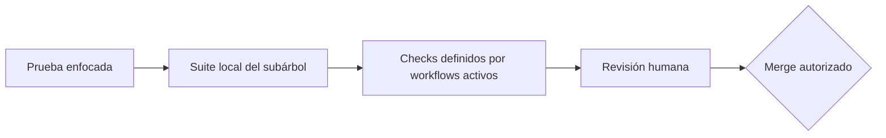

# Pruebas, calidad y frontera con CI

Los checks locales dan retroalimentación temprana; CI repite y amplía la
evidencia en un entorno limpio. Que un PR no tenga conflictos solo significa
que Git puede combinar texto: no demuestra compilación, contratos, seguridad
ni comportamiento.

## Tres niveles de confianza

1. **Enfocado:** prueba el caso modificado durante la iteración.
2. **Local completo:** ejecuta las suites del dueño y de sus consumidores.
3. **CI + review:** reconstruye desde locks, agrega certificación y valida el
   diff y las decisiones. Ningún nivel sustituye al siguiente.

## Matriz local por frontera

| Frontera | Checks locales mínimos |
| --- | --- |
| Backend | locked restore, build Release, test Release |
| Modelo EF | backend anterior + `has-pending-model-changes` + tooling DB |
| API client | `npm ci`, `generate`, `check` y `check:openapi` contra API local |
| Private Web | `npm ci`, `test`, `test:delivery`, validator y build configurado |
| Public Web local | `npm ci`, lint, typecheck, test y build configurado; el validator de release requiere metadatos y orígenes distintos del ejemplo local |
| Mobile Agent | `npm ci`, lint, typecheck y bundle seam del API client |
| Vault | secret scan, `vault:test`, `vault:generate`, `vault:check` |

Los comandos copiables están en
[Comandos locales por subárbol](comandos-locales-por-subarbol.md). Para un
cambio transversal se usa la unión de sus filas, no solo la suite más rápida.

## Qué agrega cada workflow activo

### Backend CI

Además de restore/build/test, levanta SQL Server 2022 efímero y valida tooling,
migraciones, modelo pendiente, generación de SQL idempotente revisable,
instalación limpia/upgrade, Compose e imágenes. Sus pasos de publicación están
condicionados a eventos y reglas de rama; un PR no debe interpretarse como
despliegue.

### Web clients CI

Clasifica qué cliente cambió, instala desde cada lock, ejecuta los scripts de
calidad, renderiza los Compose revisados y certifica imágenes aplicables. Los
valores de build de CI no son credenciales para copiar al checkout.

### API client CI

Compila la API del mismo commit, obtiene el Swagger local, comprueba el snapshot
y ejecuta los seams del paquete compartido con Private Web, Public Web y Mobile
Agent.

### Vault CI

Ejecuta instalación reproducible y `npm run vault:ci`, que combina pruebas del
validador y verificación sin autoescritura. El inventario generado se actualiza
localmente antes del PR.

### Estado del workflow móvil

`.github/workflows/mobile-ci.yml.template` es una plantilla versionada, no un
workflow activo porque conserva la extensión `.template`. En consecuencia no
se debe afirmar que hoy existe un carril móvil completo por PR. Cuando sus
filtros de rutas activan **API client CI**, ese workflow sí ejecuta `lint`,
`typecheck` y el bundle Metro del Mobile Agent como costura del paquete
compartido. Un cambio móvil fuera de esos filtros no queda cubierto por ese
job; la prueba en dispositivo sigue siendo evidencia explícita del autor.

## Cómo leer un fallo de CI

| Falla | Pregunta inicial | Acción segura |
| --- | --- | --- |
| install/locked restore | ¿lock y manifiesto están sincronizados? | reproducir con `npm ci` o restore locked; no relajar el lock |
| build/typecheck | ¿cambió tipo, configuración o generated code? | ejecutar el mismo script y corregir la causa |
| tests | ¿regresión, expectativa obsoleta o prueba inestable? | guardar error y aislar el caso; no omitir la prueba |
| OpenAPI/generated | ¿snapshot y API compilada divergen? | revisar diff y regenerar desde la fuente exacta |
| pending model/migration | ¿modelo EF cambió sin historia? | crear/revisar migración; no editar snapshot a mano |
| Compose/image certification | ¿se amplió el modelo cerrado? | revisar contrato operativo; no “arreglar” publicando puertos |
| Vault | ¿metadata, links, fuentes o inventario derivaron? | corregir fuente y regenerar solo `_generated` |

Un check remoto que falla después de pasar local puede revelar diferencia de
sistema operativo, entorno limpio o cobertura que solo existe en CI. Compara
comando, versión y log sanitizado antes de concluir que es “solo CI”.

## Lo que no debe hacerse para obtener verde

- quitar una prueba, validator o `--locked-mode` sin decisión revisada;
- editar manualmente código generado o el inventario del Vault;
- incluir secretos/hosts privados para reproducir un ambiente remoto;
- transformar un error visible del contrato en un mock silencioso;
- aprobar o fusionar porque el PR está libre de conflictos;
- disparar publicación o tocar el VPS desde un diagnóstico local.

La aprobación final combina checks verdes, diff entendido, documentación y
review. Es una norma de equipo: la
[protección de ramas pendiente](../../.github/BRANCH_PROTECTION.md) significa
que GitHub todavía no exige técnicamente esos checks antes de un push o merge a
`Development`. Continúa con la
[Definition of Done](definition-of-done-y-handoff.md).
