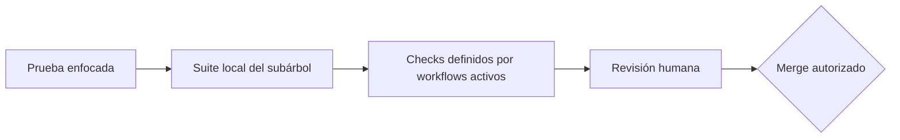

# Pruebas, calidad y frontera con CI

Los checks locales dan retroalimentación temprana; CI repite y amplía la
evidencia en un entorno limpio. Que un PR no tenga conflictos solo significa
que Git puede combinar texto: no demuestra compilación, contratos, seguridad
ni comportamiento.

## Tres niveles de confianza

1. **Enfocado:** prueba el caso modificado durante la iteración.
2. **Local completo:** ejecuta las suites del dueño y de sus consumidores.
3. **CI + review:** reconstruye desde locks, agrega certificación y valida el
   diff y las decisiones. Ningún nivel sustituye al siguiente.

## Matriz local por frontera

| Frontera | Checks locales mínimos |
| --- | --- |
| Backend | locked restore, build Release, test Release |
| Modelo EF | backend anterior + `has-pending-model-changes` + tooling DB |
| API client | `npm ci`, `generate`, `check` y `check:openapi` contra API local |
| Private Web | `npm ci`, `test`, `test:delivery`, validator y build configurado |
| Public Web local | `npm ci`, lint, typecheck, test y build configurado; el validator de release requiere metadatos y orígenes distintos del ejemplo local |
| Mobile Agent | `npm ci`, lint, typecheck, bundle seam del API client y export Android completo con Metro |
| Vault | secret scan, `vault:test`, `vault:generate`, `vault:check` |

Los comandos copiables están en
[Comandos locales por subárbol](comandos-locales-por-subarbol.md). Para un
cambio transversal se usa la unión de sus filas, no solo la suite más rápida.

## Recorrido E2E del ciclo completo

Posterior al commit verificado de esta nota: esta sección describe el código de
la fase 1 del ciclo (`8a79fe70`), que esa verificación no cubre.

Además de las suites de cada subárbol, Public Web tiene un recorrido de
Playwright que atraviesa el ciclo operativo completo contra el stack local real
([configuración](../../frontend/public-web/playwright.cycle.config.ts),
[pruebas de la fase 1](../../frontend/public-web/tests/e2e-cycle/fase1-comercial.spec.ts)
y [ADR-0037](../../docs/adr/0037-commercial-cycle-requests-drafts-amendments-and-portal-accounts.md)).

- **Qué recorre.** Cuatro proyectos encadenados, uno por fase: comercial,
  pre-operación, operación y facturación. Cada corrida crea su propia aerolínea
  sintética, y cada fase continúa la corrida que dejó la anterior.
- **Qué necesita.** El stack local de `database/DevelopmentDB` con el overlay
  de Compose para E2E, que suma almacenamiento S3 local, el CORS de los puertos
  del arnés y límites de uso altos. También Mailpit, de donde lee los enlaces y
  códigos del portal, Google Chrome, y `E2E_CYCLE_ENV_FILE` apuntando al `.env`
  del stack, del que toma las credenciales sembradas sin imprimirlas.
- **Cómo corre.** `npm run test:e2e:cycle`, desde `frontend/public-web`, levanta
  public-web y private-web en modo desarrollo y reenvía el nombre HTTPS de la
  API a la API local. El estado de la corrida y las capturas quedan fuera del
  repositorio, sin trazas ni reporte HTML. Los pasos exactos están en la
  [guía de desarrollo local](../../docs/workflows/local-development.md#recorrido-e2e-del-ciclo-completo)
  y en el [README de Public Web](../../frontend/public-web/README.md).
- **Qué no es.** Ningún workflow de CI lo ejecuta, y los huecos todavía
  abiertos figuran como `test.fixme("hueco …")`. Una corrida verde es evidencia
  local: no reemplaza CI ni prueba un despliegue.

Desde la fase 2 del ciclo (código de `50e7778f`, también posterior al commit
verificado;
[ADR-0038](../../docs/adr/0038-preoperation-contract-lifecycle-permits-master-data-and-workforce-readiness.md)):

- **Feed simulado.** El mismo overlay activa el proveedor de vuelos simulado
  (`SimulatedFlightFeed__Enabled`), que nunca llama a AeroDataBox ni a la red.
  La API se niega a arrancar si el `.env` también activa AeroDataBox, y con
  `ELEVANT_E2E_SIMULATED_FLIGHT_FEED=false` el overlay no lo activa.
- **Pasos de la fase 2.** Los huecos de la fase 2 ya son pruebas reales
  ([pruebas de la fase 2](../../frontend/public-web/tests/e2e-cycle/fase2-preoperacion.spec.ts)).
  El paso que importa vuelos se salta si la API no usa el proveedor simulado,
  para no gastar nunca unidades de pago. Las fases 3 y 4 todavía tienen pasos
  `test.fixme`.

Desde la fase 3 del ciclo (código de `f2d5c52c`, también posterior al commit
verificado;
[ADR-0039](../../docs/adr/0039-operation-planning-coverage-offline-tablet-occ-review-and-reports.md)):

- **Pasos de la fase 3.** Ya no queda ningún `test.fixme` en las
  [pruebas de la fase 3](../../frontend/public-web/tests/e2e-cycle/fase3-operacion.spec.ts):
  los pasos de los huecos 3-A a 3-K son pruebas reales, y un paso final
  comprueba los reportes de OCC y de Gestión Humana. Solo la fase 4 conserva
  pasos `test.fixme`.
- **Franja horaria.** El recorrido corre entre las 08:30 y las 22:30 de la hora
  local, porque la fase 2 elige la plantilla de turno del agente sintético que
  cubre el vuelo de la corrida. Los pasos de la fase 3 que necesitan otra
  ventana libre en ese turno se saltan con su motivo cuando ya no queda, y el
  que reabre la aprobación se salta si la operación del ciclo ya está en una
  prefactura.
- **Corrida registrada.** El 8 de noviembre de 2026 las fases 1 a 3 pasaron
  enteras contra el stack local recreado con la rama completa: 52 de 52
  pasos (14, 18 y 20). Varias corridas el mismo día agotan las ventanas libres
  del agente sintético. Para una corrida limpia se recrea el stack (`down -v`)
  y se aparta `passwords.json` del estado del arnés, porque el seed vuelve a
  las contraseñas iniciales.

Desde la fase 4 del ciclo (código de `39a85a46`, también posterior al commit
verificado; [ADR-0035](../../docs/adr/0035-direct-invoicing-simulated-ecf.md) y
[ADR-0036](../../docs/adr/0036-simulated-card-payment.md)):

- **Pasos de la fase 4.** Ya no queda ningún `test.fixme` en las
  [pruebas de la fase 4](../../frontend/public-web/tests/e2e-cycle/fase4-facturacion.spec.ts):
  la emisión, el pago con tarjeta, la nota de crédito, el estado de cuenta, los
  reportes, el menú de Finanzas, las cuentas por pagar y los gastos son pruebas
  reales. Dos pasos se saltan con su motivo cuando la corrida no dejó lo que
  necesitan: la nota de crédito y un charter facturado. El último paso
  comprueba, sin navegador, que el Vault describe el ciclo como el código: cada
  operación que cita el mapa de capacidades existe en el snapshot y ninguna
  nota vigente describe la API como vacía. La puerta real de esa regla es
  `npm run vault:ci`.
- **Pasarela simulada.** El mismo overlay activa `CardPayments__Mode=Simulated`:
  las tarjetas de prueba se aprueban o rechazan en memoria, sin red.
- **Reapertura en la fase 3.** El paso que reabre la aprobación se salta si la
  operación del ciclo ya se facturó o si la retiene un borrador interno
  antiguo: su corrección es una nota de crédito.
- **Sin corrida registrada.** Esta nota no registra todavía una corrida de la
  fase 4 contra el stack local.

## Qué agrega cada workflow activo

### Backend CI

Además de restore/build/test, levanta SQL Server 2022 efímero y valida tooling,
migraciones, modelo pendiente, generación de SQL idempotente revisable,
instalación limpia/upgrade, Compose e imágenes. Sus pasos de publicación están
condicionados a eventos y reglas de rama; un PR no debe interpretarse como
despliegue.

### Web clients CI

Clasifica qué cliente cambió, instala desde cada lock, ejecuta los scripts de
calidad, renderiza los Compose revisados y certifica imágenes aplicables. Los
valores de build de CI no son credenciales para copiar al checkout.

### API client CI

Compila la API del mismo commit, obtiene el Swagger local, comprueba el snapshot
y ejecuta los seams del paquete compartido con Private Web, Public Web y Mobile
Agent.

### Vault CI

Ejecuta instalación reproducible y `npm run vault:ci`, que combina pruebas del
validador y verificación sin autoescritura. El inventario generado se actualiza
localmente antes del PR.

### Mobile Agent CI

`.github/workflows/mobile-ci.yml` es un workflow activo para todo cambio bajo
Mobile Agent o el paquete API compartido. Reconstruye desde el lockfile,
ejecuta `lint`, `typecheck`, el smoke Metro del cliente compartido y un export
Android completo. Es evidencia de fuente y empaquetado JavaScript: no genera
una APK, no valida firma, no prueba hardware ni sustituye la aceptación en una
tablet. **API client CI** conserva además su costura contra la API compilada.

## Cómo leer un fallo de CI

| Falla | Pregunta inicial | Acción segura |
| --- | --- | --- |
| install/locked restore | ¿lock y manifiesto están sincronizados? | reproducir con `npm ci` o restore locked; no relajar el lock |
| build/typecheck | ¿cambió tipo, configuración o generated code? | ejecutar el mismo script y corregir la causa |
| tests | ¿regresión, expectativa obsoleta o prueba inestable? | guardar error y aislar el caso; no omitir la prueba |
| OpenAPI/generated | ¿snapshot y API compilada divergen? | revisar diff y regenerar desde la fuente exacta |
| pending model/migration | ¿modelo EF cambió sin historia? | crear/revisar migración; no editar snapshot a mano |
| Compose/image certification | ¿se amplió el modelo cerrado? | revisar contrato operativo; no “arreglar” publicando puertos |
| Vault | ¿metadata, links, fuentes o inventario derivaron? | corregir fuente y regenerar solo `_generated` |

Un check remoto que falla después de pasar local puede revelar diferencia de
sistema operativo, entorno limpio o cobertura que solo existe en CI. Compara
comando, versión y log sanitizado antes de concluir que es “solo CI”.

## Lo que no debe hacerse para obtener verde

- quitar una prueba, validator o `--locked-mode` sin decisión revisada;
- editar manualmente código generado o el inventario del Vault;
- incluir secretos/hosts privados para reproducir un ambiente remoto;
- transformar un error visible del contrato en un mock silencioso;
- aprobar o fusionar porque el PR está libre de conflictos;
- disparar publicación o tocar el VPS desde un diagnóstico local.

La aprobación final combina checks verdes, diff entendido, documentación y
review. Es una norma de equipo: la
[protección de ramas pendiente](../../.github/BRANCH_PROTECTION.md) significa
que GitHub todavía no exige técnicamente esos checks antes de un push o merge a
`Development`. Continúa con la
[Definition of Done](definition-of-done-y-handoff.md).
