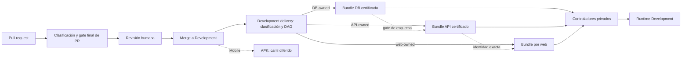

# CI/CD y entrega de Development

Esta sección responde qué valida el repositorio, qué artefacto publica cada
carril y bajo qué condiciones un controlador puede promoverlo en Development.
Describe contratos versionados; **no es una consola de operaciones**. El estado
instantáneo de GitHub, GHCR, Dokploy o el VPS necesita evidencia operativa
fechada, no se deduce de que exista un workflow.

## Elige la pregunta

| Pregunta | Nota |
| --- | --- |
| ¿Qué workflow está activo y qué gatilla? | [Workflows y estado real](workflows-y-estado.md) |
| ¿Cómo se encadenan DB, API y las dos webs? | [Cadena de artefactos y promoción](cadena-de-artefactos-y-promocion.md) |
| ¿Qué pasa si falla, se difiere o no hay cambios? | [Gates, fallos y no-op](gates-fallos-y-no-op.md) |
| ¿Qué protege el proceso y qué riesgo queda? | [Límites, revisión y rollback](limites-revision-y-rollback.md) |
| ¿Cómo será una APK, sin fingir que ya existe su CD? | [Mobile Agent: APK y CI/CD diferidos](mobile-apk-ci-cd.md) |

## Modelo en una vista

Las líneas punteadas expresan dependencias de aceptación, no una llamada de
GitHub al host. El push relevante publica en GHCR tras CI; los controladores
privados consultan los aliases y resuelven digests. No se recompila en el VPS.
El diagrama expresa la norma de revisión; la falta de branch protection
vigente permite todavía un push directo a `Development` por alguien con
permiso de escritura, que también pasa por los gates de publicación.

## Qué está dentro y qué no

- **Actual, versionado:** coordinadores de PR y Development, workflows activos
  de backend, cliente API, webs, Mobile Agent fuente, configuración operativa,
  Vault y escaneo de secretos; bundle OCI y controladores de DB/API/web.
- **Condicionado:** la promoción automática exige controlador instalado,
  baseline adoptada, schedules habilitados, runtime sano y gates satisfechos.
  Esos hechos vivos no los demuestra esta sección.
- **Diferido:** build, firma y distribución de APK, pruebas funcionales Mobile
  completas y canales de tienda; branch protection obligatoria en el
  repositorio privado bajo el plan documentado; Production.
- **Fuera de alcance:** comandos para mutar Dokploy/VPS, secretos y endpoints
  privados. Usa los [runbooks fuente](../../ops/dokploy/README.md) y la
  [guía de release](../../docs/workflows/release-workflow.md) solo mediante el
  operador y checkpoints aprobados.

La [guía de desarrollo](../06-desarrollo/README.md) cubre checks locales y
preparación del PR. Esta sección empieza donde un cambio ya puede entrar en
CI. La [política de evidencia](../08-gobernanza/fuentes-y-evidencia.md) explica
por qué un workflow versionado no equivale a un despliegue observado.
