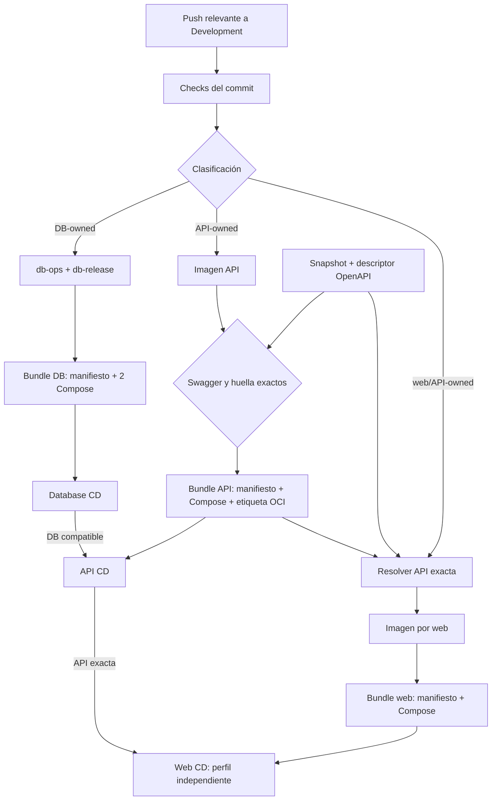

# Cadena de artefactos y promoción Development

La identidad de una entrega es su digest OCI y su manifiesto validado, no un
tag mutable. GitHub Actions construye y certifica fuera del VPS; el controlador
privado consulta GHCR y decide si el candidato puede sustituir la última
baseline saludable. No hay webhook de GitHub que despliegue dentro de Dokploy.

El workflow web actualizado usa aplicación y `run_id` como nombre estable
para el artefacto intermedio. Permite
reintentar solo la publicación sin buscar un artefacto de un intento de build
que nunca ocurrió; un build repetido reemplaza ese intermedio antes de
publicar. La publicación sigue comprobando hash, identidad de imagen, commit,
configuración y manifiesto API exacto. El bundle OCI aceptado mantiene digest
inmutable y procedencia por intento. El cambio de workflow por sí solo no
acredita ninguna promoción al VPS. Fuente:
[workflow web](../../.github/workflows/web-ci.yml) y
[prueba de reintento](../../frontend/tests/deployment/test_web_ci_artifacts.py).

El job de publicación usa un runner limpio. Antes de recertificar AVIAM Web,
instala las dependencias de su lockfile porque el validador de entorno del
certificador usa `@next/env`; la imagen sigue entrando desde el artefacto
certificado y se comprueba de nuevo antes de publicarse.

El diagrama resume relaciones, no promete que todo push produzca todos los
artefactos. La clasificación de [Workflows y estado](workflows-y-estado.md)
elige los carriles aplicables.

## 1. Base de datos: unidad certificada de tres payloads

Cuando una entrada DB-owned cambia, Backend CI valida esquema, seed,
operaciones y contenedores, publica dos imágenes inmutables (`db-ops` y
`db-release`) y después un bundle OCI v1 con:

- manifiesto cerrado: commit, run, imágenes, migraciones y fingerprints de
  modelo/seed;
- Compose de Database;
- Compose de Database Release.

CI extrae otra vez los tres payloads y exige igualdad byte a byte. Solo al
final mueve `development-certified`, alias de descubrimiento. Database CD
resuelve ese alias a digest, valida etiquetas, hashes, modelo Compose certificado
frente al Raw vivo y `runId` monótono. Bajo un lock común ejecuta backup previo,
migración, seed sintético de Development, verificación, backup posterior y
restore-check. Los backups programados y el restore-check comparten el lock y
la última imagen/Compose aceptados; no pertenecen a un candidato no aprobado.

El controlador no reescribe el Raw de Dokploy, red ni volúmenes. Si un Compose
certificado cambia semánticamente, se requiere reconciliación manual antes de
promover; una diferencia de formato o comentario puede ser equivalente.

## 2. API: base compatible antes de imagen nueva

Backend CI certifica la imagen API y compara el Swagger compilado del commit
con el snapshot OpenAPI. Solo después publica imagen y bundle OCI v1 con
manifiesto y Compose exacto. El manifiesto fija la entrega DB requerida y las
huellas de migraciones y modelo. Sin cambiar ese manifiesto v1, el bundle añade
la etiqueta inmutable `io.elevant.api-release.openapi-sha256`, que debe coincidir
con el descriptor y el snapshot versionados.

API CD acepta la DB requerida exacta o una posterior con ambas huellas
idénticas; una DB anterior o de esquema distinto difiere la API. Una vez
compatible, despliega la imagen por digest y comprueba proceso, readiness,
ping y Swagger. Una API-only puede usar la DB compatible ya aceptada. Cuando
Persistence y API cambian juntos, el job de publicación API depende del éxito
del job DB del mismo run, y el controlador vuelve a comprobar la compatibilidad
en el host.

## 3. Webs: dos ciclos, dependencia API exacta

Web CI clasifica `aviam-web` y `public-web` por separado para validación y
publicación. Su matriz construye y certifica solo las webs afectadas; cada
perfil de release publica un bundle OCI v1 propio con manifiesto
cerrado + Compose exacto, vuelve a verificar los payloads y mueve su alias al
final. El bundle fija digest de la imagen web, hash Compose, fingerprint de
configuración, bundle API, `runId`, imagen API y hash canónico OpenAPI usados en
el build.

Antes del build, el resolver exige igualdad entre descriptor, snapshot y etiqueta
del bundle API. `source.json` identifica el contrato; commit, run e imagen API
se derivan del manifiesto inmutable resuelto y se conservan en el manifiesto web
v1. Una referencia inmutable incompatible falla inmediatamente. Cuando el push
requiere API nueva, `Development delivery` espera Backend CI y transfiere su
bundle inmutable a Web CI. La ausencia de esa referencia bloquea Web CI. Si
el push es solo web, se comprueba una vez que el alias apunta a una API
certificada compatible; no se ocupa un runner esperando a que avance.

Un mismo `web-cd` tiene dos perfiles con estado, cache y rollback separados.
Antes de mutar uno exige que **esa API exacta** siga aceptada y viva: estado
`succeeded/complete`, bundle/run/imagen iguales y Swagger con el mismo hash.
No adivina que una API más reciente sea compatible. Un candidato web para una
API distinta se difiere sin consumir el intento; una nueva certificación web
puede fijar la API vigente.

Una shell/health saludable no prueba por sí sola un ciclo de negocio completo
ni su autorización. Ninguna web entra a la red SQL ni mueve el otro perfil.

El [certificador de AVIAM Web](../../frontend/private-web/scripts/certify-image.sh)
compara el cuerpo de `/healthz` con los dos bytes `ok` sin quitar saltos de
línea. Así detecta una respuesta alterada antes de publicar la imagen. Esta
prueba de imagen no acredita que el controlador ya la haya promovido.

En el PR de integración #118, el certifier de AVIAM verifica que el bundle
incluya el dashboard HR conectado y excluya el antiguo banner permanente de
datos sintéticos. El gate anterior exigía ese banner y fallaba aun cuando las
pruebas del dashboard canónico pasaban. Incorporar este ajuste al VPS exige
un nuevo run certificado y la promoción normal del perfil AVIAM.

## Coordinación de fuente y publicación

`scripts/release/path-ownership.sh` define los inputs que producen API y los
cambios que invalidan cada publicación web. `classify-changes.sh` distingue
esos inputs de los que solo requieren validación, y ambos coordinadores lo
usan. Los guards rechazan que un run antiguo mueva un alias después de un
cambio relevante. El resolver exige `ELEVANT_SOURCE_COMMIT == HEAD`; una API
anterior solo es reutilizable si pertenece a la misma historia y el diff hasta
ese checkout no contiene ningún input API.

Las publicaciones API, AVIAM y Public comparten el grupo
`development-api-web-release-publication` con `queue: max`. Se ejecutan de una
en una sin sustituir jobs pendientes. Bajo esa exclusión, cada web vuelve a
resolver tanto su digest API transferido como el alias vigente y exige igualdad
byte a byte antes de publicar. Esto cierra la carrera entre certificar una web y
mover el alias API sin cambiar los esquemas v1 ni relajar el gate exacto del VPS.

Límite conocido: un rerun manual de `Development delivery` para el mismo commit
puede crear otra tupla exacta de run/imagen/bundle. Una web en curso rechaza
el alias cambiado; si se necesita fijar la nueva tupla, se rerunea el
coordinador para ese commit.

## Orden y concurrencia

La jerarquía de locks es `database → API → web común → perfil web`. Los polls
se escalonan por minuto (DB al inicio, API a +15 s, AVIAM a +30 s, Public a
+45 s), pero los locks —no las esperas— impiden operaciones concurrentes.
SQL Server y sus volúmenes tienen ciclo de vida separado; promover API o web
no los recrea.

Esa jerarquía pertenece al host. En GitHub, la cola común descrita arriba
serializa la publicación de artefactos API/web; no sustituye los locks ni los
checks de los controladores privados.

Los controladores requieren instalación, adopción de baseline y schedules
habilitados por el operador. Para el procedimiento exacto usa los runbooks
de [Database CD](../../ops/dokploy/database-cd/README.md),
[API CD](../../ops/dokploy/api-cd/README.md) y
[Web CD](../../ops/dokploy/web-cd/README.md); esta nota no sustituye ninguno.
