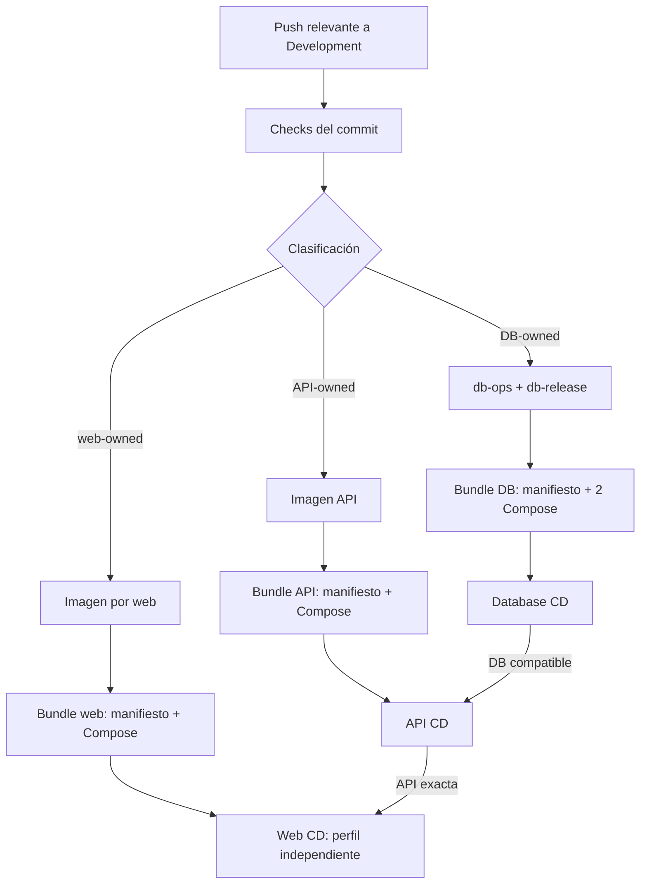

# Cadena de artefactos y promoción Development

La identidad de una entrega es su digest OCI y su manifiesto validado, no un
tag mutable. GitHub Actions construye y certifica fuera del VPS; el controlador
privado consulta GHCR y decide si el candidato puede sustituir la última
baseline saludable. No hay webhook de GitHub que despliegue dentro de Dokploy.

El diagrama resume relaciones, no promete que todo push produzca todos los
artefactos. La clasificación de [Workflows y estado](workflows-y-estado.md)
elige los carriles aplicables.

## 1. Base de datos: unidad certificada de tres payloads

Cuando una entrada DB-owned cambia, Backend CI valida esquema, seed,
operaciones y contenedores, publica dos imágenes inmutables (`db-ops` y
`db-release`) y después un bundle OCI v1 con:

- manifiesto cerrado: commit, run, imágenes, migraciones y fingerprints de
  modelo/seed;
- Compose de Database;
- Compose de Database Release.

CI extrae otra vez los tres payloads y exige igualdad byte a byte. Solo al
final mueve `development-certified`, alias de descubrimiento. Database CD
resuelve ese alias a digest, valida labels, hashes, modelo Compose certificado
frente al Raw vivo y `runId` monótono. Bajo un lock común ejecuta backup previo,
migración, seed sintético de Development, verificación, backup posterior y
restore-check. Los backups programados y el restore-check comparten el lock y
la última imagen/Compose aceptados; no pertenecen a un candidato no aprobado.

El controlador no reescribe el Raw de Dokploy, red ni volúmenes. Si un Compose
certificado cambia semánticamente, se requiere reconciliación manual antes de
promover; una diferencia de formato o comentario puede ser equivalente.

## 2. API: base compatible antes de imagen nueva

Backend CI certifica la imagen API y compara el Swagger compilado del commit
con el snapshot OpenAPI. Solo después publica imagen y bundle OCI v1 con
manifiesto y Compose exacto. El manifiesto fija la entrega DB requerida y las
huellas de migraciones y modelo.

API CD acepta la DB requerida exacta o una posterior con ambas huellas
idénticas; una DB anterior o de esquema distinto difiere la API. Una vez
compatible, despliega la imagen por digest y comprueba proceso, readiness,
ping y Swagger. Una API-only puede usar la DB compatible ya aceptada. Cuando
Persistence y API cambian juntos, el job de publicación API depende del éxito
del job DB del mismo run, y el controlador vuelve a comprobar la compatibilidad
en el host.

## 3. Webs: dos ciclos, dependencia API exacta

Web CI clasifica `aviam-web` y `public-web` por separado. Cada carril aplicable
construye y certifica su imagen, publica un bundle OCI v1 propio con manifiesto
cerrado + Compose exacto, vuelve a verificar los payloads y mueve su alias al
final. El bundle fija digest de la imagen web, hash Compose, fingerprint de
configuración, bundle API, `runId`, imagen API y hash canónico OpenAPI usados en
el build.

Un mismo `web-cd` tiene dos perfiles con estado, cache y rollback separados.
Antes de mutar uno exige que **esa API exacta** siga aceptada y viva: estado
`succeeded/complete`, bundle/run/imagen iguales y Swagger con el mismo hash.
No adivina que una API más reciente sea compatible. Un candidato web para una
API distinta se difiere sin consumir el intento; una nueva certificación web
puede fijar la API vigente.

Las webs son previews técnicos independientes: una shell/health saludable no
prueba que la API ya tenga los endpoints de autenticación y negocio de los
prototipos. Ninguna web entra a la red SQL ni mueve el otro perfil.

## Orden y concurrencia

La jerarquía de locks es `database → API → web común → perfil web`. Los polls
se escalonan por minuto (DB al inicio, API a +15 s, AVIAM a +30 s, Public a
+45 s), pero los locks —no las esperas— impiden operaciones concurrentes.
SQL Server y sus volúmenes tienen ciclo de vida separado; promover API o web
no los recrea.

Los controladores requieren instalación, adopción de baseline y schedules
habilitados por el operador. Para el procedimiento exacto usa los runbooks
de [Database CD](../../ops/dokploy/database-cd/README.md),
[API CD](../../ops/dokploy/api-cd/README.md) y
[Web CD](../../ops/dokploy/web-cd/README.md); esta nota no sustituye ninguno.
