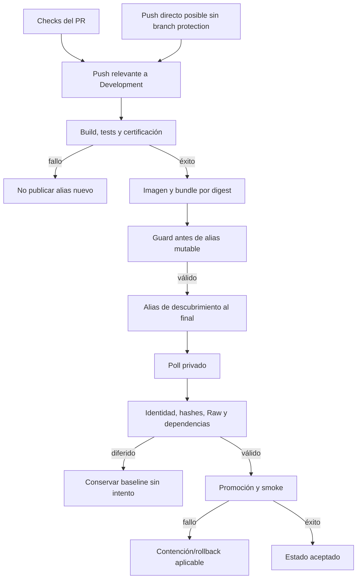

# Gates, fallos, diferidos y no-op

“No cambió el contenedor” admite varios significados. Puede ser un no-op sano,
un candidato diferido, una publicación bloqueada por CI o un intento fallido
con la baseline conservada. Hay que leer **run, digest, etapa, estado y
runtime** antes de afirmar el resultado.

## Escalera de gates

La ruta de PR es la norma del equipo, pero actualmente no está impuesta por
branch protection. `Pull request CI` exige un estado final estable: Vault y
escaneo de secretos siempre, más cada carril seleccionado por rutas. Si uno
falla, se cancela o se omite cuando era requerido, el gate final falla. Un
carril no seleccionado puede aparecer como `skipped` sin volver rojo el PR.
El push directo también debe superar los gates del run antes de cualquier
publicación; no implica revisión humana previa.

Backend CI bloquea la imagen API si Swagger compilado y snapshot divergen;
API Client CI lo repite como defensa independiente. El bundle incompleto no
se anuncia como candidato. Una etiqueta `development-certified` no demuestra
que su contenido esté desplegado ni autoriza ejecutarla como imagen mutable.

## Interpretar estados sin sobreafirmar

| Observación | Interpretación correcta | Próxima evidencia |
| --- | --- | --- |
| PR verde | validación de un SHA | revisión y run de push posterior, si hay merge |
| job de publicación omitido | cambio no clasificado para ese carril, o condición de job no satisfecha | clasificación y `if` del workflow |
| PR con carril omitido | normal si el clasificador no lo seleccionó; error si era requerido | salida del clasificador y `Final PR quality gate` |
| CI rojo antes de bundle | no hay candidato nuevo completo de ese run | primer job fallido y artefactos anteriores |
| alias movido | candidato publicado, no aceptado | digest resuelto y estado del controlador |
| DB/API/web espera dependencia | promoción diferida, no éxito | DB/API exigida, estado vivo y siguiente poll |
| digest ya aceptado, poll no-op | idempotencia esperada | baseline sana y ausencia de mutación |
| digest fallido o intento interrumpido | no se reintenta automáticamente | estado, etapa, rollback y decisión del operador |

El estado de un controlador no prueba por sí solo salud actual: se contrasta
con el contenedor, probes y estado de dependencias. Un `no-op` de poll no
equivale a nuevo backup o nuevo despliegue.

## Dónde aparece el fallo

El fallo de CI o publicación se ve en el job y resumen de GitHub Actions del
SHA exacto. El fallo posterior de CD se registra en estado persistente e
historial/logs del job de Dokploy; el status de commit en GitHub es **opcional**
para Database CD si operaciones instaló el token dedicado, no un canal de
alertas garantizado para todos los carriles. Para diagnosticar, compara el
digest anunciado, el último aceptado, la etapa fallida y la salud del runtime;
no concluyas “desplegado” solo porque el workflow terminó verde.

## Fallo por carril

### Database CD

Un fallo **antes** de crear intento y ejecutar SQL (descubrimiento, extracción
o validación) puede reevaluarse en el siguiente poll. Después de un intento,
un fallo o interrupción queda persistente, sin retry automático. La base no
recibe `Down`, restore automático ni edición de historial EF. Backup y
restore-check programados son operaciones aparte; un timeout de su lock es
fallo visible, no backup cumplido. Un digest aceptado, fallido, con `runId`
viejo o un controlador pausado se trata como no-op sin SQL.

### API CD

Si la DB requerida aún no está aceptada y compatible, la entrega espera; un
fallo DB conserva la API anterior. Un candidato API que falla health/smoke
revierte imagen + Compose al último par sano cuando es posible. Un fallo del
rollback pausa el controlador. El digest fallido/interrumpido no se reintenta
en automático. Un cambio semántico del Raw sin reconciliar falla en preflight.

### Web CD

La API requerida debe coincidir exactamente con estado, runtime y hash
OpenAPI. Si falta, el candidato web se difiere sin intento. Una promoción que
falla intenta restaurar imagen + Compose del perfil, sin tocar SQL ni la otra
web; si esa restauración falla, pausa ese perfil. Un intento ordinario
interrumpido tiene contención/reconciliación específica antes de volver a
aceptar nuevos candidatos. Un rollback drill interrumpido exige recuperar el
mismo digest bajo revisión del operador. Un perfil pausado no avanza por poll.

## Reintentar exige clasificación

Una corrección normal publica **otro digest** y se procesa por el poll. Un
retry del **mismo digest** es excepcional: el controlador exige solicitud
explícita y que el alias aún anuncie ese candidato; primero se demuestra que
la causa externa se corrigió. No borres estado o cache, no muevas el alias a
mano ni pulses Deploy para saltar el gate. Los runbooks de
[DB](../../ops/dokploy/database-cd/README.md),
[API](../../ops/dokploy/api-cd/README.md) y
[web](../../ops/dokploy/web-cd/README.md) describen los checkpoints reales.

Para interpretar compatibilidad y rollback de aplicación frente a esquema,
continúa en [Límites, revisión y rollback](limites-revision-y-rollback.md).
