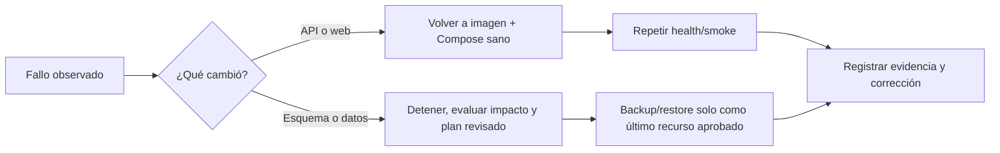

# Límites, revisión y rollback lógico

CI/CD de Development reduce errores de build, contrato y promoción, pero no
convierte un PR sin conflictos en entrega infalible. Tampoco autoriza operar
Production. La seguridad depende de revisión, compatibilidad hacia atrás,
gates de artefacto, un controlador privado y respuesta humana ante fallos.

## Cuatro fronteras distintas

| Frontera | Qué verifica | Qué no garantiza |
| --- | --- | --- |
| Git/PR | diff revisable y checks aplicables | que branch protection esté impuesta o que el deploy ya ocurrió |
| CI | compilación, tests, contrato, imágenes y bundle del commit | disponibilidad futura de GHCR o salud del host |
| Controlador CD | identidad, dependencia, Raw, health y estado antes/después | semántica funcional no cubierta por smoke |
| Red privada | alcance de conectividad al plano Development | autenticación, RBAC o tenant scope dentro de la aplicación |

El repositorio privado usa el plan GitHub Free descrito en
[Branch protection](../../.github/BRANCH_PROTECTION.md). La regla de trabajar
por PR y revisión humana existe, pero actualmente no es un bloqueo técnico:
un colaborador con write puede hacer push directo a `Development` e incluso
modificar un workflow. Los digests y labels prueban consistencia entre
artefactos; por sí solos no son attestation criptográfica de procedencia. La
activación de protección de ramas y firma/attestation verificable siguen como
endurecimiento posterior, no como gates ya presentes.

## Separación entre aprobación de código y operación

Un merge relevante a `Development` puede iniciar publicación después de CI;
no hace que GitHub se conecte al VPS. Los controladores descubren candidatos
solo si ya fueron instalados, adoptados y habilitados por el operador. Primer
despliegue, cambios semánticos de Compose Raw, redes, volúmenes, permisos,
configuración root-only, controlador y schedules requieren checkpoints
manuales. Ningún documento en `ops/dokploy` autoriza a un agente a ejecutarlos
por inferencia.

`main` es la frontera reservada a Production. Los workflows pueden validar un
PR o push a `main`, pero los jobs de publicación de Development están
condicionados al push a `Development`. La existencia de `main` y de plantillas
Production no demuestra que Production esté desplegado ni habilita un CD
productivo.

## Rollback no es una operación uniforme

- **API/web:** el controlador intenta volver al par imagen/Compose certificado
  anterior si falla una promoción. Ese rollback es seguro solo si el esquema
  continúa compatible. Web contiene su propio perfil, sin recrear la otra web.
- **DB:** no hay migración descendente, edición de `__EFMigrationsHistory` ni
  restauración automática sobre el origen. Una migración aplicada persiste si
  falla la API; por eso se requiere expand/contract y compatibilidad con la
  versión anterior de la aplicación.
- **Host/control plane:** firewall, Tailscale, Dokploy y reboot tienen
  checkpoints propios. No se sustituyen por un rollback de imagen.

La [guía de rollback](../../docs/deployment/rollback.md) exige señales de
aborto, digest anterior/nuevo, backup recuperable cuando proceda y evaluación
de pérdida de datos. Los runbooks de
[Database CD](../../ops/dokploy/database-cd/README.md),
[API CD](../../ops/dokploy/api-cd/README.md) y
[Web CD](../../ops/dokploy/web-cd/README.md) fijan la ejecución. Esta nota
no ofrece comandos para el host.

## Definición honesta de “completamente automatizado”

Para el alcance DB/API/AVIAM/Public de Development, el repositorio implementa
validación, publicación condicionada y promoción pull-based. Eso **no** incluye
la primera instalación, revisión obligatoria impuesta por GitHub, garantía de
que un servicio esté siempre sano, alertas externas completas, APK móvil ni
Production. “CI verde”, “bundle publicado”, “poll no-op” y “runtime healthy” son
afirmaciones diferentes, cada una con evidencia propia.

Ante un fallo, conserva el último estado sano, identifica el gate exacto y
documenta el incidente sin pegar logs con secretos o identificadores privados.
Consulta [Gates, fallos y no-op](gates-fallos-y-no-op.md) y la
[política de evidencia](../08-gobernanza/fuentes-y-evidencia.md).
