# Mobile Agent: diseño diferido de CI/CD para APK

> [!IMPORTANT]
> **El CI de fuente está activo; el build firmado y la distribución siguen
> diferidos.** Hoy no hay entrega automática de APK, configuración EAS,
> credenciales de firma ni canal de distribución aprobado en el repositorio.
> Ningún merge por sí solo instala o actualiza Mobile Agent en una tablet.

El resultado buscado es una APK **instalable y firmada para Development**,
compilada desde un commit revisado, entregada solo a testers autorizados y
verificable en una tablet real. Mobile Agent no se ejecuta en Dokploy: la app
nativa consume la API compartida; el dispositivo de Development necesita
acceso privado a esa API. Production y tiendas son carriles separados y aún
no están habilitados ([flujo fuente](../../docs/workflows/mobile-workflow.md),
[ADR de ambientes](../../docs/adr/0006-separate-development-and-production.md)).

## Línea de base: comprobado frente a propuesto

| Dimensión | Hoy, en el commit verificado | Para activar el carril APK |
| --- | --- | --- |
| Aplicación | Prototipo Expo SDK 54, Expo Router 6 y React Native 0.81.5; navegación y flujos de agente explorables. | Cerrar alcance funcional y probar el binario en tablet representativa. |
| API | Existe la fábrica del cliente OpenAPI compartido; los flujos móviles siguen usando el backend prototipo. | Implementar y probar contratos reales de autenticación, tareas, sincronización e idempotencia antes de habilitar esos flujos. |
| CI | `mobile-ci.yml` está activo y ejecuta `npm ci`, lint, tipos, smoke Metro del cliente compartido y export Android completo. `api-client-ci.yml` valida además la costura contra la API compilada cuando aplican sus filtros. | Añadir pruebas funcionales de sesión/offline y las puertas protegidas del futuro build firmado. |
| Build | `app.json` tiene versión visible, identificadores y versión nativa inicial; `eas.json` define APK interna y AAB de producción. Aún no existe EAS `projectId` ni configuración de firma. | Vincular proyecto/cuenta EAS, aprobar perfiles, comprobar versionCode monotónico y custodiar la firma. |
| Entrega | No existe APK firmada ni distribución versionada en el repositorio. | Publicación restringida, inventario de artefactos y aceptación humana antes de instalar. |
| Datos locales | La outbox prototípica usa AsyncStorage; no equivale a sincronización segura ni contrato de servidor. | Almacenamiento protegido, migraciones locales y reconciliación con el servidor verificadas. |

Las variables `EXPO_PUBLIC_*` del prototipo y del cliente compartido **son
configuración pública embebida**, no un almacén de secretos. La documentación
de [Expo sobre variables EAS](https://docs.expo.dev/eas/environment-variables/)
advierte que los valores `EXPO_PUBLIC_*` terminan en el código de la app.
El estado funcional actual está descrito en el [README Mobile](../../frontend/mobile-agent/README.md)
y la [frontera de la aplicación](../05-aplicaciones/mobile-agent.md).

## Cadena objetivo y puertas independientes

```mermaid
flowchart LR
    PR[PR Mobile o contrato API] --> Source[CI fuente y contrato]
    Source --> Review[Revisión humana]
    Review --> Merge[Commit aceptado en Development]
    Merge --> Approval[Autorización de build Development]
    Approval --> EAS[Build APK firmada]
    EAS --> Verify[Resultado final, hash y procedencia]
    Verify --> Testers[Distribución restringida]
    Testers --> Tablet[Aceptación en tablet real]
    Tablet -.-> Later[Canal de tienda futuro]
```

La automatización separa **CI sin credenciales de firma** (PR) del futuro
build/distribución con credenciales protegidas (commit aceptado y aprobación).
Inicialmente conviene una autorización manual vinculada al SHA exacto; no se
debe suponer que exista una regla obligatoria de protección de ramas. El
workflow de firma no debe ejecutarse desde código de un PR no confiable.
La [guía oficial de EAS en CI](https://docs.expo.dev/build/building-on-ci/)
exige preparar proyecto y credenciales interactivamente antes de construir de
modo no interactivo. En ese flujo, `--no-wait` confirma solo el envío de la
solicitud: la puerta de entrega debe esperar y comprobar el **resultado final
exitoso** del build, no el mero ID de una tarea.

### CI de PR activo y cobertura pendiente

1. La base implementada instala dependencias desde el lockfile del subproyecto
   y ejecuta lint, typecheck, el test Metro del cliente compartido y un export
   Android completo. Estos bundles prueban resolución y empaquetado, no lógica
   funcional ni una APK instalable.
2. Añadir pruebas automáticas reales para sesión, autorización/scope,
   navegación crítica, almacenamiento local, migración de su esquema, cola
   offline, reintentos, idempotencia y orden fuera de secuencia. El test de
   empaquetado **no prueba** estos comportamientos.
3. Validar el contrato OpenAPI y la adaptación móvil contra la API compilada
   del mismo cambio, aislada de cualquier VPS. No aceptar las formas de los
   mocks como contrato ni declarar integración completa por un bundle exitoso
   ([ADR del cliente](../../docs/adr/0007-api-client-generation.md)).
4. Examinar configuración, permisos nativos, dependencias y ausencia de
   secretos; probar tanto conexión disponible como perdida, fallos de
   autenticación, poco espacio, permisos denegados, cierre/reinicio y
   reconexión. Los escenarios que exigen dispositivo no quedan cubiertos por CI
   de JavaScript: tienen una puerta de aceptación física adicional.

### Build y perfil a diseñar, no existente

La [guía oficial de Expo para APK](https://docs.expo.dev/build-reference/apk/)
distingue la APK instalable de un AAB para tienda. El perfil Development
propuesto debe resolver explícitamente `distribution: internal`, tipo APK,
ambiente EAS Development, identificador nativo, versión y permisos; **no**
confundir una app autónoma para testers con un development client dependiente
del servidor Metro. El nombre del perfil, la cuenta, el identificador final y
la fuente del número de versión siguen pendientes de decisión. Un perfil
Production/AAB, cuando exista, tendrá configuración, credenciales y revisión
independientes, no un simple cambio de URL.

En una primera habilitación habrá que probar que el empaquetado EAS resuelve
correctamente el paquete local `@elevant/api-client` en este monorepo. La
compilación debe fijar SHA de origen, lockfile y ambiente; no recuperar código
mutable de otro commit ni inyectar una URL privada en esta nota o en logs.

## Distribución: alternativas y límite de confianza

| Ruta | Uso posible | Condición antes de adoptarla |
| --- | --- | --- |
| APK EAS interna | Primer piloto Development en tablets autorizadas. | Controlar cuenta y testers; revisar expiración y visibilidad del enlace. |
| Repositorio de artefactos privado o MDM | Entrega administrada a una flota. | Elegir custodio, autenticación, retención, revocación y trazabilidad por dispositivo. |
| Google Play, prueba interna/cerrada | Fase posterior de distribución Android a mayor escala. | Decidir cuenta, políticas y artefacto AAB, además de firma y versionado de tienda. |
| App Store/TestFlight | Fase iOS independiente. | No es una APK ni comparte su proceso de firma/distribución. |

Según [Expo Internal Distribution](https://docs.expo.dev/build/internal-distribution/),
una APK interna puede compartirse mediante URL, pero **por defecto cualquiera
con la URL puede descargarla**; ocultar el enlace no es control de acceso.
Antes de usar esa ruta, restringir la descarga a usuarios autenticados de la
cuenta Expo o escoger un canal privado con acceso explícito. Tampoco debe
incluirse información sensible en el binario: una APK y su configuración
pública son inspeccionables. Para tiendas, Android separa las pruebas de
[App Bundles/Play](https://developer.android.com/guide/app-bundle/test) de
la APK de instalación directa.

## Firma, versiones y procedencia

La clave de firma debe quedar **fuera de Git**, con custodia, respaldo,
recuperación y acceso mínimo acordados. Hay que elegir entre gestión de
credenciales por EAS y una custodia organizacional; no generar una segunda
clave accidental para la misma aplicación. La [documentación de credenciales
de Expo](https://docs.expo.dev/app-signing/app-credentials/) y su
[modelo de seguridad](https://docs.expo.dev/app-signing/security/) describen
esas responsabilidades. El token de automatización EAS, si se adopta, será un
secreto protegido del entorno de CI, sin acceso desde PR externos y con
rotación/revocación; nunca una variable `EXPO_PUBLIC_*`.

Cada candidato a instalar debe llevar un manifiesto saneado con SHA del commit,
ejecución de CI, identificador del build, ambiente, versión visible,
`android.versionCode` **resuelto**, identificador de aplicación, huella pública
del certificado, SHA-256 del APK, versión de contrato/API compatible, cohorte
de testers y aprobación. No incluir tokens, claves, URLs internas ni datos de
usuarios. Acordar si el versionCode se mantiene en Git o mediante el
versionado remoto de EAS; la [guía de versiones de Expo](https://docs.expo.dev/build-reference/app-versions/)
explica ambas posibilidades. Aunque se gestione remotamente, el número final
debe registrarse para reproducir y auditar cada entrega.

Para actualizar en sitio, Android requiere conservar el identificador de
aplicación y la firma compatible; el código de versión debe permitir la
actualización. La política de release será **versionCode estrictamente
creciente**. Véase la [guía de actualización de Android](https://developer.android.com/google/play/app-updates).
El identificador presente en `app.json` no constituye aún una decisión final
de separación Development/Production.

## Compatibilidad, offline y reversión

Una APK instalada no se puede promover atómicamente con el servidor. La API
debe tolerar, durante una ventana acordada, al menos la versión móvil
anterior y la nueva; los cambios de OpenAPI son aditivos por defecto. Antes de
abrir escritura real, el servidor debe validar identidad, estación/scope y
guardar el resultado idempotente de cada comando. La app debe persistir ID de
dispositivo registrado, clave de idempotencia y versión del payload, y no
eliminar evidencias ni mensajes pendientes sin confirmación duradera. Eso es
**objetivo**, no una propiedad demostrada por la outbox prototípica.

Cada cambio del esquema local exige prueba de migración con outbox pendiente,
reinicio, conectividad intermitente y versión anterior del servidor. El
rollout empieza por cohorte pequeña y se detiene si hay pérdida de datos,
duplicados, rechazo sostenido o fallos de inicio. La reversión preferida es
**roll-forward**: corregir y firmar una nueva APK con versionCode mayor y
compatibilidad conservada. Desinstalar o instalar una versión incompatible
puede borrar datos locales; nunca hacerlo sobre una tablet con outbox pendiente
sin recuperación validada ([actualizaciones Android](https://developer.android.com/google/play/app-updates)).

No hay canal OTA configurado hoy. Si se propone EAS Update más adelante,
aprobar primero una política de `runtimeVersion`, canales y compatibilidad
JS/nativo; un update JavaScript no reemplaza una migración nativa ni resuelve
la firma del binario. La [guía de runtime versions](https://docs.expo.dev/eas-update/runtime-versions/)
explica esa frontera. Hasta entonces, cada cambio distribuido sale en una APK
firmada y probada.

## Observabilidad y operación del piloto

La aceptación necesita señales sanitizadas por versión y cohorte: build
fallido/exitoso, instalación e inicio, fallos nativos, autenticación/API,
antigüedad y tamaño de la outbox, sincronizaciones confirmadas/rechazadas,
reintentos y porcentaje de dispositivos atrasados. Correlacionar un fallo de
cliente con el resultado del servidor sin registrar payload, fotografías,
tokens, PII ni claves privadas. Umbrales, herramienta, retención y responsable
de respuesta aún están por decidir. Un fallo de build bloquea distribución;
un fallo de sincronización exige preservar la cola y detener el rollout hasta
entenderlo.

## Decisiones humanas abiertas

| Decisión | Por qué bloquea la activación |
| --- | --- |
| Flujos móviles y endpoints OpenAPI reales, autenticación y autorización | El prototipo no prueba un flujo de negocio contra `Elevant.Api`. |
| Tablets/Android mínimo, permisos y pruebas físicas | Un bundle Metro o emulador no verifica cámara, red ni almacenamiento del dispositivo objetivo. |
| Cuenta/propietario EAS, custodia de keystore y recuperación | Sin firma estable no hay actualización confiable. |
| Identificadores Development y Production; versión local o remota | Evita mezclar datos y permite upgrade trazable. |
| Canal de entrega y lista de testers autorizados | Un enlace de APK interno no es privado por sí solo. |
| Cifrado/almacenamiento de sesión y outbox; retención de evidencias | AsyncStorage prototípico no satisface por sí solo estos requisitos. |
| Ventana API N−1/N, esquema offline y protocolo de rechazo | Protege dispositivos que no se actualizan al mismo tiempo. |
| OTA sí/no, umbrales de observabilidad, respuesta y rollback | Define qué se puede detener, corregir y recuperar sin perder pendientes. |

## Criterio de aceptación para habilitarlo después

El equipo podrá aprobar el workflow futuro de build, firma y distribución de
APK solo cuando se cumplan conjuntamente:

1. Contratos de negocio, identidad y sync implementados, versionados y
   verificados contra OpenAPI; pruebas de idempotencia y compatibilidad
   anterior/nueva ejecutadas.
2. Diseño de almacenamiento local seguro, migración y recuperación de outbox
   probado incluso con instalación de actualización, reinicio y fallo de red.
3. Cuenta EAS, proyecto, perfiles, identidad nativa, firma y recuperación
   preparados por responsables autorizados; secretos segregados por ambiente.
4. CI de PR con checks completos y sin credenciales; release solo de SHA
   revisado con autorización protegida, build final exitoso, integridad y
   procedencia registradas. No dar por aprobada una compilación solo porque se
   solicitó.
5. APK instalada en tablet representativa con permisos, autenticación privada,
   operación offline/reconexión y actualización en sitio aceptadas; pruebas de
   reversión sin pérdida de pendientes.
6. Canal de distribución restringido, testers y retención aprobados; señales
   mínimas y responsables de incidentes establecidos. La separación
   Development/Production y el rechazo de secretos en binario quedan revisados.

Hasta ese momento, las [comprobaciones existentes](workflows-y-estado.md)
son controles de código y contrato, **no CD móvil**. La decisión de tienda o
Production requiere una aprobación aparte.
