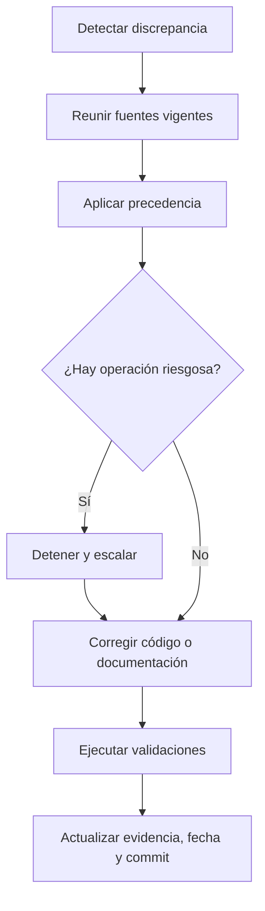

# Política de evidencia y fuentes

## Objetivo

Toda persona debe poder distinguir un hecho comprobado, una aceptación operativa, un diseño futuro y un vacío de conocimiento. Esta política regula cómo se hacen, citan, verifican y corrigen afirmaciones en el Vault.

## Precedencia

Cuando dos fuentes describen el mismo comportamiento actual y discrepan, usa este orden:

1. **Código y tests ejecutables** para comportamiento implementado.
2. **Migraciones EF Core** para historia y forma del esquema SQL.
3. **OpenAPI compilado/generado** para el contrato cliente/servidor existente.
4. **Workflows CI vigentes** para gates, dependencias y publicaciones automáticas.
5. **Plantillas y runbooks operativos aceptados** para el control plane de Development.
6. **ADR aceptados** para intención y restricciones arquitectónicas.
7. **Documentación explicativa vigente** para contexto y recorridos.
8. **Prototipos, fixtures y documentos históricos** para vocabulario e historia, nunca para contratos actuales.

La precedencia no convierte el código en una decisión correcta: si contradice una regla de seguridad o un ADR aceptado, registra el conflicto y corrige el sistema mediante el proceso autorizado. Mientras tanto describe fielmente el comportamiento y el riesgo.

## Valores de `evidence`

| Valor | Uso permitido | Evidencia mínima |
| --- | --- | --- |
| `repo-verified` | Hecho contrastado con archivos versionados vigentes | Rutas exactas en `sources` y commit verificado |
| `operator-recorded` | Estado aceptado mediante ejecución manual controlada | Registro saneado, fecha, gate y fuente versionada del procedimiento |
| `planned` | Diseño, objetivo o trabajo futuro | Documento de decisión/backlog y criterios de aceptación |
| `unknown` | Dato no demostrado o relato por recuperar | Explicación del vacío y evidencia necesaria para cerrarlo |

Una nota usa el valor que respalda su afirmación central. Si mezcla evidencias, separa claramente cada sección y cita su fuente; no inventes un valor combinado.

## Valores de `status`

| Valor | Significado |
| --- | --- |
| `verified` | La nota completa fue contrastada con las fuentes declaradas en la fecha y commit indicados. |
| `documented` | Contenido útil y versionado, aún sujeto a verificación o evolución normal. |
| `draft` | Incompleto o en discusión; no es contrato ni autorización. |
| `deferred` | Deliberadamente pospuesto y no implementado. |
| `deprecated` | Ya no debe usarse; conserva enlaces hacia el reemplazo. |
| `historical` | Describe fielmente un estado anterior y no pretende representar el presente. |

`status` describe la nota; `evidence` describe cómo sabemos lo que afirma. Ambos son obligatorios y no son intercambiables.

## Cómo respaldar una afirmación

Una afirmación importante debe incluir suficiente contexto para reproducir su verificación:

- **Qué:** comportamiento, decisión o estado exacto.
- **Dónde:** ruta versionada o registro saneado.
- **Cuándo:** fecha de última verificación.
- **Versión:** commit completo en `verified_commit`.
- **Límite:** qué no demuestra esa evidencia.

Ejemplo correcto:

> El workflow Mobile es una plantilla y no un pipeline activo. Evidencia: `.github/workflows/mobile-ci.yml.template`, verificado en el commit indicado. Esto no demuestra que una APK no pueda compilarse manualmente.

Ejemplo incorrecto:

> Mobile CI/CD funciona.

## Fuentes en frontmatter y cuerpo

- `sources` contiene rutas relativas a la raíz del repositorio, con `/` como separador.
- Usa la ruta más específica que respalde la afirmación.
- En el cuerpo, crea enlaces Markdown relativos para que la persona pueda abrir la fuente.
- Un PR, issue o log puede aportar historia, pero no reemplaza el archivo vigente para describir comportamiento actual.
- No enlaces evidencia privada que el lector esperado no pueda auditar; crea un registro saneado cuando corresponda.
- No cites una página del Vault como única prueba de otra página si ambas derivan de la misma fuente.

## Evidencia operativa

Antes de conservar una aceptación manual:

1. identifica el runbook y la versión usados;
2. registra fecha, ambiente, gate y resultado;
3. elimina secretos, datos de negocio, usuarios personales, IP y dominios privados;
4. conserva hashes/digests solo cuando no revelen información protegida y sean necesarios;
5. declara si la prueba fue predeploy, postdeploy, postreboot o rollback;
6. diferencia `healthy`, `no-op`, `deferred`, `failed` y “no observado”;
7. explica qué componentes no fueron alterados.

Un mensaje de éxito aislado no prueba todo el sistema. La nota debe enumerar los gates que ese mensaje representa o enlazar el acta saneada que lo haga.

## Historia y testimonios

- Git demuestra commits y archivos, no las motivaciones anteriores al repositorio.
- Los testimonios se atribuyen por rol o participante autorizado, con fecha y alcance.
- Un recuerdo no confirmado usa `evidence: unknown` o queda explícitamente como testimonio.
- No reescribas una decisión histórica con conocimiento posterior; agrega una nota de contexto actual.
- Si una fecha, autoría o motivo no puede demostrarse, escribe “desconocido”, no una fecha aproximada presentada como exacta.

## Prototipos y datos

Los prototipos sirven para reconstruir flujos y vocabulario. Sus mocks, `localStorage`, fixtures, credenciales y objetos no son contratos de API ni modelos persistentes. Nunca se copian datos personales o secretos desde un prototipo al Vault, seed o Production.

## Resolución de discrepancias

Si el conflicto no se resuelve en el PR actual, cambia la nota a `draft` o `unknown`, documenta la brecha y evita instrucciones operativas ambiguas.

## Información prohibida

No se versionan:

- secretos o valores derivados que permitan recuperarlos;
- identidades personales innecesarias;
- FQDN privados, nombre real del tailnet o IP públicas;
- contenido de backups, dumps o tablas con datos de negocio;
- logs crudos con headers, tokens, connection strings o SQL sensible;
- claves de firma, sesiones, cookies o material de autenticación.

Usa placeholders como `<PRIVATE_SERVICE>`, `<REDACTED_DIGEST>` o `service.example.test`. La utilidad documental nunca justifica exponer una frontera privada.

## Auditoría de una nota

Una nota puede conservar `verified` solo si:

- todas sus afirmaciones centrales tienen fuentes;
- las fuentes existen en el commit declarado;
- no confunde presente, historia y futuro;
- los límites y excepciones relevantes están explícitos;
- no contiene material prohibido;
- sus enlaces y diagramas validan;
- el responsable puede explicar cómo repetir la verificación.

Relacionados: [Metadatos](metadatos.md), [Mantenimiento](mantenimiento-del-vault.md), [Cómo usar el Vault](../00-inicio/como-usar-el-vault.md).
