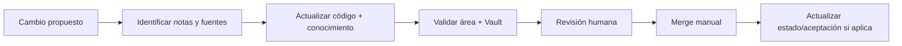

# Mantenimiento del Vault

## Contrato de mantenimiento

El Vault evoluciona en los mismos PRs que cambian conocimiento durable. No se deja la documentación para una limpieza futura cuando cambia un contrato, una decisión, un flujo o una obligación operativa.

## Cuándo actualizarlo

Actualiza las notas afectadas cuando un PR cambie:

- comportamiento visible o flujo de usuario;
- términos, reglas o invariantes de dominio;
- límites entre módulos, clientes, API, base o proveedor externo;
- endpoint, DTO, código de estado o contrato OpenAPI;
- entidad, relación, índice, migración, seed o ownership de datos;
- comando de desarrollo, dependencia, toolchain o estrategia de pruebas;
- gate CI, artefacto publicado, orden CD o política de release;
- topología, acceso, secreto, backup, restore, monitoreo o rollback;
- estado de una capacidad, riesgo, decisión o trabajo diferido.

Una refactorización interna sin cambio durable puede declarar “sin impacto documental”, pero el PR debe justificarlo.

## Flujo de actualización

1. Crea una rama feature desde `Development`.
2. Lee los `AGENTS.md` aplicables.
3. Localiza notas por `area`, `tags`, enlaces y búsqueda textual.
4. Actualiza primero la fuente ejecutable y después su explicación, salvo PR exclusivamente documental.
5. Usa la [plantilla](../99-plantillas/README.md) apropiada para conocimiento nuevo.
6. Verifica fuentes, enlaces, diagramas, metadatos y seguridad.
7. Ejecuta checks del subárbol y del Vault.
8. Describe en el PR qué cambió, qué no cambió y qué permanece pendiente.
9. El responsable hace merge manual solo con checks revisados.

Un PR documental no autoriza ejecutar el runbook que documenta.

## Mapa de impacto

| Cambio en | Revisión documental mínima |
| --- | --- |
| `backend` | Capacidad, arquitectura, contrato API, seguridad y pruebas relacionadas |
| `database/DevelopmentDB` | Modelo de datos, migraciones, ownership, rollback y orden DB → API |
| `frontend/private-web` | Flujo interno, contrato consumido, estados/error y accesibilidad |
| `frontend/public-web` | Flujo cliente, aislamiento tenant, contrato y accesibilidad |
| `frontend/mobile-agent` | Flujo agente, offline/idempotencia, contrato, permisos y distribución |
| `packages/api-client` | OpenAPI, consumidores y compatibilidad coordinada |
| `.github/workflows` | Gates, triggers, artefactos, dependencias y estado CI/CD |
| `ops/dokploy` | Operaciones, seguridad, observabilidad, rollback y evidencia de aceptación |
| `docs/adr` | Índices, arquitectura afectada, decisiones reemplazadas y consecuencias |

## Responsabilidades

- **Autor del cambio:** actualiza conocimiento y aporta evidencia.
- **Revisor del área:** confirma precisión y límites técnicos/funcionales.
- **Operador:** valida procedimientos y aceptaciones del VPS; el autor no los presume.
- **Equipo ELEVANT:** mantiene navegación, taxonomía y deuda documental.

`owner` debe ser un rol o equipo estable, no depender de una cuenta personal.

## Revisión periódica

Además de cambios por PR:

- revisa índices y páginas `seed` al cerrar cada hito relevante;
- audita notas `verified` cuando cambie una fuente listada;
- revisa `deferred` para confirmar que no se describe accidentalmente como implementado;
- revisa runbooks después de cada uso real, rollback o incidente;
- revisa inventarios derivados cuando cambie el árbol, workflow, OpenAPI o migraciones;
- archiva o marca `deprecated` en lugar de borrar contexto necesario para trazabilidad.

No actualices fechas en masa para aparentar vigencia. Una fecha nueva representa una lectura y contraste completos.

## Contenido generado

Los inventarios marcados como generados se actualizan únicamente mediante su generador documentado. No edites manualmente un bloque derivado. El checker debe detectar drift sin escribir durante CI. Una falla de generación no autoriza ignorar la diferencia: corrige el generador o la fuente.

## Artefactos visuales portables

- Cada Canvas o Base nativa mantiene un companion Markdown cuando la relación también debe entenderse en GitHub.
- El checker admite deliberadamente el subconjunto Mermaid usado por el proyecto: `flowchart`/`graph` y `sequenceDiagram`. Un tipo o construcción nueva debe ampliar primero sus pruebas de sintaxis; no se omite el gate para aceptar el diagrama.
- La validación estructural no sustituye la revisión visual: antes del merge, comprueba el render de diagramas modificados en GitHub u Obsidian.

## Cambio de estado

### A `verified`

Requiere fuentes vigentes, verificación integral, commit, fecha y checks aplicables.

### A `deferred`

Explica por qué se pospone, dependencias, riesgos y criterios de aceptación. No dejes instrucciones que aparenten estar habilitadas.

### A `historical`

Conserva fecha/período, contexto y enlace al estado vigente. No “modernices” el relato original.

### A `deprecated` o `retired`

Indica el reemplazo, la fecha efectiva y cualquier consumidor que aún dependa de la nota. Nunca mantengas dos fuentes vigentes para el mismo contrato.

## Incidentes y operaciones

- Un incidente usa la [plantilla de incidente](../99-plantillas/incidente.md) y solo evidencia saneada.
- Un procedimiento operativo usa la [plantilla de runbook](../99-plantillas/runbook.md), incluye rollback y checkpoints.
- Después de una ejecución, registra resultado sin copiar secretos o logs crudos.
- Si el procedimiento real difirió del runbook, conserva la divergencia y corrígelo antes del siguiente uso.

## Checklist para PR

- [ ] Leí los `AGENTS.md` aplicables.
- [ ] Identifiqué todas las notas afectadas.
- [ ] Separé presente, historia y futuro.
- [ ] Verifiqué afirmaciones contra las fuentes con mayor precedencia.
- [ ] Actualicé los once metadatos sin cambiar IDs existentes.
- [ ] Revisé enlaces relativos, Mermaid y navegación.
- [ ] No introduje secretos, PII ni identificadores de infraestructura privada.
- [ ] Ejecuté los checks del área y del Vault.
- [ ] Declaré qué no fue desplegado o verificado.

## Deuda documental

No ocultes deuda dentro de prosa. Crea una nota o entrada de backlog con responsable por rol, estado, dependencias, riesgo y criterio de cierre. Si la deuda afecta una instrucción riesgosa, degrada la nota a `draft` hasta resolverla.

Relacionados: [Política de evidencia](fuentes-y-evidencia.md), [Metadatos](metadatos.md), [Cómo usar el Vault](../00-inicio/como-usar-el-vault.md).
