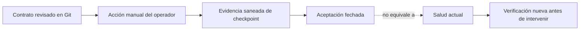

# Operaciones de Development

Este mapa explica **qué se aceptó operativamente**, qué contrato técnico está versionado y cómo orientarse ante una anomalía sin convertir el Vault en una consola de producción. Se refiere al VPS privado de Development y a datos sintéticos. [Production](../../docs/deployment/environments.md) es una frontera futura separada; Mobile Agent se distribuye como aplicación nativa, no como servicio de Dokploy.

> [!IMPORTANT]
> La última aceptación saneada en el repositorio data del **12 de septiembre de 2026**. No es una comprobación del estado del host al momento de leer esta nota. Antes de intervenir se requiere evidencia fresca, autorización del operador y el runbook versionado correspondiente. Ninguna nota del Vault autoriza conectarse, desplegar, reiniciar o cambiar permisos.

## Mapa de consulta

| Pregunta | Nota | Clase principal de evidencia |
| --- | --- | --- |
| ¿Qué servicios existen y dónde termina cada frontera de red? | [Topología y límites](topologia-y-limites-development.md) | Aceptación del operador + Compose revisados |
| ¿Cómo pasa un artefacto certificado a DB, API o las webs? | [Controladores, schedules y promoción](controladores-schedules-y-promocion.md) | Aceptación del operador + controladores versionados |
| ¿Qué protege los datos y qué demuestra una prueba de restore? | [Backups y restore-check](backups-y-restore-check.md) | Scripts, Compose y aceptación del operador |
| ¿Qué se observa realmente y qué alertas faltan? | [Observabilidad y alertas](observabilidad-y-alertas.md) | Plantilla de Beszel + backlog |
| ¿Cómo se mantiene o recupera el host sin ampliar exposición? | [Mantenimiento, reboot y recuperación](mantenimiento-reboot-y-recuperacion.md) | Runbooks y aceptación postreboot |
| ¿Cómo funciona el acceso humano a SQL sin exponerlo? | [SQL privado y SSMS](sql-privado-y-ssms.md) | ADR, contrato de acceso y aceptación |

## Regla de lectura

`repo-verified` certifica el contenido revisado del repositorio; `operator-recorded` indica que una aceptación manual saneada quedó registrada en documentación versionada. Ni una plantilla ni un mensaje de éxito aislado prueban un runtime vivo. Consulta la [política de evidencia](../08-gobernanza/fuentes-y-evidencia.md) y el [estado inicial](../00-inicio/estado-inicial.md).

## Qué no cubre este mapa

- No contiene comandos host ejecutables, direcciones, nombres privados de Service, credenciales, capturas ni logs crudos. Los procedimientos reproducibles permanecen en [la configuración de Dokploy](../../docs/deployment/dokploy-configuration.md) y los [runbooks del control plane](../../ops/dokploy/README.md).
- No afirma que los recorridos de negocio de las webs ya funcionen de extremo a extremo: el despliegue web aceptado es un **preview técnico** y el OpenAPI real sigue siendo mínimo. Ver [API compartida](../05-aplicaciones/api-compartida.md).
- No define RPO/RTO ni recuperación de Production. La copia off-host y los controles externos por carril siguen diferidos para Development.

Volver a [Home](../00-inicio/home.md) o al [Atlas](../diagrams/atlas-elevant.md).
