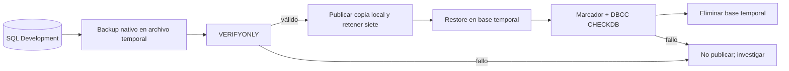

# Backups y restore-check de Development

La aceptación saneada registra backup nativo y restore-check correctos durante el rollout y verificaciones posteriores; el programa aceptado prevé una copia diaria y una prueba semanal. Esto demuestra la ejecución en aquellos checkpoints, **no** que la última copia de hoy exista ni que sea restaurable. Antes de depender de ella, el operador debe consultar ejecución reciente, integridad, espacio, lock y resultado del restore-check en el runtime.

## Qué protege cada capa

| Capa | Demuestra | No demuestra |
| --- | --- | --- |
| Backup SQL nativo `COPY_ONLY`, `CHECKSUM`, `COMPRESSION` | Archivo consistente creado por el motor | Capacidad de restaurarlo o disponibilidad fuera del VPS |
| Verificación y publicación de `.bak` | La copia pasa `VERIFYONLY` antes de sustituir el archivo temporal; retención local de siete | Integridad futura del medio o historial completo de datos |
| Restore-check semanal | La copia se restaura en una base temporal, conserva marcador Development, pasa `DBCC CHECKDB` y la base temporal se elimina | Procedimiento de recuperación de servicio, RPO/RTO, failover o ausencia de pérdida de datos |
| Snapshot del proveedor | Punto de recuperación de host completo para incidentes mayores | Backup lógico consistente de SQL vivo; puede revertir cambios posteriores |

El backup vive en un volumen externo de backups distinto del volumen primario SQL, pero **en el mismo VPS**. Sin copia cifrada off-host, una pérdida total de ese servidor obliga a reconstruir Development con migraciones y seed; los datos de prueba posteriores se pueden perder. Por eso el ambiente debe seguir siendo sintético y reconstruible. Production requiere otro diseño de retención, cifrado, RPO/RTO y restore ensayado. Fuentes: [backup](../../database/DevelopmentDB/scripts/backup/README.md), [restore-check](../../database/DevelopmentDB/scripts/recovery/README.md) y [ambientes](../../docs/deployment/environments.md).

Los jobs de backup, restore-check y promoción comparten el lock de Database CD y ejecutan la imagen/Compose de la **última entrega aceptada**, no un candidato nuevo ni el Raw vivo. Si el mantenimiento espera el lock hasta su límite, el job falla y requiere revisión; la espera no es evidencia de que se completó. No ejecutar un segundo job SQL para “compensar”.

## Si se necesita recuperar datos

El restore-check no es un botón de rollback. Se detienen escrituras afectadas, se preserva la base actual, se restaura bajo otro nombre y se valida antes de decidir un cambio de conexión. Una migración descendente o un restore sobre el origen nunca son respuesta automática a un deploy fallido. El procedimiento ejecutable y sus decisiones viven en [rollback de despliegue](../../docs/deployment/rollback.md), [guía de recuperación DB](../../database/DevelopmentDB/scripts/recovery/README.md) y [runbook Database CD](../../ops/dokploy/database-cd/README.md). No copie backups ni contenido de tablas al Vault o a un issue.
