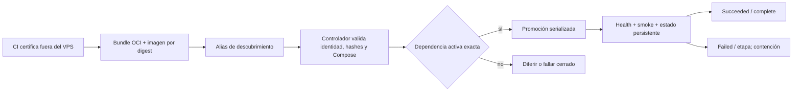

# Controladores, schedules y promoción observable

La [aceptación del operador](../../docs/deployment/dokploy-configuration.md) documenta cuatro perfiles CD activos —DB, API, AVIAM Web y Public Web— con **seis** schedules habilitados tras el reboot final: backup, restore-check y poll de DB; poll de API; poll de cada web. Dos schedules legacy de mantenimiento DB quedaron deshabilitados. Se refiere al checkpoint del 12‑09‑2026, no a una consulta actual a Dokploy.

## Cadena de confianza

El alias mutable solo permite localizar el candidato; la identidad ejecutada es inmutable. Los controladores comprueban repositorio/ref/commit/run, manifiesto cerrado, imagen por digest y equivalencia semántica entre Compose certificado y Raw vivo. El estado y la caché persisten con acceso root-only. Una instalación o actualización del controlador sigue siendo manual; un archivo nuevo en Git no lo instala en el VPS. Ver [Database CD](../../ops/dokploy/database-cd/README.md), [API CD](../../ops/dokploy/api-cd/README.md) y [Web CD](../../ops/dokploy/web-cd/README.md).

En la preparación comercial del 26-09-2026 se observó que guardar Raw y Environment en Dokploy no regeneró sus archivos `code/` antes de Deploy. El operador comprobó el Raw guardado por hash, pausó Database CD con los schedules deshabilitados y sincronizó los archivos vivos bajo copia de seguridad restringida, sin desplegar. Este checkpoint preparatorio no equivale a una promoción aceptada; el [procedimiento de Dokploy](../../docs/deployment/dokploy-configuration.md) exige después bundle certificado, `--dry-run` y las verificaciones de promoción.

Un cambio de runtime web que altera la semántica del Compose requiere la
misma distinción entre Raw guardado y archivo vivo. El controlador Web CD
compara el archivo vivo con el Compose certificado antes del drill y nunca
lo reescribe. El [procedimiento revisado](../../docs/deployment/dokploy-configuration.md)
exige pausar el perfil, guardar A, preparar B en ambas representaciones sin
desplegar y pasar `--dry-run`; si el drill restaura A, también se restauran
ambas representaciones de Compose antes de reanudar. Esto describe el contrato
de operación, no afirma que la migración a Next.js ya esté desplegada.

## Dependencias y relojes

| Carril | Frecuencia aceptada | Gate que impide adelantarlo |
| --- | --- | --- |
| DB poll | Cada minuto, al inicio | Bundle DB certificado; lock propio; estado de intento y baseline |
| DB backup | Diario, ventana nocturna UTC | Mismo lock de DB; espera acotada; usa última entrega aceptada |
| DB restore-check | Semanal, UTC | Mismo lock de DB; usa backup validado y última entrega aceptada |
| API poll | Cada minuto, desplazado tras DB | Estado DB `succeeded/complete`, bundle requerido o DB compatible más nueva; locks DB → API |
| AVIAM Web poll | Cada minuto, después de API | Coincidencia **exacta** de bundle/run/imagen API, contenedor sano y fingerprint OpenAPI; locks DB → API → Web común → perfil |
| Public Web poll | Cada minuto, después de AVIAM | Mismo gate API exacto; perfil y estado separados; lock común evita solapamiento entre webs |

Los desfases reducen contención ordinaria; **los locks son la exclusión real**. Un timeout de mantenimiento es fallo visible, no éxito; no se compensa creando otro job. Un candidato web con API requerida aún no activa se difiere sin promoverse. El requisito de DB para API tolera una entrega DB posterior solo si sus huellas de migraciones/modelo siguen compatibles; Web CD no supone compatibilidad de una API posterior.

## Cómo interpretar resultados

| Señal | Significado operativo |
| --- | --- |
| `succeeded/complete` | Todas las etapas del intento terminaron; en web el drill aceptado también exige rollback satisfactorio |
| `no-op` | Digest ya aceptado, antiguo o controlador pausado: no mutó el workload; el poll natural sigue contando como ejecución observada |
| `deferred` | Falta una dependencia certificada; no equivale a fallo de deploy ni a éxito |
| `failed/<etapa>` o interrupción | No hay retry automático después de crear intento; se conserva evidencia y se decide recuperación explícita |
| `paused=true` | Estado administrativo; no asumir que un job aparentemente exitoso ejecutó SQL o desplegó |

API y webs tienen rollback de **imagen + Compose/hash** hacia su última baseline sana cuando el esquema sigue compatible; si el rollback web falla, queda pausado el perfil afectado. Database CD no hace migración descendente ni restore automático sobre el origen. Ningún carril autoriza borrar redes o volúmenes. La promoción por commit no prueba que una pantalla de negocio esté integrada: las webs siguen siendo preview técnico.

## Detección hasta que existan alertas externas

El contrato de observación es revisar diariamente estado del controlador, `current`/`last-success`, historiales de Schedules, logs saneados y health. El token para publicar commit statuses y los heartbeats independientes por carril siguen **diferidos**; no se debe prometer una alerta automática de fallo CD. Ver [Observabilidad y alertas](observabilidad-y-alertas.md) y [backlog de hardening](../../docs/deployment/development-hardening-backlog.md).
