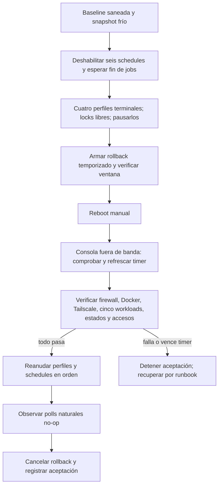

# Mantenimiento, reboot y recuperación de Development

La [aceptación postreboot](../../docs/deployment/dokploy-configuration.md) registra que el host, firewall, cuatro perfiles CD, seis schedules y cinco workloads conservaron sus límites tras el reinicio final del 12‑09‑2026. Durante esa aceptación una primera ventana temporizada expiró y el rollback actuó; el operador recuperó desde la consola fuera de banda, rearmó la ventana, reaplicó la fase final y repitió los gates antes de aceptarla. La lección es **no interpretar una sesión abierta ni un servicio `active` aislado como prueba de recuperación**.

## Secuencia de decisión, no receta ejecutable

La línea base incluye identificadores e imágenes de los cinco workloads, hashes de estados y paquetes de controlador, pero **esos valores no se copian al Vault**. El operador conserva la evidencia protegida y comparte solo resultados saneados. El orden de reanudación es DB → API → AVIAM → Public; el de schedules comienza por backup/restore-check de DB, luego polls DB → API → ambas webs. La mera existencia de tareas programadas no demuestra que sus próximas ejecuciones sean correctas.

## Gates que no pueden omitirse

| Momento | Prueba indispensable | Respuesta a fallo |
| --- | --- | --- |
| Antes de tocar host | Consola fuera de banda, snapshot frío, inventario, Tailscale/SSH nuevos, ausencia de jobs/locks activos | Detener; no reiniciar durante una promoción ni con estado divergente |
| Durante corte de firewall/SSH | Rollback acotado instalado, activo y con próxima ejecución; pruebas nuevas internas y externas | Dejar actuar el rollback; no abrir acceso general ni alterar reglas Docker/Tailscale |
| Inmediatamente tras boot | Reconfirmar y refrescar la ventana temporizada desde consola fuera de banda | Si venció o falta el marcador, detener aceptación y seguir recuperación del firewall |
| Antes de reanudar CD | Firewall final exacto; Docker/Tailscale/systemd; cinco workloads sanos sin recreación; estados/cachés íntegros; SQL privado y pruebas negativas de red | Mantener perfiles/schedules pausados; aislar componente fallido |
| Antes de cancelar rollback | Dos conexiones nuevas de administración; HTTPS privado; SQL Tools/SSMS autorizados y no autorizados; polls naturales no-op | No declarar aceptación; conservar recuperación armada |

La tabla de firewall ELEVANT pertenece solo al host y se administra transaccionalmente; no se vacía el ruleset completo. El proveedor mantiene un perfil independiente. El timer de rollback **no revierte** cambios del panel del proveedor. El [runbook de firewall](../../ops/dokploy/firewall/README.md), el [runbook de host](../../ops/dokploy/host/README.md) y el [drop-in SSH](../../ops/dokploy/ssh/README.md) contienen las acciones exactas y sus precondiciones.

Para fallo de aplicación, el [rollback de despliegue](../../docs/deployment/rollback.md) permite volver a imagen anterior si el esquema es compatible. Para fallo DB no se ejecuta `Down` ni restore automático. Para pérdida total del VPS, el snapshot es último recurso y revierte cambios posteriores; los backups locales pueden perderse con el host. Ninguna de estas rutas autoriza un restore de Production en Development ni borrar volúmenes para “limpiar” el problema.
