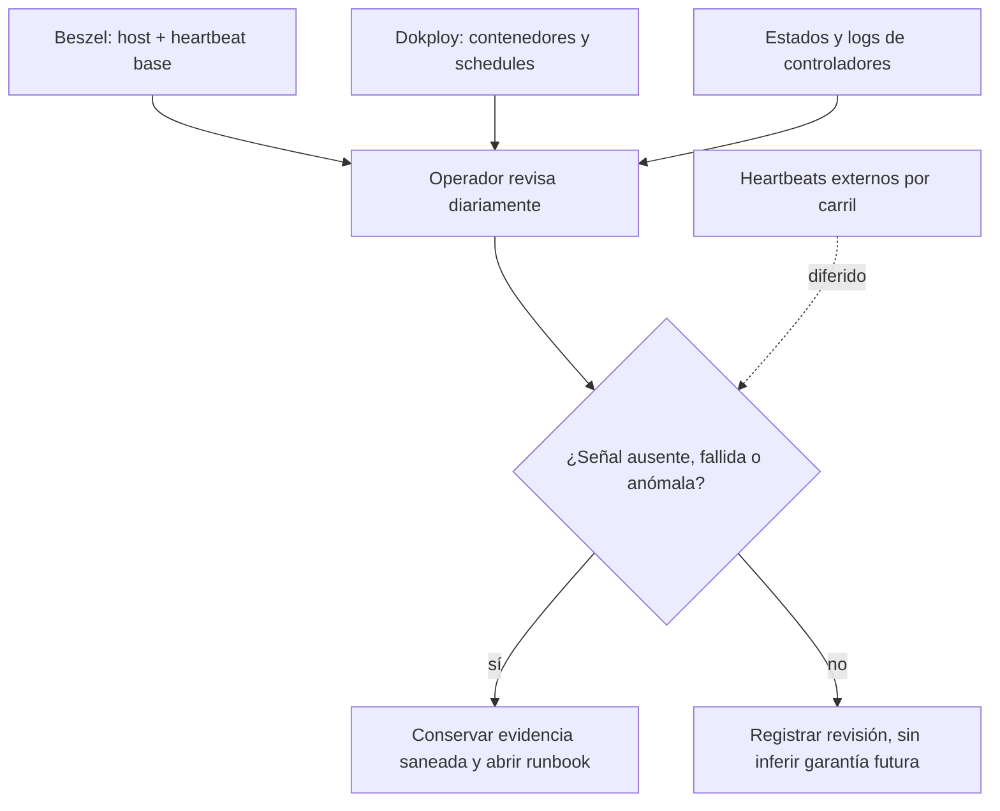

# Observabilidad y alertas de Development

La aceptación del 12‑09‑2026 documenta Beszel Hub y Agent por acceso privado, métricas del host y un heartbeat base del Hub. La [plantilla](../../ops/dokploy/observability/README.md) **no monta Docker socket**: Beszel no puede inventariar contenedores ni observar directamente su health, logs o reinicios. Esto es un límite de seguridad deliberado, no una señal de que Docker esté vacío.

## Diagnóstico de PDF financieros en el código

Los endpoints de factura y recibo no fiscal devuelven un 503 genérico cuando
falla la verificación o publicación del documento privado. En el código, el
evento `FinancialDocumentUnavailable` (`1801`) registra solo la etapa estable
(`Stage`) y el nombre del tipo de excepción interna (`Cause`): distingue
lectura de origen/metadata, renderizado, configuración, lectura/escritura S3
e integridad. No registra el mensaje de la excepción, identificadores, claves
de objeto, bytes ni credenciales. Esta señal **no es una alerta externa** y
su existencia en Git **no prueba su promoción ni el funcionamiento del PDF en
el VPS**; el operador debe verificar el commit desplegado y repetir una
descarga real antes de cerrar el incidente. La aceptación histórica de Beszel
descrita arriba no se actualiza por esta revisión de código.

## Cobertura real frente a cobertura deseada

| Señal | Cobertura aceptada | Brecha explícita |
| --- | --- | --- |
| Host: CPU, memoria, carga, disco y red | Panel privado Beszel; heartbeat base del Hub | La notificación externa del heartbeat y las alertas de umbral no estaban aprobadas |
| SQL Server y cinco workloads | Contenedores/health en Dokploy y preflight bajo revisión manual | Sin chequeo externo independiente de SQL health ni lectura automática por Beszel |
| Seis schedules | Historial de Dokploy y logs del controlador; revisión diaria del operador | Sin dead-man propio por carril, ni aviso automático de job ausente, fallo o timeout |
| Promociones | Estado persistente, intentos y logs saneados | Commit statuses desde el VPS siguen opcionales/no configurados en el estado aceptado |

Los seis carriles son DB backup, DB restore-check, DB poll, API poll, AVIAM poll y Public poll. Un poll *no-op* válido significa que el schedule corrió y no había un candidato nuevo; no equivale a un job ausente. Un check externo futuro deberá distinguir inicio, éxito, fallo, ausencia y no-op, con periodo y gracia compatibles con el cron y el timeout. El [backlog de hardening](../../docs/deployment/development-hardening-backlog.md) exige además prueba controlada de fallo y de ausencia antes de declarar la cobertura aceptada.

## Qué debe revisar una persona

- Salud y reinicios de las cargas, estado de los cuatro perfiles y ejecución natural de los seis schedules en la ventana esperada.
- Espacio libre, uso de recursos y capacidad para conservar backups; un timeout del lock de mantenimiento es error visible.
- Que el Service de monitoreo siga privado y Funnel continúe apagado.
- Fechas y resultados del último backup y restore-check, no solo existencia de archivos.

Si faltan métricas de contenedores, **no** se habilita un proxy Docker genérico: la plantilla advierte que podría exponer `Config.Env`, logs y archivos sensibles. Una futura interfaz de lectura necesita allowlist exacta por ruta/método y revisión separada. El [preflight](../../ops/dokploy/preflight/README.md) produce inventario read-only, pero su salida puede contener topología privada y se sanea antes de compartirla.
