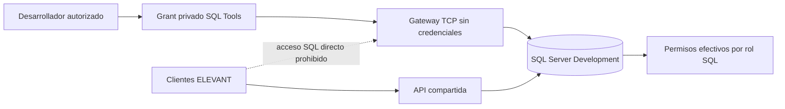

# SQL privado y operación con SSMS

El acceso SSMS es una **excepción humana para Development sintético**, autorizada por [ADR‑0013](../../docs/adr/0013-development-ssms-data-access.md) y aceptada operativamente el 12‑09‑2026. No convierte SQL en API pública ni da acceso SQL a Private Web, Public Web o Mobile Agent. El gateway TCP separado no autentica ni guarda contraseñas; la autorización se compone de **identidad Tailscale personal** y **login SQL personal**.

## Fronteras de acceso

| Frontera | Contrato aceptado | Fallo esperado |
| --- | --- | --- |
| Red | SQL no tiene puerto publicado; gateway usa red de datos más bridge dedicada y expone solo loopback al Service privado | Conexión directa al host o desde Internet |
| Tailscale | Solo miembros de grupo SQL autorizado u operaciones alcanzan el Service; Funnel desactivado | Identidad fuera del grupo |
| SQL Server | Login individual, cifrado de transporte y rol de equipo de privilegio acotado | Contraseña errónea o permiso fuera del rol |
| Cliente ELEVANT | API versionada como única frontera de datos | Llamada directa a SQL desde una app |

El grupo del equipo puede `SELECT`, `INSERT`, `UPDATE` y `DELETE` en esquemas de negocio, y solo leer esquemas técnicos. No recibe DDL, administración, migración, backup, restore ni propiedad de la base. Las constraints SQL siguen operando, pero un CRUD directo **omite a propósito** validaciones de flujo de la API. Por ello se usan únicamente datos sintéticos, se limita el conjunto afectado y se prefieren transacciones reversibles al explorar. Una tabla, columna, índice, clave o constraint cambia solo mediante [migración EF revisada](../06-desarrollo/migraciones-y-datos.md), nunca desde el diseñador de SSMS.

La instalación auxiliar de **Database Diagrams** fue una mutación controlada a cargo de operaciones; no se otorgó propiedad temporal de la base al equipo. Un diagrama sirve para visualizar relaciones; si SSMS propone guardar DDL, se cancela. Las cuentas personales identifican el principal conectado, pero **no existe historial DML durable** ni captura automática antes/después de cada fila. Esa trazabilidad requeriría otra decisión. Ver [contrato de permisos y uso](../../docs/security/database-access.md).

## Si el acceso falla o debe retirarse

No se abre SQL al público, no se desactiva cifrado y no se usa una cuenta administrativa compartida para “probar”. Primero se distingue DNS/Service/ACL, gateway, red interna, autenticación SQL y permiso efectivo, con pruebas positivas y negativas nuevas. La recuperación o baja acotada drena el Service, detiene el gateway o deshabilita el login individual según el incidente; no recrea SQL ni elimina volúmenes. Los campos SSMS, pruebas y rollback detallados viven en [Acceso seguro a la base](../../docs/security/database-access.md) y el [runbook del gateway](../../ops/dokploy/sql-tools-gateway/README.md), no en esta nota.

Production no hereda gateway, logins, rol, certificado confiado para Development ni diagramas. Su acceso administrativo exige diseño separado.
