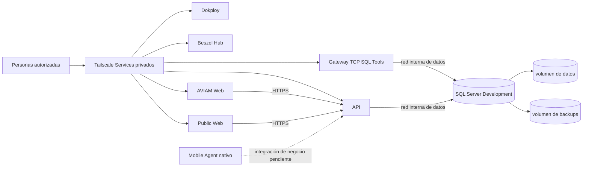

# Topología y límites de Development

La [aceptación operativa saneada](../../docs/deployment/dokploy-configuration.md) registra un host privado con cinco cargas de aplicación: SQL Server, API, AVIAM Web, Public Web y gateway de herramientas SQL. Dokploy y observabilidad son componentes de control separados. Los recursos Compose, redes y volúmenes tienen ciclos de vida distintos. Esta es una fotografía **aceptada el 12‑09‑2026**, no un inventario en vivo.

El diagrama muestra la frontera prevista, no afirma que cada pantalla ya consuma casos de uso de negocio reales. Los clientes no entran a la red SQL y no hay un backend ni una base por cliente. [Arquitectura](../04-arquitectura/sistema-y-fronteras-de-confianza.md) explica el límite de confianza de la aplicación.

## Matriz de responsabilidades

| Componente | Función aceptada | Límite de red y cambio |
| --- | --- | --- |
| SQL Server | Persistencia Development en volumen nombrado, motor en contenedor | Solo red interna de datos; sin publicación directa del puerto SQL ni Domain |
| Database release / jobs | Migración y mantenimiento one-shot | No son servicios permanentes; no poseen el volumen ni el esquema fuera del carril DB |
| API | Única frontera de datos para aplicaciones | Red de datos y red propia de runtime; listener del host en loopback, presentado por Service privado |
| AVIAM Web y Public Web | Dos previews web desplegados por separado | Redes runtime propias, sin red SQL; cada imagen y estado CD son independientes |
| Gateway SQL Tools | Puente TCP para SSMS humano, sin credenciales ni terminación TLS | Red de datos hacia SQL y bridge dedicada para **solo** publicación loopback; SQL no se une a esa bridge |
| Dokploy | UI y jobs internos de control | Solo accesible a operaciones por Service privado; AutoDeploy y Domain de los recursos ELEVANT permanecen desactivados |
| Beszel | Métricas de host y heartbeat base | Hub privado; no monta Docker socket y no inventaría contenedores |

Las [plantillas operativas](../../ops/dokploy/README.md) establecen estas fronteras; el [handoff aceptado](../../docs/deployment/dokploy.md) registra su comprobación manual. La presencia del Compose en Git, por sí sola, no demuestra que el contenedor siga activo.

## Exposición y roles

- El perímetro aceptado solo admite conectividad pública mínima para Tailscale y diagnóstico de red. El firewall del proveedor y la tabla del host son capas independientes; Tailscale Serve no equivale a Funnel.
- Operaciones administra host, panel y monitoreo. Desarrolladores autorizados usan los Services de aplicación. El acceso humano SQL agrega un grupo específico y un login SQL individual; no se hereda del acceso a una web.
- La red privada **no sustituye** autenticación de aplicación, RBAC ni aislamiento tenant/estación. La API inicial no implementa aún esos casos de negocio.
- Production no se construye copiando este Compose: requiere host, secretos, licencia, backup y política de acceso propios.

Antes de diagnosticar una caída, contrasta la topología con el [preflight read-only](../../ops/dokploy/preflight/README.md) y el runbook correspondiente, sin volcar Environment ni datos de contenedor.
