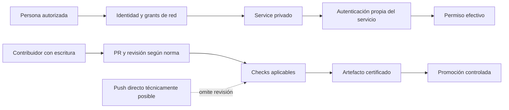

# Seguridad y límites de acceso

La seguridad de ELEVANT tiene tres planos distintos: **quién alcanza un servicio**, **quién se autentica y qué puede hacer**, y **quién puede cambiar o publicar el sistema**. Una prueba de conectividad sólo confirma el primero. Este mapa distingue contrato versionado, aceptación operativa documentada y salud actual, que exige comprobación nueva.

## Elige la pregunta

| Pregunta | Nota | Fuente ejecutable o runbook |
| --- | --- | --- |
| ¿Por dónde se alcanza Development? | [Perímetro y acceso privado](perimetro-development-y-acceso-privado.md) | [Tailscale](../../ops/dokploy/tailscale/README.md), [firewall](../../ops/dokploy/firewall/README.md), [SSH](../../ops/dokploy/ssh/README.md) |
| ¿Dónde viven secretos y qué puede hacer una persona en SQL? | [Identidades, secretos y datos](identidades-secretos-y-datos-de-prueba.md) | [Gestión de secretos](../../docs/security/secrets-management.md), [acceso SQL](../../docs/security/database-access.md) |
| ¿Qué amenaza o control sigue abierto? | [Riesgos y controles pendientes](riesgos-y-controles-pendientes.md) | [Backlog de hardening](../../docs/deployment/development-hardening-backlog.md), [protección de ramas](../../.github/BRANCH_PROTECTION.md) |

## Modelo resumido

La política define grants privados y pruebas negativas; no autoriza conectar clientes directamente a SQL. A la vez, la API de negocio todavía no tiene autenticación/autorización implementada y el repositorio privado no impone técnicamente el PR antes de un push. Esas brechas no se maquillan con aislamiento de red.

## Límites del mapa

- No contiene credenciales, direcciones privadas, IP, nombres personales de cuentas, salidas SQL ni instrucciones para modificar el VPS.
- Los detalles de operación y recuperación están en [Operaciones](../09-operaciones/README.md); este índice explica la política.
- La excepción SSMS vale sólo para Development y datos sintéticos. Production requiere una decisión independiente.
- Un documento no demuestra que un control funcione en este momento; para mantenimiento o incidente se usa el runbook vigente y evidencia nueva.

Volver a [Home](../00-inicio/home.md), [Arquitectura](../04-arquitectura/README.md) o [Fuentes y evidencia](../08-gobernanza/fuentes-y-evidencia.md).
