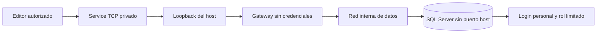

# Perímetro de Development y acceso privado

El contrato versionado mantiene Dokploy, observabilidad, API, ambas webs y herramientas SQL dentro de la tailnet. Los endpoints de aplicación se alcanzan mediante Services HTTPS; SQL Tools es un Service TCP distinto. La política usa **grants deny-by-default** y separa autoaprobación del host de autorización del usuario. Son reglas revisadas, no una lectura de conectividad en vivo.

## Capas que no se sustituyen

| Capa | Decide | No decide |
| --- | --- | --- |
| Firewall del proveedor y host | Qué tráfico llega desde fuera | Autorización de API o SQL |
| Tailscale y grants | Qué identidad llega a un Service | Permisos SQL o reglas de negocio |
| OpenSSH | Administración por clave y elevación controlada | Acceso a productos |
| Gateway SQL | Reenvío TCP a la red interna de datos | Login ni permisos SQL |
| SQL Server | Autenticación y grants por login | Aislamiento de red externo |
| API futura de negocio | Tenant, estación y autorización por operación | Puertos del host |

## Recorrido SQL excepcional

El gateway pertenece a la red interna de datos y a una bridge dedicada para materializar **sólo un binding loopback**. SQL permanece únicamente en la red interna y no publica su puerto en el host. No se usa Funnel, subnet route ni acceso directo al host. El gateway no termina TLS ni autentica; la prueba de red y la de permisos SQL son gates distintos. El [runbook del gateway](../../ops/dokploy/sql-tools-gateway/README.md) contiene el modelo exacto.

## Administración y recuperación

El [runbook SSH](../../ops/dokploy/ssh/README.md) define cuenta operativa por clave, sin root remoto ni contraseña SSH; el Browser Terminal del proveedor es recuperación fuera de banda. El [runbook de firewall](../../ops/dokploy/firewall/README.md) exige sesiones **nuevas**, rollback armado mientras se cambia red y desarmado sólo tras aceptación. Una conexión ya abierta no prueba que se pueda iniciar otra.

| Actor | Debe poder alcanzar | Debe quedar fuera |
| --- | --- | --- |
| Operaciones | SSH, control plane y Services necesarios | Docker API/Swarm publicados, SQL directo del host |
| Equipo Development | API y webs Development | Control plane, SSH y SQL sin grant adicional |
| Editores SQL aprobados | Service SQL Tools con login propio | DDL, administración y puerto directo |
| Internet | Ningún control plane ni SQL de Development | Dokploy, observabilidad, Docker, Swarm y SQL |

Una identidad puede pertenecer a más de un grupo y acumular sus grants. La [política](../../ops/dokploy/tailscale/policy.hujson.example) prueba casos positivos y negativos. No se copian nombres reales, DNS ni direcciones al Vault.

## Aceptación no es monitoreo

Los runbooks y la [configuración Dokploy](../../docs/deployment/dokploy-configuration.md) registran el perímetro previsto y sus gates. Afirmar que sigue vigente tras un cambio o reboot exige repetir pruebas externas, estado de Services, listeners, redes, permisos y firewall. Ver [Operaciones](../09-operaciones/README.md).
