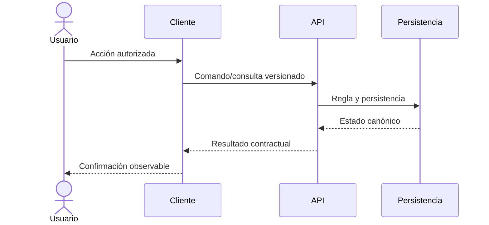

# Plantilla: capacidad — resultado del usuario

> [!NOTE]
> Al duplicar: cambia `type` a `capability`, define el estado por capa y elimina este aviso. Una pantalla prototipo no demuestra una capacidad de extremo a extremo.

## Resultado esperado

<!-- Qué puede lograr el usuario, en qué contexto y cómo se reconoce el éxito. -->

## Actores y autorización

| Actor/rol | Puede | No puede | Scope obligatorio |
| --- | --- | --- | --- |
|  |  |  |  |

## Alcance

### Incluido

- Pendiente de completar.

### Excluido o diferido

- Pendiente de completar.

## Estado por capa

| Capa | Estado | Fuente | Brecha |
| --- | --- | --- | --- |
| Flujo de producto |  |  |  |
| Private/Public/Mobile |  |  |  |
| OpenAPI/API |  |  |  |
| Dominio/aplicación |  |  |  |
| Persistencia |  |  |  |
| CI/CD/operación |  |  |  |
| Observabilidad |  |  |  |

## Flujo principal

## Reglas e invariantes

- Pendiente de completar.

## Contrato API

- Endpoints:
- DTO/versiones:
- Errores esperados:
- Idempotencia/concurrencia:
- Compatibilidad:

## Datos

- Entidades/tablas:
- Ownership:
- Retención/auditoría:
- Migración/seed:
- PII o clasificación:

## Clientes

### Private Web

- Estado y comportamiento:

### Public Web

- Scope tenant/estación y comportamiento:

### Mobile Agent

- Offline, sincronización, dispositivo y comportamiento:

## Seguridad

- Autenticación:
- Autorización:
- Fronteras de confianza:
- Secretos:
- Casos de abuso:

## Validación

| Nivel | Escenario | Resultado |
| --- | --- | --- |
| Unitario |  |  |
| Integración |  |  |
| Contrato |  |  |
| Cliente |  |  |
| Operación |  |  |

## Fallos y recuperación

- Pendiente de completar.

## Métricas y observabilidad

- Señal de uso:
- Señal de éxito:
- Señal de fallo:
- Alerta/owner:

## Decisiones y relacionados

- ADR:
- Arquitectura:
- Runbook:
- Backlog:

## Fuentes

<!-- Enlaces a prototipo, OpenAPI, código, migraciones, tests y evidencia operativa, indicando qué prueba cada uno. -->
