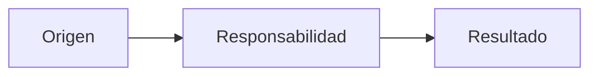

# Plantilla: página de conocimiento

> [!NOTE]
> Al duplicar: reemplaza todo el frontmatter, empieza como `draft`/`unknown` si aún no verificaste y elimina este aviso.

## Resumen

<!-- Responde en dos o tres frases: qué explica, para quién y cuál es su límite. -->

## Estado

<!-- Distingue implementado, desplegado, histórico, diferido y desconocido. No uses “actual” sin fecha/evidencia. -->

| Dimensión | Estado | Evidencia |
| --- | --- | --- |
| Implementación | Pendiente de completar | Ruta o brecha |
| Operación/despliegue | Pendiente de completar | Registro saneado o “no aplica” |
| Documentación | Borrador | Esta nota |

## Contexto

<!-- Explica los antecedentes imprescindibles, sin repetir páginas enlazadas. -->

## Comportamiento o conocimiento central

<!-- Describe invariantes, responsabilidades, flujo y límites con términos verificables. -->

## Diagrama

<!-- Conserva el diagrama solo si mejora la comprensión. Etiquetas sin datos sensibles. -->

## Casos límite y fallos

- Pendiente de completar.

## Decisiones y consecuencias

- Pendiente de completar.

## Verificación

<!-- Explica cómo un lector reproduce la comprobación sin mutar ambientes ni exponer secretos. -->

- Fuente primaria:
- Check o prueba:
- Resultado esperado:
- Lo que esta verificación no demuestra:

## Preguntas abiertas

- Ninguna, o lista explícita con `unknown`/`deferred`.

## Relacionados

- [Home](../00-inicio/home.md)
- [Política de evidencia](../08-gobernanza/fuentes-y-evidencia.md)

## Fuentes

<!-- Convierte las rutas de frontmatter en enlaces Markdown y añade contexto de uso. -->
