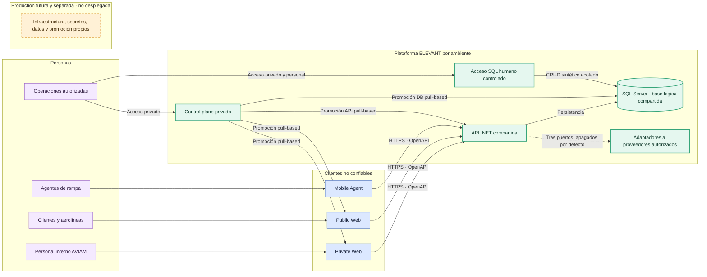

# Arquitectura y contexto inicial

ELEVANT conserva una sola API y una sola base lógica por ambiente. Los tres clientes son fronteras independientes de experiencia, no backends ni bases separadas. El [Canvas interactivo](arquitectura-contexto.canvas) permite recorrer las relaciones espacialmente.

*Posterior al commit verificado de esta nota (código de `39a85a46`):* Mobile Agent también consume la API con el cliente compartido, y los adaptadores a proveedores externos arrancan apagados hasta que una configuración explícita los enciende.

## Límites que el mapa hace explícitos

- Ningún cliente accede directamente a SQL Server ni a proveedores externos.
- Private Web y Public Web tienen imágenes y carriles de entrega independientes, pero consumen la misma API.
- Mobile Agent se distribuye como aplicación nativa y no se aloja en Dokploy.
- El acceso SQL humano pertenece sólo a Development, es privado y no sustituye migraciones revisadas.
- Production requiere infraestructura, secretos, datos, backups y promoción separados; hoy permanece diferida.

Amplía el contexto en [Arquitectura general](../../docs/architecture/overview.md), [Ambientes](../../docs/deployment/environments.md) y [Development en Dokploy](../../docs/deployment/dokploy.md).

Volver a [Home](../00-inicio/home.md) o al [Atlas general](atlas-elevant.md).
