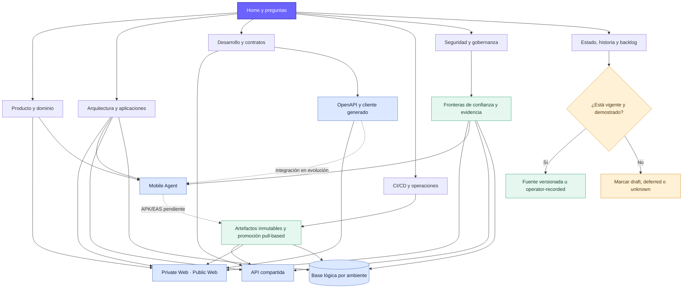

# Atlas general de ELEVANT

Este mapa conecta las áreas que explican ELEVANT sin convertir la documentación en una segunda fuente de verdad. Empieza en [Home](../00-inicio/home.md), comprueba la vigencia en [Estado inicial](../00-inicio/estado-inicial.md) y termina siempre en una fuente ejecutable o en evidencia explícita.

- [Abrir el Canvas interactivo](atlas-elevant.canvas)
- [Abrir la Base nativa de conocimiento](atlas-conocimiento.base)
- [Ver arquitectura y contexto](arquitectura-contexto.md)
- [Ver navegación y estados](navegacion-estado.md)

## Cómo leerlo

1. **Orientación:** Home y los mapas de preguntas indican dónde buscar.
2. **Explicación:** producto, arquitectura y aplicaciones aportan contexto.
3. **Cambio:** desarrollo, contratos y CI/CD describen cómo evolucionar el sistema.
4. **Operación:** despliegue, seguridad y recuperación explican cómo conservarlo sano.
5. **Prueba:** el estado y la evidencia determinan si una afirmación puede usarse hoy.

La [estructura real del repositorio](../../docs/architecture/repository-structure.md) y las reglas de [`AGENTS.md`](../../AGENTS.md) prevalecen sobre este dibujo.
