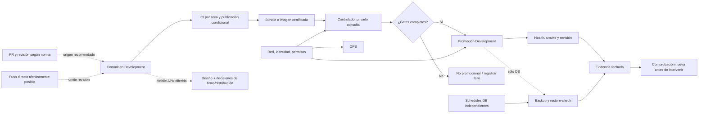

# Entrega, operaciones y seguridad

Este mapa visual responde cuatro preguntas en orden: **¿qué certificó CI?**, **¿qué aceptó el controlador?**, **¿qué se observó después?** y **¿qué frontera de acceso sigue vigente?** Una etapa verde no demuestra automáticamente la siguiente. El diseño APK aparece como rama diferida, no como despliegue.

- [Canvas interactivo](entrega-operaciones-seguridad.canvas)
- [Base filtrable de las notas 07, 09 y 10](entrega-operaciones-seguridad.base)

## De commit a observación

| Desde | Hacia | Lectura correcta |
| --- | --- | --- |
| Commit → CI | Tests y publicación condicional por área | Un PR sin conflictos no garantiza checks verdes; branch protection aún no impone el PR. |
| CI → artefacto | Digest y procedencia certificados | El VPS no recompila un origen mutable. |
| Controlador → runtime | Gates de estado, dependencia, salud y compatibilidad | Un no-op aceptado no recrea contenedores; un fallo no equivale a rollback destructivo. |
| Runtime → observación | Health y logs; backup/restore-check del carril DB | Ni un check de API/web dispara por sí mismo el backup ni la última aceptación documentada prueba salud actual. |
| Persona → SQL | Service privado → gateway → login limitado | Red y permiso SQL son controles independientes; no es acceso de los clientes. |
| Mobile → APK | Diseño pendiente → aprobación → futura implementación | La plantilla móvil actual no produce ni distribuye APK. |

Las columnas del Canvas usan texto numerado además de colores; no hay significado que dependa sólo del tono. La Base es un catálogo **de las notas 07/09/10**, no de todas las tarjetas externas del Canvas. Este índice conserva acceso completo en GitHub o sin abrir las vistas nativas de Obsidian.

## Índice de todas las tarjetas

### 01 · Entrega

- [Mapa de CI/CD](../07-entrega/README.md)
- [Workflows y estado real](../07-entrega/workflows-y-estado.md)
- [Cadena de artefactos y promoción](../07-entrega/cadena-de-artefactos-y-promocion.md)
- [Gates, fallos y no-op](../07-entrega/gates-fallos-y-no-op.md)
- [Límites, revisión y rollback](../07-entrega/limites-revision-y-rollback.md)
- [APK Mobile diferida](../07-entrega/mobile-apk-ci-cd.md)

### 02 · Operaciones

- [Mapa de Operaciones](../09-operaciones/README.md)
- [Topología y límites Development](../09-operaciones/topologia-y-limites-development.md)
- [Controladores, schedules y promoción](../09-operaciones/controladores-schedules-y-promocion.md)
- [Backups y restore-check](../09-operaciones/backups-y-restore-check.md)
- [Observabilidad y alertas](../09-operaciones/observabilidad-y-alertas.md)
- [Mantenimiento, reboot y recuperación](../09-operaciones/mantenimiento-reboot-y-recuperacion.md)
- [SQL privado y SSMS](../09-operaciones/sql-privado-y-ssms.md)

### 03 · Seguridad

- [Mapa de Seguridad](../10-seguridad/README.md)
- [Perímetro y acceso privado](../10-seguridad/perimetro-development-y-acceso-privado.md)
- [Identidades, secretos y datos](../10-seguridad/identidades-secretos-y-datos-de-prueba.md)
- [Riesgos y controles pendientes](../10-seguridad/riesgos-y-controles-pendientes.md)
- [Backlog de hardening fuente](../../docs/deployment/development-hardening-backlog.md)
- [Runbook Tailscale fuente](../../ops/dokploy/tailscale/README.md)

### 04 · Evidencia

- [Esta lectura accesible](entrega-operaciones-seguridad.md)
- [Base filtrable](entrega-operaciones-seguridad.base)
- [Estado inicial aceptado](../00-inicio/estado-inicial.md)
- [Política de fuentes y evidencia](../08-gobernanza/fuentes-y-evidencia.md)
- [Roadmap del Vault](../00-inicio/roadmap-del-vault.md)

## Antes de tomar una decisión

1. Comprueba la fecha y el `verified_commit` de la nota.
2. Distingue contrato de workflow, aceptación operativa y observación actual.
3. Sigue la fuente código-adjacent; el Vault no sustituye runbooks ni autoriza acciones en el host.
4. Para anomalías, preserva evidencia saneada y usa el gate/fallo correspondiente antes de pensar en rollback.
5. Para Mobile APK, resuelve decisiones humanas de firma, distribución, dispositivo y compatibilidad antes de activar un pipeline.

Volver a [Home](../00-inicio/home.md) o al [Atlas general](atlas-elevant.md).
