# Mapa de navegación y estado

El Vault separa dos preguntas: **dónde encuentro una respuesta** y **cuánta confianza merece**. Usa el [Canvas interactivo](navegacion-estado.canvas) para navegar y la [Base del atlas](atlas-conocimiento.base) para filtrar las propiedades.

```mermaid
flowchart LR
    HOME[Home] --> QUESTION{¿Conozco el área?}
    QUESTION -->|No| QUICK[Respuestas rápidas]
    QUESTION -->|No| MAP[Mapa de preguntas]
    QUESTION -->|Sí| NOTE[Nota del área]
    QUICK --> NOTE
    MAP --> NOTE
    NOTE --> STATE[Revisar status y maturity]
    STATE --> EVIDENCE[Revisar evidence y sources]
    EVIDENCE --> SOURCE[Comprobar fuente de verdad]
    SOURCE --> DECIDE{¿La evidencia alcanza?}
    DECIDE -->|Sí| USE[Usar con el alcance declarado]
    DECIDE -->|No| MARK[Marcar draft, deferred o unknown]
    MARK --> BACKLOG[Registrar brecha sin inventar]

    classDef entry fill:#6c63ff,color:#fff,stroke:#4b44c7,stroke-width:2px;
    classDef nav fill:#dce8ff,color:#17213a,stroke:#4f75c2;
    classDef proof fill:#e5f7ef,color:#173f31,stroke:#36a579;
    classDef caution fill:#fff1d6,color:#4d3512,stroke:#d99021;
    class HOME entry;
    class QUESTION,QUICK,MAP,NOTE nav;
    class STATE,EVIDENCE,SOURCE,USE proof;
    class DECIDE,MARK,BACKLOG caution;
```

## Vocabulario de vigencia

| `status` | Interpretación |
| --- | --- |
| `verified` | Contrastado con la evidencia indicada. |
| `documented` | Explicado y versionado; puede seguir evolucionando. |
| `draft` | Incompleto; no usar como contrato. |
| `deferred` | Deliberadamente pospuesto; todavía no existe. |
| `deprecated` | Se conserva durante una retirada controlada. |
| `historical` | Describe un estado anterior. |

La madurez usa `seed`, `evolving`, `stable` o `retired`; la evidencia usa `repo-verified`, `operator-recorded`, `planned` o `unknown`. Ninguna combinación convierte por sí sola una nota en autorización operativa.

## Atajos

- [Home](../00-inicio/home.md)
- [Respuestas rápidas](../00-inicio/respuestas-rapidas.md)
- [Mapa de preguntas](../00-inicio/mapa-de-preguntas.md)
- [Estado inicial](../00-inicio/estado-inicial.md)
- [Metadatos](../08-gobernanza/metadatos.md)
- [Fuentes y evidencia](../08-gobernanza/fuentes-y-evidencia.md)
- [Mantenimiento](../08-gobernanza/mantenimiento-del-vault.md)
- [Plantillas](../99-plantillas/README.md)
