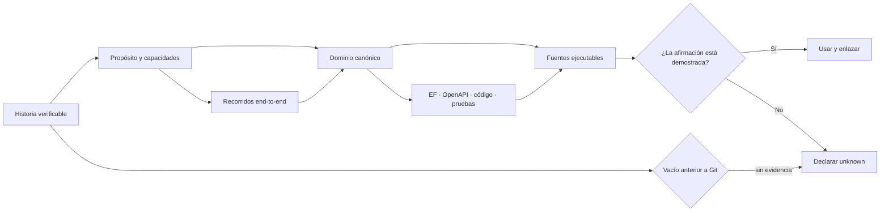

# Producto, dominio e historia

Este lienzo conecta tres preguntas que deben responderse juntas antes de diseñar una capacidad: **cómo llegamos aquí**, **qué resultado busca el producto** y **qué lenguaje/reglas gobiernan el cambio**. La cuarta columna obliga a terminar en evidencia o en una incertidumbre explícita.

- [Abrir el Canvas interactivo](producto-dominio-historia.canvas).
- [Abrir la Base filtrable](producto-dominio-historia.base).
- [Volver al Atlas general](atlas-elevant.md).

## Modelo portable

## Las cuatro columnas

| Columna | Pregunta | Entrada principal | Error que evita |
| --- | --- | --- | --- |
| Memoria | ¿Qué cambió y desde cuándo puede probarse? | [Historia](../01-historia/README.md) | Convertir recuerdos, mensajes de commit o merges en hechos operativos no demostrados. |
| Producto | ¿Para quién y con qué resultado existe la capacidad? | [Producto](../02-producto/README.md) | Implementar pantallas aisladas sin recorrido, usuario o estado de cobertura. |
| Dominio | ¿Qué términos, identidades, ciclos e invariantes intervienen? | [Dominio](../03-dominio/README.md) | Persistir mocks, duplicar conceptos o confiar autorización al cliente. |
| Evidencia | ¿Qué fuente demuestra la respuesta y en qué commit? | [Fuentes y evidencia](../08-gobernanza/fuentes-y-evidencia.md) | Presentar prototipo, plan o aceptación histórica como contrato vigente. |

## Recorridos sugeridos

### Incorporación rápida

1. Lee la [cronología versionada](../01-historia/cronologia-versionada.md).
2. Entiende la [visión y el espacio de problema](../02-producto/vision-y-problema.md).
3. Aprende el [glosario canónico](../03-dominio/glosario-canonico.md).
4. Contrasta el [estado inicial](../00-inicio/estado-inicial.md).

### Diseñar una capacidad

1. Ubícala en el [mapa de capacidades](../02-producto/mapa-de-capacidades.md).
2. Sigue sus [recorridos end-to-end](../02-producto/recorridos-end-to-end.md).
3. Identifica [contextos y límites](../03-dominio/contextos-y-limites.md).
4. Verifica entidades, contrato HTTP, pruebas y preguntas abiertas antes de proponer implementación.

### Resolver una discrepancia

1. Determina si la afirmación es histórica, actual o futura.
2. Abre sus `sources` y el `verified_commit`.
3. Aplica la precedencia de la [política de evidencia](../08-gobernanza/fuentes-y-evidencia.md).
4. Si falta respaldo, conserva la contradicción como brecha; no la resuelvas por intuición.

## Interacción en Obsidian

Abre la raíz del repositorio como vault. En el Canvas puedes desplazarte entre columnas, abrir cada nota dentro del mismo espacio y seguir las aristas transversales. La Base permite alternar tarjetas, tablas de Producto/Dominio, Historia verificable e incertidumbre visible sin plugins comunitarios.

El Canvas es navegación, no un contrato. El equivalente Mermaid y esta tabla mantienen el contenido legible en GitHub y para cualquier IA que solo pueda leer archivos.

Volver a [Home](../00-inicio/home.md).
